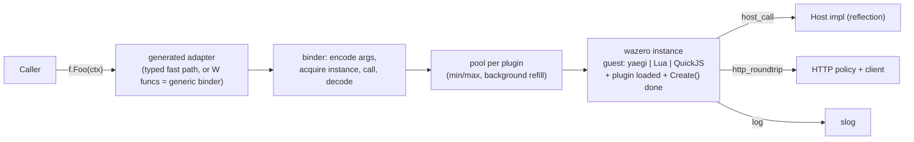

# plg — sandboxed plugin system for Go services

Module `github.com/heynemann/go-plg`, package `plg`, Go ≥ 1.27.

Plugins written in **Go, Lua and TypeScript** are loaded **as source** from pluggable storages and called through ordinary Go interfaces. Every plugin runs inside **WebAssembly** ([wazero](https://github.com/tetratelabs/wazero), pure Go, no cgo):

| Plugin language | Interpreter inside WASM |
|---|---|
| Go | [yaegi](https://github.com/traefik/yaegi) compiled to wasip1 |
| Lua | C Lua 5.4 built with wasi-sdk |
| TypeScript | QuickJS-ng built with wasi-sdk; [esbuild](https://github.com/evanw/esbuild), compiled to wasip1, bundles in a sandbox of its own |

Plugin authors never run a build step.

**Stability is the top priority.** A plugin must never be able to take down the host process. Out-of-memory, panics, stack overflow, runaway CPU and data races inside a plugin all become errors on that plugin's call; the faulty instance is discarded.

Engineering rules (strict linting, testing, benchmarks, concurrency, JSON) are in [RULES.md](RULES.md); every ticket must meet them.

## Public API

```go
import (
    "github.com/heynemann/go-plg"
    _ "github.com/heynemann/go-plg/guest/golang"     // only the guests you use
    _ "github.com/heynemann/go-plg/guest/lua"
    _ "github.com/heynemann/go-plg/guest/typescript"
)

c := plg.New(
    plg.WithLogger(logger),
    plg.WithMeterProvider(mp),
    plg.WithMemoryBudget(4 << 30),
    plg.WithCompilationCacheDir("/var/cache/plg"), // default: $PLG_CACHE_DIR, else os.UserCacheDir()/plg/<wazero version>
)
defer c.Close(ctx)

err := plg.Register[contract.Fooer](ctx, c, "fooer",
    plg.WithStorage(plg.NewFSStorage("/srv/plugins/fooer")),
    plg.WithGolangPlugins(), plg.WithLuaPlugins(), plg.WithTypescriptPlugins(), // none = all
    plg.WithPool(1, 64),
    plg.WithMemoryLimit(64 << 20), // per instance
    plg.WithPollInterval(30*time.Second),
    plg.WithHost[contract.Host](hostImpl),
    plg.WithConcurrentCalls(64), // Lua/TS: calls one instance serves at once while they await HTTP (default 1)
    plg.WithHTTP(plg.HTTPPolicy{AllowedHosts: []string{"api.example.com"}}),
)

f, err := plg.Get[contract.Fooer](ctx, c, "fooer/my-own-fooer")
bar, err := f.Foo(ctx)
for key, f := range plg.All[contract.Fooer](ctx, c) { /* key order */ }

err = c.Reload(ctx)                        // every registered interface
err = plg.ReloadInterface(ctx, c, "fooer") // one interface
```

| Function | Semantics |
|---|---|
| `New(opts...)` | Container-wide options: `WithLogger` (slog; discard by default), `WithMeterProvider` (OTel metric API; global by default), `WithMemoryBudget`, `WithCompilationCacheDir`, `WithOnPanic`, `WithPanicHistory(n)` (default 64). |
| `Register[T](ctx, c, name, opts...) error` | Loads synchronously and fails fast. Validates `T` (and `Host`), lists the storages, fetches, compiles, warms `min` instances, then publishes a new snapshot atomically. Registering the same `name` twice is an error. Fails with a message naming the import if a needed guest package isn't linked in. |
| `Get[T](ctx, c, key) (T, error)` | `key` = `<name>/<descriptor key>`. Errors: `ErrNotFound`, or `ErrTypeMismatch` if the key belongs to another interface. 0 allocations, ≤ 50 ns. |
| `All[T](ctx, c) iter.Seq2[string, T]` | Plugins implementing `T`, in key order, over a fixed snapshot. 0 allocations. |
| `c.Reload`, `ReloadInterface` | Mirrors the storage catalogue (see Lifecycle). |
| `c.Close(ctx)` | Stops pollers and refillers, drains in-flight calls, closes instances and runtimes. |

### Interface contract (checked by reflection at Register, for both `T` and `Host`)

- **Method shape:** every method is `M(ctx context.Context, args...) (results..., error)`. ctx first and error last are both required.
- **Allowed types:** data only: bool, integers, floats, string, `[]byte`, slices, string-keyed maps, structs, struct pointers, `time.Time`, error. Funcs, channels and interfaces are rejected.
- **Big integers:** values Lua/JS numbers can't represent exactly (|n| > 2^53) fail with an error rather than losing precision.
- **Name mapping in Lua/TS:** method names stay exact. Struct fields use the `json` tag name, otherwise the Go field name.

## Storage

```go
type Storage interface {
    Name() string // used only in logs and metrics
    List(ctx context.Context) ([]Descriptor, error)
    Open(ctx context.Context, d Descriptor) (fs.FS, error)
}

type Descriptor struct {
    Key         string   // unique within one Register call
    Language    Language // LanguageGo | LanguageLua | LanguageTypeScript
    Entrypoint  string   // path inside the fs.FS returned by Open
    Version     string   // change detection; empty → content hash
    MemoryLimit uint64   // per-instance bytes; 0 → the Register limit, which it may only lower
}
```

- **Scope:** storages belong to one Register call. Every plugin they list implements that interface.
- **Built-in storages:** memory (`NewMemoryStorage`), filesystem directory (`NewFSStorage(dir)`), and any `io/fs.FS` (`NewFSStorageFromFS(name, fsys)`). S3 (aws-sdk-v2) and Postgres (pgx) are provided only as `examples/`.
- **Built-in layout:** one directory per plugin containing `plugin.json` with `{"language", "entrypoint", "version"?, "memoryLimit"?}`. The key is the directory name. `memoryLimit` may only *lower* the Register limit.
- **Multi-file plugins:** the plugin's fs.FS is mounted read-only into the guest at `/plugin`.
  - yaegi compiles the package directory.
  - Lua `require` resolves only inside `/plugin`.
  - esbuild bundles TS imports from the fs.FS, in its own wasm sandbox (never on the host: see "Second adversarial review fixes", 01).
- **Duplicate keys** across a Register's storages: an error at Register; on Reload, keep the previous version and log.
- **Languages not enabled:** a plugin in a language the Register didn't enable is skipped, logged and counted; not an error.

## Codegen (service developer only)

The host still needs one compiled adapter per interface, because Go can't create a type with methods at runtime. The service adds one line next to the interface:

```go
//go:generate go run github.com/heynemann/go-plg/cmd/plg gen Fooer
```

It generates:
- **The adapter for `Fooer`:** `struct{ W<Method> func(...) }` plus forwarding methods, with a compile-time check (`var _ Fooer = ...`) so a changed interface fails the build until you regenerate. Its `init()` registers the adapter with plg.
- **Fast paths (ticket 16; `plg gen -fast=false` leaves them out):** a second adapter whose methods call plg through `plgimpl.Invoker` with a typed call value per method, and an encoder and a decoder per type the methods reach, which encode exactly as the reflective codec (no `reflect.MakeFunc`, no reflection on the host). They're registered as `Contract.Fast` with `Contract.Layout`, the fingerprint of the encoding they were generated for; registration fails if the types changed since (a struct field added, removed, reordered or excluded), so stale generated code can't silently encode an old layout. Contracts without them (hand-written, or generated by an older plg gen) use the generic binder, with the same behavior.
- **The contract package's source,** embedded with `go:embed` (non-test files, excluding the generated file). The generic Go guest interprets this source, so Go plugins can `import` the real contract package. The contract package may import only allowlisted packages; `plg gen` checks this.

Not generated:
- **Host dispatch:** the host calls `Host` methods by reflection.
- **Go guest stubs for `Host`:** plg synthesizes this Go source at Register and the guest interprets it.
- **Guest-side codecs:** yaegi would interpret generated Go codecs (≈ 125–175× slower than the compiled reflective codec, measured in ticket 16), and the Lua/QuickJS glue already builds values from the schema in C.

Other commands:
- **`plg warm [-cache-dir dir]`** (library: `plg.Warm(ctx, opts...)`): compiles every guest plg ships into the compilation cache (same directory resolution as `WithCompilationCacheDir`: flag, else `$PLG_CACHE_DIR`, else the user cache directory). Run it in the Docker build so containers start warm. Cold compile: Go guest ≈ 4 s, QuickJS/Lua ≈ 0.1–0.5 s; from cache ≈ 0.02–0.2 s.
- **`plg build-guest -pkg encoding/xml [-pkg ...] -o guest.wasm`:** builds, from the service module's requirements, a custom Go guest whose plugins may also import the given packages (stdlib or pure-Go third-party), passed per Register via `WithGoGuest(embedded)`. The service takes on that build and its cold compile.

## Architecture



**One guest ABI for all three languages,** so the host side is the same for every language:
- **Guest exports:** `plg_alloc`, `plg_init` (load the entrypoint, run `Create`), `plg_call(method, ptr, len)`, `plg_close`.
- **Host imports:** `plg.host_call`, `plg.http_roundtrip`, `plg.log`.

**Codec:** our own length-prefixed little-endian binary format.
- Host and Go guest use encoder/decoder plans built once per type; on the host, the codecs `plg gen` generates per contract replace them (same bytes, same errors).
- The Lua and QuickJS glue (C) build tables and objects directly.

**Plugin entry points:**

| Language | Entry |
|---|---|
| Go | `func Create(host contract.Host) (contract.Fooer, error)`, or `func Create() (contract.Fooer, error)` when no Host is registered |
| Lua | `function Create() return { Foo = function(self, ...) end } end`, with `host` and `http` as globals |
| TS | `export function Create() { return { Foo(...) {} } }`; methods may be `async`; `host` and `fetch` are globals |

ctx is never visible to scripts. The host uses it to enforce deadlines and passes it to Host and HTTP calls.

**Guest capabilities:**
- **WASI:** read-only `/plugin` mount, monotonic and wall clocks, random. No filesystem beyond `/plugin`, no env, no sockets.
- **stdout/stderr** are captured per instance (bounded) and sent to slog with the plugin key.

**Go guest stdlib allowlist** (fixed in the prebuilt guest; the list lives in `internal/goallow/packages.txt`):
`bufio bytes context encoding/base64 encoding/hex encoding/json errors fmt io maps math math/* net/http (client only, via host transport) net/url regexp slices sort strconv strings sync sync/atomic time unicode/*`, plus the contract source and the synthesized `Host` stubs.

**Goroutines are banned in Go plugins.** Plugin source is parsed with `go/parser` before loading, and any `go` statement is rejected. Reasons, observed in probes:
- A WASM guest has no parallelism.
- Guest goroutines are paused between calls (a background counter advanced 0 while the host was idle).
- They freeze during host calls.

Parallelism comes from the instance pool.

**Lua/TS libraries:**
- Lua: `base` (minus file loading), `string`, `table`, `math`, `utf8`, `coroutine`, plus a bundled in-guest `json` module (`json.encode`/`json.decode`).
- QuickJS: ECMAScript built-ins only (no `std`/`os` modules), plus `console`, `host` and `fetch`.
- TS async: when a method returns a Promise, the host runs QuickJS's pending jobs until it settles or ctx ends.

## Resource limits

- **Memory:**
  - **Per instance:** `WithMemoryLimit` per Register, rounded down to whole 64 KiB pages. Defaults: Lua/TS 64 MiB, Go 128 MiB (yaegi's baseline is ≈ 29 MiB). The limit is enforced by wazero's `WithMemoryLimitPages`. A descriptor's `MemoryLimit` (plugin.json `memoryLimit`) may lower it; asking for more is capped at the Register limit, with a warning.
  - **One runtime per limit:** one wazero runtime per distinct limit in the container, shared by every Register and language using it, all sharing the compilation cache.
  - **Container budget:** `WithMemoryBudget(total)`. Register fails if the worst case (Σ plugins × pool max × limit, over every plugin registered) exceeds it, and pools stop growing once the budget is reached.
- **CPU:** `WithCloseOnContextDone` is always on. Every call is stopped preemptively when its ctx ends; that instance is then closed and replaced. Cost ≈ 2 µs per call plus a 1.5–4× slowdown of guest code. This is accepted. A guest waiting in WASI's `poll_oneoff` (a Go plugin's `time.Sleep`, timers) is stopped the same way: plg serves `poll_oneoff` itself, waiting on the call's ctx (review fix 01).
- **Pool:** `WithPool(min, max)`, `1 ≤ min ≤ max ≤ 4096`, default `WithPool(1, GOMAXPROCS)`.
  - **Background refill:** a goroutine per plugin keeps `min` instances warm. Callers take an idle instance; they create one only while under `max` and the budget; otherwise they wait on ctx.
  - **Failing `Create()`:** a `Create()` that fails during refill backs off exponentially (100 ms doubling to 30 s) and is logged at Warn.
  - **Fresh instances:** each pool member is a separate instance with its own `Create()` result, so state is per instance.
- **Instance discard:** an instance is discarded on a trap, deadline, panic, or codec/ABI failure. It's kept when the plugin returns an ordinary error.
  - Reason: wazero leaves a trapped instance callable, and it then answers with `err=nil` (observed), so trapped instances must never be reused.
- **Call depth:** Lua (`LUAI_MAXCCALLS`) and QuickJS (`JS_SetMaxStackSize`, linked with a larger wasm stack) turn deep recursion into ordinary errors. Go recursion hits the memory limit and traps.

## HTTP (built in, off by default)

`WithHTTP(plg.HTTPPolicy{...})` per Register. Default values once enabled:
- `AllowedHosts` (required)
- `BlockPrivateNetworks: true` (SSRF protection)
- `Timeout: 10s` (and never later than the call's ctx deadline)
- `MaxRequestBytes: 1 MiB`, `MaxResponseBytes: 4 MiB`
- `MaxRequestsPerCall: 16`

How each language reaches it:
- **Go plugins** use the standard `net/http` client: the guest sets `http.DefaultTransport` to a transport that calls the host. Proven: `http.Get` from yaegi inside wazero → `200 OK`; a host not on the allowlist → `403 Forbidden host not allowlisted`.
- **TS** uses `fetch()`; **Lua** uses `http.request{...}`.
- **Every request** is logged and counted in metrics (status, latency, bytes) by plugin key.

By default a request blocks its instance for its duration (one call per instance), so size pools for I/O: a Lua/TS instance costs ≈ 3 MiB of host memory (its linear memory starts with a 2 MiB stack; see ticket 17), a Go instance ≈ 29 MiB. With `WithConcurrentCalls(n)` a Lua/TS instance serves up to n calls at once, running others while a call awaits `fetch`/`http.request` (ticket 17).

**gRPC:** for now, expose gRPC-backed operations as typed `Host` methods implemented with your own grpc-go clients. A generic gRPC capability will be designed when it's needed.

## Concurrency and performance

- **Snapshot:** the catalogue is an immutable snapshot behind `atomic.Pointer`. Register and Reload publish with compare-and-swap. **No mutexes anywhere**; shared mutable state uses `sync/atomic`, `xsync/v4` or channels.
- **Get/All:** `Get` is a map lookup plus a type assertion; `All` iterates a pre-sorted slice per type. Neither allocates.
- **Measured per call (spike, wazero v1.12.0, go1.27.3, CPU cap on / off):**

| Guest | Per call | Memory per instance | Instantiate |
|---|---|---|---|
| QuickJS-ng | 3.1 / 1.05 µs | ≈ 3 MiB (2 MiB of it the wasm stack; the spike's 0.5 MiB had a small stack) | 1.7 ms |
| C Lua 5.4 | 7.5 / 3.7 µs | ≈ 3 MiB (likewise; spike 0.2 MiB) | < 1 ms |
| yaegi | 78 / 19 µs | ≈ 29 MiB | 38–59 ms |

- **Budgets:** Get/All 0 allocations and Get ≤ 50 ns, enforced in CI. Call costs are tracked with benchstat but don't fail the build.

## Lifecycle

- **Register:** any failure returns an error. Nothing is published.
- **Reload / polling** (`WithPollInterval` per Register; unchanged plugins are skipped by version or hash):
  - Removed from the catalogue: removed from the snapshot.
  - New but broken: skipped, logged, counted.
  - Updated but broken: the last good version stays, logged, counted.
  - Duplicate keys: the previous version stays, logged.
- **Draining:** each plugin generation keeps an atomic count of calls in flight. When it reaches 0 after replacement or removal, `plg_close` runs (calling the plugin's optional `Close`) and the instances are freed.

## Stability and panic containment

**Inside the guest:**
- **Traps:** out-of-memory, stack overflow, a Go runtime abort, or a deadline become errors on that call. The instance is discarded. Other instances and the host are unaffected (observed for every case in the spike).
- **Go plugin panics** are recovered by the guest at the call boundary and returned as `*plg.PanicError`. That instance is discarded anyway.

**On the host:** every host-side boundary runs behind `recover()`:
- Storage `List`/`Open`
- the codec
- Host method dispatch
- HTTP policy/transport
- pollers and refillers
- user callbacks

**Reporting:** every failure is a `*plg.PanicError` you can extract with `errors.As`:

```go
type PanicError struct {
    Key      string
    Language Language
    Phase    Phase  // Load | Create | Call | Host | HTTP | Storage | Close | Poll | Refill | Callback
    Method   string
    Value    any    // recovered value or trap message
    Stack    []byte // host Go stack (host-side failures)
    Guest    string // guest traceback: Go runtime/yaegi, Lua traceback or JS stack, from captured stderr
    Time     time.Time
}
```

It is:
- logged at Error level;
- counted in the `plg.plugin.panics{key,phase}` metric;
- passed to `WithOnPanic` (itself guarded by recover);
- kept in a bounded, lock-free history (a ring of `atomic.Pointer`) available through `c.RecentPanics()`.

**Residual risks:**
- Host memory is ordinary Go heap: after a large guest closes, RSS stays high until the Go scavenger returns memory (observed).
- Lua's error handling depends on wazero's *experimental* exception-handling feature. Pinned and covered by tests.
- Resolved (ticket 02): yaegi interprets contract packages inside the wasm guest, and the reflection codec works on interpreted types (see the ticket 02/03 entries below); the per-contract-guest fallback was not needed.

## Observability

- **slog:** loads, reloads, skips, failures, panics and traps, pool exhaustion, budget refusals, HTTP requests, guest stdout/stderr.
- **OTel metrics** (`go.opentelemetry.io/otel/metric` API only), labelled by plugin key (names and attributes: `WithMeterProvider`'s doc):
  - calls, latency, errors, panics/traps;
  - pool instances, in-use (instances serving at least one call), calls in flight, waits, refills;
  - instance memory;
  - loads, reload failures and skipped plugins;
  - HTTP requests, latency, bytes.

## Package layout

- **Core:** `github.com/heynemann/go-plg` (package `plg`, flat).
- **Guests:** `github.com/heynemann/go-plg/guest/{golang,lua,typescript}`, each embedding its `.wasm` and registering itself with a blank import. The `.wasm` files are committed, built by `make guests` with pinned wasi-sdk/Go versions, and checked in CI for reproducible builds.
- **Guest sources:** `guestsrc/` (C glue for Lua/QuickJS, Go sources for the yaegi guest).
- **CLI:** `cmd/plg` (`gen`, `warm`, `build-guest`).
- **Examples:** `examples/` (S3 storage, Postgres storage, an end-to-end service).

## Milestones

Each milestone is implemented, tested with `go test -race`, smoke-run against real plugins, and committed separately.

1. **M1 Core:** Container, snapshot, `Register`/`Get`/`All`, interface and Host validation, `Storage`/`Descriptor`, memory/FS/fs.FS storages, `plugin.json`, errors, `PanicError` and the recover helpers on the host.
2. **M2 WASM host:**
   - Runtime management: memory limits, CPU cap, compilation cache.
   - The guest ABI, codec, binder, pool with background refill, memory budget.
   - Host interface dispatch and the HTTP capability on the host side.
   - Instance discard rules and trap → `PanicError` mapping.
3. **M3 TypeScript guest:** QuickJS-ng build plus glue, esbuild bundling from fs.FS, async methods (job loop), `fetch`, `console`, call depth limit.
4. **M4 Lua guest:** C Lua 5.4 build (wasm exception handling), sandboxed `require`, `http.request`, call depth limit.
5. **M5 Go guest:**
   - First, prove that yaegi can interpret contract source.
   - Generic yaegi guest with stdlib allowlist and host transport for net/http.
   - `go` statement rejection, guest-side panic recovery, synthesized Host stubs.
   - `plg gen` and `plg build-guest`.
6. **M6 Lifecycle:** Reload, polling, last-good handling, draining, `plg_close`, `c.Close`.
7. **M7 Observability:** slog/OTel wiring, panic history, `plg warm`, benchmarks with Get/All budgets enforced and call costs tracked.
8. **M8 Fast paths:** generated codec plans and direct binders, kept only where benchmarks show the gain.
9. **M9 Multiplexed async I/O:** TS and Lua instances serve other calls while a `fetch`/`http.request` is pending. Kept only if benchmarks of I/O-heavy plugins show the memory and density win.

## Known risks

- Go plugins are ≈ 20–50× slower per call and ≈ 10× heavier per instance than Lua/TS in this design. This was accepted for full isolation.
- wazero's exception-handling feature (needed by Lua) is experimental.
- The yaegi guest's cold compile (≈ 3–4 s, ≈ 0.15 s from the disk cache; see tickets 01 and 15) depends on the disk cache and `plg warm` for fast startups.
- The guest `.wasm` artifacts must be rebuilt and re-verified whenever wazero, wasi-sdk, Lua, QuickJS, yaegi or Go are upgraded.

## Decisions and measurements (implementation log)

### Ticket 01: Go guest artifact and compilation cache

- **Contract-source interpretation works; no fallback needed.** Inside the committed wasip1 artifact running in wazero v1.12.0, yaegi v0.16.1 interprets the contract package's source at its real import path (`github.com/heynemann/go-plg/internal/testcontract`, an `internal/` path: yaegi does not enforce Go's internal-import rule) and a plugin package importing it, and calls through a host-rendered dispatcher (`internal/engine` integration test `TestGoGuestInterpretsContractSource`). Plugins may be `package main` (the dispatcher imports them under an alias); yaegi then runs their `main()` at load, like an `init`.
- **Artifact:** `guest/golang/golang.wasm`, 14.5 MB raw (3.3 MB gzipped), so it is committed uncompressed (the gzip threshold was ~20 MB). Built by `make guests` with `-trimpath -buildvcs=false -buildmode=c-shared` and `GOTOOLCHAIN=go1.27.3`; `make verify-guests` (CI) rebuilds it and the symbol tables and fails on any diff.
- **Compile times (Go guest, wazero compiler, linux/amd64, measured by `TestCompileCacheAcrossProcesses` in two fresh non-race processes):** cold ≈ 2.9–3.7 s, warm from the disk cache ≈ 0.12–0.14 s. Under `-race` the same compile is ≈ 33 s cold / 0.7 s warm, which is why that test builds its helper without the race detector. (The 11–15 s quoted earlier was for a guest with the full stdlib.)
- **Stdlib allowlist** is extracted with `yaegi extract` for GOOS=wasip1 into `guestsrc/golang/symbols` (`make symbols`). `cmp` is available too, because yaegi compiles it from source for its generic `maps`/`slices`. `encoding/json.Options` is excluded: its method takes an internal type, so no wrapper can be generated.
- **yaegi v0.16.1 workarounds, both in the guest:** (1) methods with *unnamed* parameters (`func (f *T) M(context.Context) ...`) read their receiver from the wrong frame slot and panic, so `internal/goguest` rewrites every unnamed parameter to `_` as it reads sources (line numbers unchanged); (2) yaegi does not type-check that `Create`'s result implements the interface and its run-time assertions on interpreted interfaces are unreliable, so the dispatcher assigns `plugin.Create` to a `func() (contract.Fooer, error)` variable (a wrong signature fails at load) and reports a nil instance as a load error.
- **wazero v1.12.0 data race:** `internal/version` caches the module version unsynchronized on first use, so the first concurrent `NewCompilationCacheWithDir`/`NewRuntime` calls race. `engine.New` resolves it once per process first (`primeWazeroVersion`).
- **Guest ABI as built:** `plg_alloc(size) ptr`, `plg_init(len) packed`, `plg_call(method, len) packed`, `plg_close() packed`; results are `ptr<<32|len` of a status-prefixed buffer (statuses OK, Error, Panic, Load, ABI; zero is invalid). Messages are capped at 64 KiB. Panic and ABI statuses, traps, deadline stops and malformed buffers mark the instance broken.
- **Lint config:** `exhaustruct_v5` (golangci-lint 2.14's successor of the already-disabled `exhaustruct`) is disabled for the same reason.

### Ticket 02: tracer bullet (a Go plugin through a typed interface)

- **Contract registration:** `plg.Contract{Interface, Adapter, Source}` (the import path is `Interface.PkgPath()`), registered with `RegisterContract` (returns an error) or `MustRegisterContract` (panics; what `plg gen`'s `init()` will call). It validates the interface, requires one `W<Method>` field per method of exactly the method's type (parameter names are irrelevant to type identity, so generated fields may omit them) and a pointer that implements the interface, snapshots `Source` (at least one `.go` file at its root) and builds, once per contract, the rendered dispatcher, the Go init payload and the per-method codecs. `internal/testcontract/fooer_plg.go` is the hand-written stand-in for ticket 04's output. A contract whose types the codec cannot encode yet (slices, maps, structs) is rejected until ticket 03.
- **Interface validation** runs at Register before the contract lookup, so the precise message wins over "no contract". Data types are bool, integers, floats, string, `time.Time`, and slices, string-keyed maps, structs with only exported fields and struct pointers built from them (recursive types allowed). `error` and `context.Context` are accepted only as the last result and the first parameter; variadic methods are allowed (the variadic parameter is a slice). Arrays, complex numbers and `uintptr` are rejected along with funcs, channels and interfaces.
- **Errors:** exported sentinels (`ErrNotFound`, `ErrTypeMismatch`, `ErrClosed`, `ErrInvalidInterface`, `ErrInvalidContract`, `ErrNoContract`, `ErrInvalidName`, `ErrDuplicateName`, `ErrNoStorage`, `ErrInvalidDescriptor`, `ErrDuplicateKey`, `ErrUnsupportedLanguage`, `ErrGuestNotLinked`, `ErrLoad`, `ErrCall`) wrapped with details. A plugin's own error is a `*PluginError` whose `Error()` is exactly the plugin's message; failures outside the plugin's code (trap, deadline stop, guest panic, ABI violation) wrap `ErrCall` and discard the instance. `ErrCall` is what ticket 07 refines into `*PanicError`.
- **Get/All type identity:** `Get[T]` compares the plugin's registered interface type with `T` before asserting, so an interface with the same method set (which the adapter would satisfy) is still `ErrTypeMismatch`.
- **All's snapshot is taken when the iteration starts**, not when `All` is called: `All` must stay small enough to inline (with the race detector too), otherwise the compiler cannot see that the loop body does not escape and every `range` allocates. Coverage instrumentation defeats that inlining, so the allocation test skips under `-cover` and `make allocs` (part of `make check`) runs it uninstrumented, with `-race`.
- **Names** are non-empty, contain no `/`, and are unique per container across interfaces; they are reserved (xsync.Map) before loading, so concurrent duplicates fail fast, and released when a Register fails. Register lists every storage and checks every key, entrypoint and duplicate before resolving guests, then loads plugins one by one; nothing is published unless all load. A Register racing `Close` returns `ErrClosed` and closes what it loaded.
- **Languages:** only `LanguageGo` exists so far; any other language is `ErrUnsupportedLanguage` until its guest ticket adds it. A Go plugin whose guest is not linked fails with `ErrGuestNotLinked` naming `import _ "github.com/heynemann/go-plg/guest/golang"`. Guest linking is per program, so the not-linked and broken-guest cases are test-only packages (`internal/noguest`, `internal/brokenguest`).
- **Go entrypoint:** a package directory, or a `.go` file in it; every file below that directory is copied into the plugin's immutable source tree (`src/plg.local/plugin`, next to the contract source and the dispatcher), shared by all of the plugin's instances.
- **Runtime and module:** one wazero runtime per container with the Go limit of 128 MiB (ticket 06 makes it one per distinct limit); each guest module is compiled once per container by the first Register needing it (concurrent Registers wait; a failed compile is forgotten and retried).
- **Pool (size 1):** a buffered channel of slots; a caller takes a slot (waiting on its ctx, or failing with `ErrClosed`), spawns an instance into it if it is empty, and gives it back. A broken or discarded instance is closed and its slot left empty, so the next caller spawns a fresh one with a fresh `Create`. Each slot owns a reusable argument buffer. `Close` takes every slot back (waiting on its ctx for calls in flight) and closes the instances.
- **testcontract** gained `Spin(ctx, n)` (a deadline stops it preemptively in tests) and the corpus a `createpanics` plugin.
- **Measured (go1.27.3, linux/amd64, 32 threads, no race detector):** `Get` 10.7 ns/op, `All` over two plugins 17.7 ns/op, both 0 allocs (parallel: ~1 ns/op); one `Foo` call into a Go plugin ≈ 244 µs/op, 10 allocs, almost all of it inside the guest (yaegi interpreting the dispatcher, the plugin and the contract code), with every protection on.

### Ticket 03: full data-type codec

- **Wire format** (documented in `internal/wire`'s package doc, pinned by layout tests): integers of every kind are 8-byte words, but only |n| ≤ 2^53 crosses; slices and maps carry a uint32 count with `0xFFFFFFFF` = nil (nil and empty stay distinct, also for `[]byte`, which is raw bytes, not words); map entries are key string + value, in map iteration order, and a decoder rejects duplicate keys; pointers are a presence byte; structs are their fields in declaration order with no names; `time.Time` is Unix seconds + nanoseconds (0–999999999), the instant crosses and decodes in UTC (location and monotonic reading dropped; seconds also obey ±2^53). A struct field tagged `json:"-"` is not encoded and decodes as zero. Nesting is capped at `MaxDepth` = 10000 levels (a pointer cycle fails with `ErrTooDeep` instead of overflowing the stack, and so does a hostile encoding); a length prefix is checked against the remaining input (count × minimum element size) before anything is allocated. Slices whose elements encode as nothing (`[]struct{}`) are rejected at plan time, since no input could bound their length.
- **Big integers:** encoding and decoding fail with `wire.ErrPrecision` beyond ±2^53 (2^53 itself crosses: it is exact in a float64), on both sides, for parity with Lua/JS numbers. Errors name the location: `parameter 1: Lines[1].Qty: wire: integer beyond ±2^53: 9007199254740993` (fields by Go name, `[i]` indexes, `["key"]` map keys). On the host, an argument that cannot be encoded and a result the guest cannot encode both fail with the new sentinel **`plg.ErrConversion`**, naming key, method, parameter/result and field; the instance is kept. The guest reports the latter with the new status **`StatusConvert`** (6).
- **Field naming = `json` tag name, else the Go name**; an embedded struct is one field named after its type (not flattened like encoding/json: yaegi's interpreted types do not even mark embedded fields as anonymous). Two fields with the same name are rejected by the codec, so `RegisterContract` fails with `ErrInvalidContract`.
- **Schema for Lua/TS (`wire.Schema`):** built from the codec plans; a type table (`typeCount`, then per type a kind byte + payload: bit size for ints/uints/floats, element index for slices/maps/pointers, field count + (name, type index) per encoded field for structs) followed by the methods (name, parameter type indexes, result type indexes; ctx and the final error excluded, as on the wire). Counts and indexes are uint32, names are wire strings, indexes make recursive types finite. Layout pinned by `TestSchemaLayout`; tickets 12/13 send it in the Lua/TS init payload.
- **Plans once per type:** `wire.Planner` memoizes plans by `reflect.Type` (recursive types share one node; a failed `For` forgets everything it planned); one planner per contract on the host (at `RegisterContract`) and per instance load in the guest, so calls never plan. Evidence: encoding `SampleOrder`-like structs and decoding fixed-size structs allocate 0 (`TestEncodingAndFixedSizeDecodingDoNotAllocate`, run by `make allocs`). The guest decodes into yaegi's interpreted types by reflection (verified: tags and field order are preserved, recursive types are self-identical); variadic methods are called with `CallSlice`.
- **Validation fix:** `checkData` looped forever on recursive slice/map types (`type L []L`, `type T map[string]T`); it now tracks every visited type.
- **Test contract:** `Shaper` (Echo/EchoPtr/Inspect/Bump/Grow/Index/Reverse/Later/Sum over `Order`, `Line`, `Point`, `Tree`, `[]byte`, `time.Time`, variadic) in `internal/testcontract/shapes.go`, with `SampleOrder`/`EmptyOrder` fixtures; plugin `testdata/plugins/go/shaper`. Fuzz targets: `FuzzDecode` (scalars, canonical bytes) and `FuzzDecodeComposites` (every composite shape; no panic, re-encodes to the same length and decodes again).
- **Per-call cost investigation.** Profiles: host pprof of `BenchmarkCallGo` shows ~80% of CPU in JIT-compiled guest code and wazero's call loop; host-side plg code is ~2–3 µs of the call. Guest-side timing (temporary instrumented artifact, `time.Now` around each phase of `plg_call`): decode 6 µs, the yaegi call 204 µs, encode 2 µs, host + transitions 25 µs. Native yaegi runs the same call in 2.75 µs: the wasm penalty is a near-constant ≈ 88× here and in the spike (913 ns native → 81.5 µs), so the gap to the spike was more interpreted work per call, not the host. Found and fixed: the dispatcher forwarded each call through an interpreted `PlgCall_<M>` function calling `inst.M(...)` on an interface, i.e. a second interpreted frame plus yaegi's dynamic method lookup (`getMethodByName`). The dispatcher now binds the instance's method values once in `PlgInit` (`var PlgCall_M func(...)`) and the guest calls them directly: native 2.75 µs/62 allocs → 1.5 µs/31 allocs; in wasm a trivial method (`Count`) went from 107 µs to 35 µs. A method yaegi cannot bind (one promoted from a nil embedded interface, i.e. a plugin implementing part of the interface) falls back to forwarding through a recover-guarded binder and panics only when called, as in Go (`TestPartialImplementationPanicsOnlyWhenCalled`).
- **Result:** `BenchmarkCallGo` (Foo, every protection on) **244 µs → 117–143 µs/op, 10 allocs** (unchanged; 3 of them are wazero's per-call ctx watcher goroutine). New `BenchmarkCallGoStruct` (Echo of `SampleOrder`: nested slices, maps, pointers, bytes, time): ≈ 270–290 µs/op, 41 allocs; the extra ≈ 150 µs is the guest-side reflection codec (natively 0.6 µs encode + 1.3 µs decode, `BenchmarkCodec`), times the same wasm factor.
- **What remains is inherent to the CPU cap.** With `WithCloseOnContextDone(false)` (measurement only) the same call costs 21.8 µs (5.4× less); a Go loop iteration costs 21 ns vs 0.7–1.1 ns, an allocation 370–550 ns vs 40–130 ns. wazero v1.12's `ensureTermination` inserts at every wasm loop header a call to `check_module_exit_code_trampoline`, which exits native code to Go (`ExitCodeCheckModuleExitCode` → `FailIfClosed` → re-entry via `afterGoFunctionCallEntrypoint`), so the Go scheduler can preempt; Go's wasm backend wraps every function body in a loop (for goroutine resumption), so every guest function call pays a native→Go→native round trip. perf with wazero's `perfmap` build tag attributes 8 % to the trampoline and ≈ 25 % to the Go-side transition (`afterGoFunctionCallEntrypoint`, `callWithStack`). Dropping the cap would break the stability guarantee (and native code that never yields also blocks the host's stop-the-world GC). The rest of the spike gap is the generic guest's `reflect.Value.Call` into yaegi's `MakeFunc` wrapper (10–20 µs in wasm vs a typed call, which only a per-contract guest can make: ticket 16) and the plugin's own interpreted work (`Greeting`, an interpreted contract function).

### Ticket 04: `plg gen`

- **Command:** `cmd/plg` is one statement, `os.Exit(cli.Main(os.Args[1:], ".", os.Stderr))`; `internal/cli` dispatches commands (ticket 11 adds `warm` and `build-guest` there) and `internal/gen` generates. Exit codes: 0 ok, 1 failure, 2 usage. `plg gen A B ...` writes one file, `<first name in lower case>_plg.go`, for all named interfaces, starting with `// Code generated by plg gen. DO NOT EDIT.`. It never overwrites a file without that header and leaves an identical file untouched (no needless rebuilds).
- **Generated code:** per interface, `type plg<Iface> struct{ W<Method> func(<param types>) <results> ... }` (methods in go/types order, i.e. sorted like reflect's), forwarding methods with parameters named `p0, p1, ...` (interface parameter names could clash with the file's imports), `var _ Iface = (*plg<Iface>)(nil)` so a changed interface fails `go build` until regenerated; per file, `//go:embed *.go` into `plg<First>Source` and an `init()` calling `plg.MustRegisterContract` for each interface. Imports and package-level names avoid every identifier the package declares (deterministic numeric suffixes: `context2`, `plgFooer2`); an import is aliased when its name is not its path's last element (`plg "github.com/heynemann/go-plg"`, `rand2 "math/rand/v2"`).
- **Source handed to the guest:** ticket 02 filtered nothing (the hand-written `Source` embedded `contract.go` by name). `go:embed` has no exclusions, so the generated embed takes every `.go` file and `internal/contractsrc` drops `_test.go` files and plg-generated files (first line equal to the header, CRLF tolerated) when the contract is registered; other files are kept as before. `plg gen` checks the imports of exactly the files the guest receives, including files the host's build constraints exclude (they are embedded too), and type-checks the ones that build on the host. Loading uses `go/parser` + `go/types` with the standard library's `gc` importer (export data from the go command's build cache): no `golang.org/x/tools` dependency, and the allowlist check runs before type-checking, so only allowlisted stdlib packages are ever imported. The `source` importer was measured ≈ 90× slower under `-race` (1.36 s vs 15 ms per load) and made the `-count=10` run take a minute.
- **Refused, with the reason:** names that are not identifiers or are repeated; directories without a package; parse, build-constraint and type errors; names that are not interfaces, generic interfaces (and generic aliases), type constraints, and interfaces with methods `M` and `WM` (the field would clash with the method); imports outside the allowlist, each listed as `file:line:col: "path"`, followed by the allowlist. `plg gen` does not re-check plg's interface contract (ctx first, error last, data types): `MustRegisterContract` does at init.
- **One allowlist:** `internal/goallow/packages.txt` (package `goallow`) is the Go guest allowlist; the Makefile derives `GUEST_STDLIB` from it (minus `cmp`, compiled by yaegi from source, and `encoding/json`, extracted separately), `plg gen` checks against it, goguest's allowlist test imports every package of it, and a goallow test fails if the committed symbol tables do not match it. Same extracted list as before, so the artifact is unchanged.
- **testcontract** is generated (`//go:generate` in `contract.go`); `source.go` and the hand-written adapter are gone and the tracer tests run unchanged on the generated code. A gen test fails if the committed `fooer_plg.go` is not what `plg gen` produces; the engine and goguest tests read the contract through `contractsrc.Snapshot`. The `cmd/plg` integration test runs `go generate` in a scratch module that requires this checkout: twice with no diff, `go vet`, a program whose `Register` succeeds only if the generated `init` registered the contract, a changed interface failing `go build` (`missing method`) until regenerated, and a disallowed import failing `go generate`.
- **Coverage:** `cmd/plg/main.go` is excluded from the gate (`os.Exit` cannot run in a test process; the integration test runs it as a subprocess, whose coverage `go test` does not collect). `internal/gen` leaves 2 statements uncovered, the unreachable `go/format` failure of its own output.
- **CI fix:** CI's `go test -race -shuffle=on -count=10 ./...` panicked: the `internal/guestreg` tests registered fixed language names in the process-global registry, so the second run registered them twice. They now use fresh random names. `make check` runs the same `-count=10` unit run (`make repeat`) and CI's separate step is gone since `make check` covers it.

### Ticket 05: filesystem and fs.FS storages with plugin.json

- **API:** `NewFSStorage(dir)` (an `os.DirFS`, named `dir`; an `os.Root` opened per List/Open since review fix 04) and `NewFSStorageFromFS(name, fsys)` (any `io/fs.FS`, e.g. an `embed.FS` narrowed with `fs.Sub`) both return `*FSStorage`. Register options `WithGolangPlugins`, `WithLuaPlugins`, `WithTypescriptPlugins`; constants `LanguageLua` (`"lua"`) and `LanguageTypeScript` (`"typescript"`); `Descriptor.MemoryLimit uint64` (bytes, 0 = the Register limit); sentinel `ErrInvalidManifest`.
- **Layout:** every top-level directory is a plugin whose key is its name; top-level files and dot-prefixed entries are ignored (so `.git` or a README next to the plugins are harmless). `List` returns the plugins sorted by key; `Open` returns `fs.Sub(fsys, key)` after rejecting keys that are not a single directory name. Symlinked files are skipped, as `memfs.AddTree` skips them at load. (Review fix 04: `Open` returns an in-memory copy, and links out of a plugin fail its load.)
- **plugin.json** is parsed with sonic configured `CaseSensitive`, `DisallowUnknownFields`, `ValidateString`, `UseUnicodeErrors`: a misspelt or wrongly cased key (`memory_limit`, `Language`) is an error instead of a silently ignored limit. `language` must be exactly `go`, `lua` or `typescript`; `entrypoint` a non-empty `fs.ValidPath`; `memoryLimit`, when present, an integer from 1 to 4 GiB (the wasm32 maximum, 65536 pages; rounding to pages is ticket 06's). Any failure, a missing plugin.json included, is `ErrInvalidManifest` naming the directory, and Register wraps it in `ErrLoad` naming the storage. Fuzzed by `FuzzFSStorageManifest` (a rejected manifest names its directory; an accepted one meets every constraint and survives re-encoding unchanged); 60 s / 7.8 M execs found nothing.
- **Content-hash versions:** a missing `version` becomes `sha256:<hex>` over each regular file's path (relative to the plugin directory, varint-length-prefixed) and the SHA-256 of its contents, in lexical order, so it changes exactly when a file is added, removed, renamed or edited, and does not depend on the key or on the backing FS (a directory and an embed.FS of it hash the same). Register applies the same hash to an empty `Version` from any storage (memory, custom), so every loaded plugin has a version for ticket 10's change detection. (Review fix 04: `FSStorage.List` leaves it empty too; Register hashes the snapshot it loads.)
- **Allowlist semantics:** no language option enables every language. With options, a plugin in another language (unknown ones like `cobol` included) is skipped and logged at Info with `key`, `storage` and `language` (counting it is ticket 14's metrics). Keys and duplicates are checked over every listed plugin before skipping, so enabling a language later can never turn a valid configuration into a duplicate-key error. An enabled Lua/TypeScript plugin fails Register with `ErrUnsupportedLanguage` until its guest ticket lands.
- **Multi-file Go plugins** needed no new loading code: ticket 02 already copies the entrypoint's whole package directory into the read-only source tree; `testdata/storages/disk/multifile` (three files, entrypoint `.`) proves it end to end through a real directory.
- **Not enforced yet:** `MemoryLimit` is parsed, validated and carried on the Descriptor only; ticket 06 applies it (it may only lower the Register limit).
- **Measured (`BenchmarkFSStorageList`, the per-storage cost Register pays before loading, testdata tree of three plugins with one hashed):** directory 53 µs/op, 11.6 KB, 100 allocs; embed.FS 6.2 µs/op, 7.6 KB, 63 allocs. Hashing reads through one 4 KiB buffer per plugin and hides `*os.File`'s `WriteTo`, which otherwise allocates 32 KiB per file (168 KB/op before).

### Ticket 09: host-mediated HTTP

- **API:** `WithHTTP(HTTPPolicy{AllowedHosts, BlockPrivateNetworks, Timeout, MaxRequestBytes, MaxResponseBytes, MaxRequestsPerCall})` per Register; zero fields take the defaults (10 s, 1 MiB, 4 MiB, 16). `BlockPrivateNetworks` is a `*bool` so that its zero value keeps the safe default (nil = true); tests and services that must reach a private host set `new(false)` and list it in AllowedHosts. Invalid policies (no AllowedHosts, a malformed entry, negative limits, sizes over 1 GiB) fail Register with `ErrInvalidHTTPPolicy` before the name is reserved. Without `WithHTTP` every request is refused (and logged).
- **AllowedHosts entries:** host names (case-insensitive, one trailing dot ignored, Unicode converted to punycode with `golang.org/x/net/idna`'s lookup profile exactly as net/http converts the names it dials; ASCII names must be letters, digits, `-`, `_`), `*.name` wildcards (strict subdomains only), IPv4/IPv6 literals (IPv4-mapped IPv6 unmapped, zones rejected), each with an optional `:port`; without a port any port matches, and a URL's port is its explicit one or its scheme's default. Only http and https; CONNECT is refused. An IP rule never matches a name and vice versa (so `127.000.000.001` or `2130706433` are not `127.0.0.1`). Matching is fuzzed (`FuzzHostMatching`: no panics, an entry allows its own host, ASCII case and one trailing dot are ignored, wildcards exclude the apex).
- **SSRF:** with BlockPrivateNetworks the host's `net.Dialer.Control` checks every address a connection is about to use, after DNS resolution, so names resolving or rebinding to private addresses are refused like IP literals. Refused: everything not global unicast (loopback, link-local incl. 169.254.169.254, multicast, unspecified, broadcast), RFC 1918 and fc00::/7 (incl. AWS's fd00:ec2::254), 0/8, 100.64/10 (incl. 100.100.100.200), 192.0.0/24, 198.18/15, 240/4, documentation ranges, fec0::/10, Teredo, the whole local-use NAT64 range 64:ff9b:1::/48 (RFC 8215 lets a network embed the IPv4 address under any RFC 6052 layout, so none can be assumed; adversarial fix 04), and IPv4-mapped, well-known NAT64 (64:ff9b::/96) and 6to4 addresses embedding any of these. The transport never uses an environment proxy. The plugin is told "private network address refused" without the address; the log has it.
- **Host side** (`internal/httpcap`, one `http.Transport` per Register, idle connections closed with the container or a failed Register): each request runs under `context.WithTimeout(callCtx, Timeout)`, so it never outlives the call; the request body is copied out of guest memory (the transport may read it after RoundTrip returns); the response body is read straight into the answer buffer and fails with `ErrResponseTooLarge` after at most MaxResponseBytes (+ one 32 KiB read), headers are capped at 64 KiB by the transport. MaxRequestBytes bounds the whole encoded request (URL, header, body). Redirects are not followed by the host: the guest's `http.Client` follows them, so every hop is a new request checked against the policy and counted in MaxRequestsPerCall. The guest's Host header override is not sent: the URL's host is always the virtual host. Panics in the capability are recovered, logged at Error with the stack and answered as an internal error. Every request is logged by plugin key (`plg: http request` at Info with method, URL without query or credentials, status, sizes, duration; refusals and failures at Warn with the reason).
- **ABI:** host imports in wasm module `plg`: `http_roundtrip(ptr, len u32) u32` hands over an `internal/httpabi` request (method, URL, header pairs, then the body as the remaining bytes) and returns the length of the encoded answer the host keeps pending (`wire.StatusOK` + status code + header + body, or `wire.StatusError` + reason); `take_result(ptr, len u32)` copies it to guest memory (an exact-length, same-call handover: anything else traps with `ErrABI` and the instance is discarded). The engine finds an instance's host state by its wazero module name (unique per runtime), so calls pay no per-call context allocation; the per-call request counter and the pending answer reset at each `plg_init`/`plg_call`. `take_result` is generic so ticket 08's `host_call` can reuse it.
- **Guest:** `internal/goguest.Transport` is installed as `http.DefaultTransport` by the wasip1 main, so plugins use plain `net/http` (`http.Get`, `http.Client`, `http.NewRequest`). The allowlist (`internal/goallow/packages.txt`) gained `net/http`, with client symbols only (`make symbols` excludes the server side: `ListenAndServe`, `Server`, `ServeMux`, `Handler`, `ResponseWriter`, `FileServer`, ...). yaegi v0.16.1 does not support `for range <int>` (`nil type` panic at load); the test plugins use classic loops.
- **Artifact:** net/http grew the Go guest from 14.6 MB to 22.7 MB raw, over the ~20 MB threshold, so it is now committed as `guest/golang/golang.wasm.gz` (5.2 MB; `scripts/gzipwasm.go`: compress/gzip BestCompression with an empty header, byte-identical across rebuilds) and inflated once per process by `guest/golang` (`sync.OnceValues`). Cold compile ≈ 4.3–5.0 s, warm from the disk cache ≈ 0.17–0.22 s (`TestCompileCacheAcrossProcesses`, non-race helper, on a loaded 32-thread machine).
- **Measured (go1.27.3, linux/amd64, loopback httptest server, no race detector):** host side of one request (`httpcap` `BenchmarkRoundTrip`) ≈ 145 µs/op, 77 allocs (parallel ≈ 41 µs/op), almost all net/http and the loopback server; a Go plugin call making one `http.Get` through the host (`BenchmarkHTTPRoundTripGo`) ≈ 0.89 ms/op, 93 allocs, against ≈ 0.24 ms for a plain call.
- **Flaky tests fixed later:** `TestTransportFailures` expected a refused connection on the port of an `httptest` server it had just closed, but under the full parallel suite the kernel sometimes handed that port to another listener: 16 parallel runs × 3000 reproduced it 9 times, each time reaching `TestHandlerRefusals`'s server, which then failed its no-hits check too. Its server now hangs up without answering, so the request fails in transit (`ErrFailed`) on a port it owns. Tests must not assume a closed port stays free. `TestRequestsEndWithTheirContext` waited for the server to see two requests, the first being the one its 50 ms policy timeout ends; under load that one timed out before reaching the server and the test hung until `go test`'s 10 min timeout (2 of 60 full loaded runs). Only the request the test cancels now signals the server's start, and its client has a one-hour timeout so that only the call's context ends it.

### Ticket 06: pooling and resource limits

- **API:** Register options `WithPool(min, max)` and `WithMemoryLimit(bytes)`; container option `WithMemoryBudget(total)` (0 = no budget); sentinels `ErrInvalidOption` and `ErrMemoryBudget`. `ErrInvalidDescriptor` now also covers a descriptor `MemoryLimit` under one 64 KiB page or over 4 GiB.
- **`min >= 1`:** `WithPool` needs `1 <= min <= max <= 4096` (default `1, GOMAXPROCS`). One warm instance at least means Register always runs every plugin's `Create` (fail fast), and no call to an idle plugin pays a cold start (≈ 40–60 ms for Go). `max` is capped because each pool allocates room for `max` idle instances.
- **Pool design (`pool.go`, no locks):** a buffered channel of idle slots (capacity `max`, so giving an instance back never blocks), an atomic `size` counting the places taken by instances alive or starting, an atomic `waiting` count and a one-slot `wake` channel. A place is reserved (CAS on `size` under `max`, then the budget) before an instance starts and given back when it fails to start or is closed. A caller with nothing idle announces itself as waiting, then tries to grow; a discard after its failed attempt sees the waiter, and the refiller then starts an instance for it (`size < min || (waiting > 0 && size < max)`), so no wake-up is lost. Callers start instances with their own ctx (a call with a tight deadline on an exhausted pool can fail while starting one).
- **Refiller:** one goroutine per plugin, started by Register after the `min` instances, with a context cancelled by the pool's close; it waits on `wake` and starts instances while the pool needs them. A failed start (Create error, trap, or a budget refusal) is logged at Warn with `key`, `error` and `retry_in` and retried after 100 ms, doubling to 30 s; a success resets the delay. Close sets `closed`, closes `done` (waiting callers get `ErrClosed`), cancels the refiller (which also stops an instance it is starting) and waits for it, then closes instances as they come back, waiting on ctx; instances a caller or the refiller starts during close are collected too. Every goroutine is owned by `Container.Close` (goleak in every package). Pool timing (backoff sequence, refill, close) is tested with `testing/synctest` and fake instances in `internal_test.go`.
- **Discard rules (unchanged from 02, now tested by identity):** a trap, deadline stop, guest panic, ABI violation or undecodable result closes the instance and the refiller replaces it; an ordinary plugin error keeps it. Export-test hooks `HoldInstance` (instances are numbered per plugin), `Stats` and `MemoryInUse` make identity, refills and accounting observable.
- **Memory limit:** effective limit = Register limit (default 128 MiB for Go), lowered by the descriptor's, rounded down to whole pages; a descriptor asking for more is capped and logged at Warn (`plg: plugin memory limit capped at the Register limit`), not an error. Measured with `testdata/plugins/go/hog` (allocates n MiB per call): a fresh Go instance can hold ≈ 28 MiB at a 48 MiB limit, ≈ 44 at 64, ≈ 60 at 96, ≈ 92 at 128; the call over the limit traps in the Go runtime (`runtime.throw` in `allocLarge`), fails with `ErrCall` and only its instance is replaced.
- **One runtime per distinct limit,** shared by every Register and language with that limit (rather than per (Register, language, limit)): the runtime only fixes the memory cap, so sharing loses nothing and saves a module compile per Register. Runtimes are created lazily; one created by a Register racing `Close` is closed by that Register (wazero's `Close` is idempotent). **Compile cost per extra runtime** (Go guest with net/http, 22.7 MB raw, non-race, compilation cache warm): the first runtime loads from the disk cache in ≈ 160 ms; each further runtime still takes ≈ 125–145 ms (≈ 67–90 ms with the 14.5 MB guest before ticket 09), because wazero shares the machine code through the container's cache (its engine is per cache, keyed by module hash) but decodes the module again per runtime, and decoding dominates. Hence one runtime per limit, never per Register. `TestRegistersWithTheSameMemoryLimitShareARuntime` checks four Registers over two limits compile twice.
- **Budget:** two atomic counters. `reserved` holds the worst case (`max × limit`) of every registered plugin: Register reserves its plugins after listing them and before loading anything (fail fast), and gives the reservation back if any load fails. `used` charges each instance's limit while it lives; a pool grows only when it fits, so at run time pools never exceed the budget even where reservations would allow it (ticket 10's overlapping generations). With Register reserving the worst case, run-time refusals cannot happen yet; the pool tests construct pools over a smaller budget to prove growth stops (callers wait; the refiller logs and backs off).
- **CPU cap:** `engine.NewRuntime` always sets `WithCloseOnContextDone(true)`; `TestDeadlineStopsAnInfiniteLoopAndDiscardsTheInstance` stops a real `for {}` at its deadline and the next call runs on a new instance.
- **For later tickets:** 07 should put the refiller's start behind `recover` (`Phase: Refill`) and map traps to `PanicError`; 10 can drain a generation with `pool.close` (it already waits for instances in use) and must `unreserve` a removed plugin's `max × limit`; runtimes are never closed before the container (a limit no plugin uses any more keeps its runtime); 14 can export `size`, `waiting`, `refills`, `grows` and the budget counters as metrics.
- **Measured (go1.27.3, linux/amd64, Ryzen 9 9950X3D, 32 threads, no race detector, after rebasing on 03 and 09):** pool acquire + release with an instance idle 28 ns/op, 0 allocs; under `RunParallel`, 32 goroutines sharing one instance 227–231 ns/op, with 32 instances 47 ns/op, 0 allocs. One `Foo` call into a Go plugin 119–127 µs/op (10 allocs); from 32 goroutines with one instance 132–148 µs/op (serialized), with `WithPool(32, 32)` 4.5–4.7 µs/op per call: ≈ 30× the throughput. Under `-race`, `TestPoolServesManyConcurrentCalls` makes 6400 real calls (64 goroutines × 100, ordinary errors and panics mixed in, pool of 2–8) in ≈ 17 s, and `TestPoolUnderContention` runs 64 goroutines × 1000 acquire/release cycles with discards.
- **Pre-existing test-only race fixed here (`internal/goguest`):** `make check`'s repeated unit run intermittently reported a data race inside yaegi v0.16.1: it builds a recursive struct type (testcontract's `Tree`, added by 03) by patching the field types of a `reflect.StructOf` type in place (`unsafe2.SetFieldType`), and reflect caches StructOf types process-wide, so two interpreters in parallel tests patch the same type. Every goguest test that interprets the testcontract package now runs serially (`//nolint:paralleltest` with that reason); production is unaffected, since each interpreter runs alone in its own wasm instance. The package's tests take ≈ 7 s for `-race -count=10`.
- **Flaky pool tests fixed later:** `warm` starts the refiller goroutine, and its first look at the pool could come after a test's caller had announced itself waiting: seeing the waiter, the refiller started the instance the test expected the caller to start (`TestPoolCloseCollectsAnInstanceACallerStartedMeanwhile` got an instance instead of `ErrClosed` in 3 of 12000 `-race` runs). The pool was right (the caller took the instance given back, within `max`); the tests were not. With a `runtime.Gosched()` widening that window, five tests failed (in up to 97 % of runs, two by deadlock). `startPool` now ends with `synctest.Wait()`, so the refiller is parked on `wake` before the test acts; tests outside a bubble use `warmPool`.

### Ticket 08: typed Host interface

- **API:** `plg.WithHost[H any](impl H) RegisterOption` and the sentinel `ErrInvalidHost`. Register fails with `ErrInvalidHost` (wrapping `ErrInvalidInterface` for contract violations) when H breaks the interface contract (same `validateInterface` as T), when its types cannot be planned by the codec, when H is declared outside the registered interface's package (Go plugins interpret only that package's source), when impl is a nil interface, or when WithHost is given twice. H may be any interface of the contract package, T itself included; it needs no generated adapter (`plg gen` is unchanged; `internal/testcontract` gained `Host`, `User` and the plugin interface `Hosted`, added to its `go:generate` line).
- **Host dispatch:** per Register, `newHost` plans every Host method once with a `wire.Planner` (reusing the plugin-method `method` plans: arguments after ctx, results before the error) and binds impl's methods through an interface-kind `reflect.Value`, so `Method(i)` follows H's method order. The handler decodes the arguments, calls the method with the ctx wazero hands the host import (the ctx of the `plg_call` in progress, or Register's/the spawning call's ctx while `Create` runs) and answers status-prefixed: `StatusOK` + results, `StatusError` + the method error's exact message, `StatusConvert` + an `ErrConversion` message naming `Host.Method: result k` and the field, or `StatusPanic` + the panic message. An unknown method index or malformed arguments are ABI violations: the import panics, the call traps and the instance is discarded. Every one of these is guarded by `recover`; a panic is logged at Error with key, method, value and stack and never discards the instance.
- **Panic seam for ticket 07:** `hostPanic(ctx, logger, key, method, value, stack) error` in `host.go`, called from inside the deferred recover (so `debug.Stack` is the panicking stack), is the single place a Host panic becomes an error; 07 swaps the logger for its panic reporter and returns the `*PanicError` (Phase Host), whose `Error()` becomes the `StatusPanic` message the plugin receives (agreed with the 07 agent). Today the plugin gets `plg: host method panicked: contract.Host.Method: <value>`.
- **Wire / engine:** host import `plg.host_call(method, ptr, len u32) u32` next to 09's `http_roundtrip`, sharing its pending-result/`take_result` protocol and per-instance `hostState`; `engine.InstanceOptions.Host engine.HostFunc` (nil: any `host_call` traps as an ABI violation). The Go init payload gained `Host` (`"pkg.Name"`), `HostPath` and `HostMethods` (empty without a Host).
- **Guest stubs (how interpreted code reaches the compiled import):** `goabi.RenderDispatcher(iface, host)` renders, with a Host, `type plgHost struct{}` whose methods forward to package variables `PlgHostCall_<M>` of the method's exact type, and `PlgInit` calls `create(plgHost{})` with `create` typed `func(contract.Host) (contract.Fooer, error)`. Before `PlgInit`, the guest `Eval`s each variable (settable: yaegi returns the variable itself) and sets it to a `reflect.MakeFunc` closure in compiled `internal/goguest` that encodes the arguments with codecs planned once at load, calls `plg.host_call` through `goguest.HostFunc` (wired to the wasm import in `guestsrc/golang`), and decodes the answer; host errors of any status reach the plugin as `errors.New(message)`. No symbol package (`interp.Exports`) was needed: interpreted code calls straight into compiled code with its own typed values (verified natively and in wazero). An argument the guest cannot encode fails that host call with an error naming the parameter, without reaching the host; a malformed answer is recorded as an ABI fault and turns the plugin call (or init) into `StatusABI`, discarding the instance.
- **Create signature:** without WithHost, `func Create() (T, error)`; with it, `func Create(contract.Host) (T, error)`, strictly (as the PLAN entry-point table says), each mismatch failing Register with a message naming the expected form and `plg.WithHost`. yaegi represents every interpreted interface as one reflect type (`interp.valueInterface`) and compiled the dispatcher's assignment of a `Create(contract.Hosted)` to `func(contract.Host) ...` without complaint (observed), so the guest also checks Create's parameter in the plugin's source (`go/parser`, already linked): it must be the Host's qualified name through the file's import of the contract package (any import name) or the bare name through a dot import; a local alias of the type is rejected.
- **Not done here:** Lua/TS host bindings (12/13) reuse `host_call` and the handler unchanged (arguments and results in the wire encoding, schema from `wire.Schema`). A Host implementation must not wait on a call to the plugin that is calling it (its instance is busy).
- **Measured (go1.27.3, linux/amd64, 32 threads, no race detector):** host side of one call (`BenchmarkHostDispatch`, Lookup returning a struct with a nested pointer, a slice and a time) ≈ 540 ns/op, 275 B, 8 allocs (≈ 155 ns/op parallel); one plugin call making one host call (`BenchmarkCallGoHost`, every protection on) ≈ 210–225 µs/op, 15 allocs vs ≈ 120–150 µs/op, 10 allocs for `BenchmarkCallGo`, so the host round trip costs ≈ 80–90 µs, nearly all of it inside the guest (yaegi calling the stub and the reflect.MakeFunc closure, encode/decode in wasm, two host-import transitions); with a struct result (`BenchmarkCallGoHostStruct`) ≈ 335 µs/op, 26 allocs.

### Ticket 07: stability, panic containment and inspection

- **API:** `*PanicError{Value, Time, Key, Language, Phase, Method, Guest, Stack}` (field order is alignment's; the PLAN shape otherwise), `type Phase string` with `PhaseLoad`, `PhaseCreate`, `PhaseCall`, `PhaseHost`, `PhaseHTTP`, `PhaseStorage`, `PhaseClose`, `PhasePoll`, `PhaseRefill`, `PhaseCallback`; container options `WithOnPanic(func(ctx, *PanicError))` and `WithPanicHistory(n)` (default 64, `<= 0` keeps none); `(*Container).RecentPanics()` (oldest first, at most n); sentinel `ErrGoStatement`. `Error()` is `plg: <key>: <phase> [<method>] failed: <value>`; `Unwrap` returns `ErrCall` in `PhaseCall` (so every `ErrCall` from 02–06 is now a PanicError and the old `errors.Is(err, ErrCall)` checks hold) and `Value` when it is an error, so a call stopped at its deadline is `errors.Is(err, context.DeadlineExceeded)`.
- **What is a PanicError:** a host-side panic recovered at a boundary, or a guest failure that discards the instance: trap (OOM, stack overflow, runtime abort), deadline stop, guest-recovered panic, ABI violation/undecodable result. Not: plugin errors, conversion errors, a `Create` returning an error, source that fails to load (all ordinary errors, as before). Phases: `Create` covers the whole `plg_init` guest step (interpreting the source, the plugin's `init`/`main`, `Create`); `Load` is the host loading a plugin (the storage's fs.FS is user code: hashing, copying, parsing it) and host panics while warm starts instances; `Call` also covers a host panic in the codec or while a caller starts an instance.
- **Boundaries (all with `recover`, stack = `debug.Stack()` taken in the deferred function):** Storage `Name`/`List` (key = Register name) and `Open` (`PhaseStorage`, via `storageCall`); the whole of `load` (`PhaseLoad`); the call boundary `exchange` (encode, guest call, decode; the instance is discarded); Host dispatch (08's seam: a panic in the Host method or in plg's decoding/encoding of its values becomes a `PhaseHost` PanicError, logged/recorded/called back, whose `Error()` text the plugin receives as the Host method's error; the instance keeps serving); the HTTP capability (`internal/httpcap` no longer logs itself: `Client.Handler(key, panicked)` passes the recovered value to the container's reporter, `PhaseHTTP`, and the plugin's request fails with `ErrInternal`); the pool's `spawn` (phase of whoever starts: `Load` from warm, `Call` from a caller, `Refill` from the refiller), each refiller iteration (`PhaseRefill`; counted as a failure, so it backs off) and `closeInstance` (`PhaseClose`); the `WithOnPanic` function and the logger's handler (`PhaseCallback`, `Method` `OnPanic` / `slog.Handler.Handle`; recorded in the history, never passed to OnPanic again, and a panicking handler's own failure is not logged with it). Reporting = Error log `plg: plugin failure` (key, phase, value, language, method, guest, stack), history, then OnPanic synchronously on the failing goroutine. Pollers are ticket 10's: its poll round runs behind the same reporter with `PhasePoll`.
- **History:** a ring of `atomic.Pointer[panicEntry{pe, seq}]` plus an atomic sequence counter; a writer takes `seq` and stores into `seq % n` by compare-and-swap, unless the slot already holds a newer entry; a reader walks the last n sequence numbers and keeps only slots whose entry carries exactly that `seq`, so overwritten or not-yet-stored slots are skipped instead of returned out of order. Proven by `TestPanicHistoryUnderConcurrency` (8 writers × 2000, 4 concurrent readers, `-race`: every read ≤ n entries and per-writer ordered; quiescent read is exactly n).
- **Lost-update race fixed later:** the store was unconditional, so a writer delayed between taking `seq` and storing overwrote the entry recorded n later in the same slot, which was then missing for good (the quiescent read of `TestPanicHistoryUnderConcurrency` had n − 1 entries: 26 of 4800 runs, 16 in parallel, `-race`). `TestPanicHistoryKeepsANewerEntryFromALateWriter` replays that interleaving deterministically.
- **Guest output:** `internal/guestout.Capture`, one per instance (created by `goLauncher.start`, wired as the wazero module's stdout/stderr). Complete lines are logged as `plg: guest output` with `key`, `stream` (stdout at Info, stderr at Warn), cut at 4 KiB per record, at most 64 KiB per stream per step, each record costing its length plus one so that empty lines count too (so at most 65536 records; then one `plg: guest output truncated` notice); partial lines are flushed when each step (init, call, close) ends. stderr's last 32 KiB live in a lazily allocated ring; `Guest()` returns what stderr received since the step began — that is `PanicError.Guest`. The capture is owned like the instance (one goroutine at a time), so it needs no synchronization. Measured (no race detector): a step with no output (`Begin` + `End`, paid by every call) 1.5 ns/op, 0 allocs; one 80-byte stderr line kept and logged 45 ns/op, 1 alloc (the line's string, discarding handler). Calls stay at 10 allocs (`BenchmarkCallGo` 131–150 µs/op, unchanged); `BenchmarkHostDispatch` ≈ 565 ns/op, 8 allocs (≈ 540 before: the panic boundary is now an inner closure).
- **Guest tracebacks, as observed with the hostile corpus:** a Go plugin's panic: yaegi prints one `file:line:col: panic: pkg.Func(...)` line per interpreted frame it unwinds (`/gopath/src/plg.local/plugin/plugin.go:64:2: panic: plg.local/plugin.deeper(...)` … `plugin.go:35:9: … Fail(...)`), so `Guest` is the plugin-level traceback; this needed no guest change (the artifact is untouched). OOM: `fatal error: out of memory` + the Go runtime's goroutine trace (`runtime.throw`, `runtime.mallocgc`, …). Unbounded recursion at a 48 MiB limit: the stack copy fails first (`fatal error: out of memory`, or sometimes `fatal error: arena already initialized`, in `runtime.stackalloc`/`newstack`/`morestack`: "Unbounded recursion's two fatal errors" below), no wasm-level stack overflow. Runtime abort: `select {}` ⇒ `fatal error: all goroutines are asleep - deadlock!` with the trace through `reflect.Select`.
- **Limitation (deadline stops, accepted):** a call stopped at its context's deadline (`for {}`) has no traceback. wazero v1.12's close-on-context-done raises a `*sys.ExitError` and `wasmdebug.(*stackTrace).FromRecovered` deliberately returns exit errors without the wasm stack it built ("Don't wrap an exit error!"), and a single-threaded wasm yaegi cannot be interrupted to report its position (guest goroutines do not run while the interpreter loops). So `Guest` holds only what the plugin wrote to stderr during that call (usually nothing); the stop is identified by `errors.Is(err, context.DeadlineExceeded)`.
- **`go` statements:** before copying a Go plugin's source, Register parses every regular non-test `.go` file below the package directory on the host (`go/parser`, `SkipObjectResolution`; symlinks skipped as memfs skips them) and fails with `ErrLoad` wrapping `ErrGoStatement: plugin.go:18:2, worker.go:8:2` (positions relative to the plugin's fs.FS, nested func literals and subdirectories included). A file that does not parse now fails here with the parser's `file:line:col` (still `ErrLoad`, as the guest's load error was). Not covered: stdlib functions that spawn goroutines internally (`time.AfterFunc`, `context.AfterFunc`) — they are paused between calls like any guest goroutine.
- **Hostile corpus (RULES §2), `testdata/hostile/go/<case>/` with plugin.json, loaded through `NewFSStorageFromFS`:** `hostile` (`Fail("panic"|"oom"|"recurse"|"abort"|"loop"|"print")`), `createoom` (Create runs out of memory ⇒ Register fails with a `PhaseCreate` PanicError carrying the OOM trace), `goroutine` (two go statements in two files). Every case runs in one pool-of-1 instance at a 48 MiB limit, the host survives, the next call runs on a fresh instance, each failure is in `RecentPanics` and logged at Error. Lua/TS cases join this directory with their guests.
- **For later tickets:** 10 — wrap the poll round with `c.panics.recovered(ctx, &PanicError{Key: name, Phase: PhasePoll}, v)`; `pool.closeInstance` reports host panics only: close *errors* (including a plugin `Close` returning an error once 10 adds it) stay ordinary errors logged at Warn — if 10 wants guest traps in `plg_close` reported, map them in `goInstance.Close` with `Guest()`. 12/13 — implement the pool's `instance` interface (incl. `Guest()`) and reuse `guestout.Capture`; Lua/JS tracebacks then land in `PanicError.Guest` the same way. 14 — count `report` calls as `plg.plugin.panics{key,phase}`.

### Ticket 10: reload, polling and draining

- **API:** `(*Container).Reload(ctx)` reloads every registration and returns the failures joined (in name order); `plg.ReloadInterface(ctx, c, name)` reloads one (`ErrNotFound` for an unknown name, `ErrClosed` once closed); Register option `WithPollInterval(d)` (negative ⇒ `ErrInvalidOption`, 0, the default, does not poll). A plugin instance may define `Close() error` or `Close()`: the dispatcher binds it to `goabi.CloseVar` (`PlgClose`; yaegi's interface assertions compare method names only, so each binder recovers the panic a mismatched signature causes and reports no Close, as Go would), and the guest's `plg_close` calls it once. The guest artifact was rebuilt for this (`make guests`, reproducible).
- **One reloader goroutine per registration** (`reload.go`), started once Register publishes, runs a round per request and per poll tick (`time.Ticker`: a round longer than the interval is followed by one more, not a backlog), so rounds of one registration never overlap and each round compares against exactly what it replaces. A request returns the next round to start, which lists the storages after the request; requests made while a round runs share the next round. ctx bounds only the caller's wait. `Close` cancels the rounds' context (a load in progress stops with it and the round fails with `ErrClosed`; a round that outlives Close's ctx publishes nothing, the catalogue being closed) and waits for the goroutines on ctx; a Register racing Close stops its own.
- **Change detection:** a listed plugin is unchanged when its whole `Descriptor`, version included, equals the served generation's: unchanged plugins are neither recompiled nor restarted (`TestPollingFollowsTheStorage` checks the generation and the instance identity). An empty `Version` is resolved as Register does, by opening the plugin and hashing its files, so a storage giving versions spares that per poll.
- **Mirroring rules:** a plugin no longer listed is removed (`Get` and calls through adapters obtained earlier: `ErrNotFound`); a new plugin that fails to load is skipped and logged at Warn (`plg: reload skipped a new plugin that failed to load`); an updated plugin that fails keeps its last good generation (`plg: reload kept the last good version of a plugin`) and is retried on every poll; a key listed twice or with an invalid descriptor keeps its previous generation (`listStorages` now collects per-key problems; Register still fails on the first); a storage that cannot be listed (a malformed `plugin.json` included) fails the round with nothing changed (`plg: reload failed`). Every failure is also returned, joined. All of a round's changes are published in one CAS (`snapshot.with(iface, put, removed)` rebuilds that interface's sorted slice).
- **Generations:** `plugin` is one generation of a key. `state` (`atomic.Int64`) counts calls in flight plus `retiredBit` (1<<62) once retired: `enter` adds 1 and backs out if the bit is set (the caller re-reads the catalogue, whose latest snapshot never holds a retired generation), `leave` subtracts 1 and closes `idle` when only the bit is left, `retire` ORs the bit in. `idle` is closed once through a CAS on `quiet`, since both the last leave and a refused late enter can see zero. `TestGenerationRetiringUnderLoad` retires under 32 goroutines' traffic: no call runs on an idle generation, and every worker is refused afterwards.
- **Adapters follow the key:** the adapter bound at a key's first load is shared by its later generations, and each call looks up the key's current generation (`c.serving`: one map lookup and two atomic adds, no allocation), so an adapter obtained before a reload calls the new version, fails with `ErrNotFound` after a removal and works again when the key comes back. `HoldInstance` counts as a call in flight too.
- **Draining:** retiring a generation starts a goroutine (owned through `c.retired`, an `xsync.Map` of cancel functions) that waits for `idle`, closes the pool (each instance running the plugin's Close) with `closeTimeout` = 10 s, gives the memory reservation back and closes `closed`; a Close that hangs is stopped at the timeout by wazero's close-on-context-done, so it cannot hold a generation's memory forever. `Container.Close` stops the reloaders, swaps in the closed snapshot, retires every generation and waits on ctx for all retired ones (when ctx ends it cancels the waits: idle instances are closed at once, those in use are left to the runtimes' close), and returns the failures of closing the generations it retired (`closeErr`, written before `closed` is closed).
- **Memory budget:** a new generation reserves its full worst case while the one it replaces keeps its own until it is closed, so an update needs that headroom; one that does not fit fails with `ErrMemoryBudget`, like a broken update. Register's reservations move onto their generations and are given back when each closes.
- **Merged with 07 (panics):** Register and reloads share 07's boundaries: storage `Name`/`List`/`Open` (`PhaseStorage`) and `loadStep` (`PhaseLoad`, around opening and launching; reloads split the two so that only a changed plugin takes a reservation, given back when its launch fails or panics). A panic once a plugin's instances have started (in `launch`: only the user's slog handler, on `plg: plugin loaded`) now closes them before the boundary reports it; on 07's main such a pool was left with no owner, its refiller never stopped. Anything else panicking in a round (the user's slog handler, say) is recovered around the round as `c.panics.recovered(ctx, &PanicError{Key: name, Phase: PhasePoll}, v)`, returned to the callers waiting for it; the reloader survives. The retired-generation closer recovers too (`PhaseClose`, the generation counts as closed). Removed generations are retired before their `plg: plugin removed` log, so a panicking handler cannot leave one undrained. `plugin.lang` (07) is `plugin.desc.Language` here.
- **Plugin Close failures follow 07's Close conventions:** `engine.Instance.Close` reports a plugin Close that did not succeed as `*engine.CloseError{Status, Message}`, and no longer runs `plg_close` once its ctx has ended (a forced Close then frees the instance without running plugin code, instead of reporting a stop for every idle instance). `goInstance.Close` keeps a Close returning an error an ordinary error (logged at Warn by the closer: `plg: closing a plugin version failed`, and returned by `Container.Close` for the generations it closes); a guest panic, a trap, a stop at the close timeout or an ABI violation in `plg_close` becomes a reported `PanicError` in `PhaseClose` carrying the guest's stderr (`Guest`: yaegi's plugin-level traceback for a panic).
- **Logs:** reloads log plugins in a language the Register leaves out at Debug only, so polling does not repeat Register's Info line every interval; the memory-limit-capped warning moved from listing to `launch`, so it fires once per actual load. Loaded, closed and removed versions are logged at Info with key and version.
- **Flake fixed in 09's `TestPluginHTTPEndsWithTheCall`:** "call deadline before the policy timeout" raced a 100 ms deadline against the request reaching the server and hung on `<-srv.abandoned` when the deadline won. It now calls with an `expiring` context (its `Done` closes and its `Err` becomes `context.DeadlineExceeded` when the test closes it) closed only once the server saw the request, and also checks the failure is the call's deadline, not the policy's timeout. "policy timeout" (a real 50 ms timer in httpcap) waits for the abandonment only when the request reached the server before the timer fired. The HTTP test file passed 5× under `-race` (`-count=5`).
- **Measured (go1.27.3, linux/amd64, Ryzen 9 9950X3D, 32 threads, no race detector, benchstat over 6 runs against main at 07):** one Go plugin call (`BenchmarkCallGo`) 113.8 µs ± 20% before vs 125.9 µs ± 16% after (p = 0.093, no significant change), 10 allocs both; `BenchmarkCallGoParallel` pool=1 126.0 vs 139.6 µs (p = 0.13, ~), pool=32 4.697 vs 4.622 µs (−1.6%); `Get` 11.25 vs 10.98 ns, 0 allocs; `GetParallel` 1.27 vs 1.31 ns. A reload finding nothing to do (`BenchmarkReloadUnchanged`: a directory of three version-less plugins listed and hashed, compared, the round handed over to and back from the reloader) 119 µs/op, 22 KiB, 150 allocs; asked for from 32 goroutines (`BenchmarkReloadUnchangedParallel`) 17.4 µs per request, the requests sharing rounds; a reload replacing a plugin (`BenchmarkReloadChanged`: copy and check the source, start the instance, run Create, publish, close the old generation) 129 ms/op, 42.7 MiB, 138k allocs. `BenchmarkRegister` (new; RULES §3 lists Register, which had none: one plugin under a new name each time) 151–169 ms/op, 52–62 MiB, 252–272k allocs (3 runs).
- **Limitations:** polling lists every storage each interval (no change notifications); version-less plugins are hashed on every poll. A plugin's Close runs only on instances closed while their close context lives: after `Container.Close`'s ctx ends, instances still in use are freed with their runtime, without their Close.

### Ticket 11: `plg warm` and `plg build-guest`

- **How warm knows the linked guests: both ways.** `plg.Warm(ctx, opts...)` compiles every guest registered in `internal/guestreg` (`guestreg.All()`, sorted by language) into the on-disk cache, so it covers whatever the calling binary links: a service may call it from its own main. `plg warm` is `plg.Warm` in the plg command, which links every guest plg ships (`internal/cli` blank-imports `guest/golang`; tickets 12/13 add `guest/typescript` and `guest/lua` there, nothing else changes). The cache is keyed by the module bytes, wazero's version, `WithCloseOnContextDone` and the CPU features (wazevo `fileCacheKey`), not by the memory limit: Warm compiles through the same `engine.NewRuntime` + `compileGuest` path as a container, so the entries match, provided the service builds against the same plg version as the `go run .../cmd/plg warm` it runs (it does, through its go.mod) on a machine with the warming CPU's features; anything else is an ordinary cold compile.
- **Cache directory:** flag `-cache-dir` (relative to the working directory), else `$PLG_CACHE_DIR`, else `os.UserCacheDir()/plg/<wazero version>`. `PLG_CACHE_DIR` is honoured by the library default too (`engine.DefaultCacheDir`), so a Dockerfile can set it once for both the warm step and the service, and `WithCompilationCacheDir` still wins. Unlike `New`, Warm fails (`engine.NewOnDisk`) when the directory cannot be created or written instead of falling back to memory, and fails with `ErrGuestNotLinked` when nothing is linked. The command logs each compile (`plg: guest compiled guest=go duration=…`) to stderr.
- **Proof (`cmd/plg` `TestWarmSparesAFreshProcessTheColdCompile`):** in a scratch service module (generated contract, plg replaced by the checkout), `go run github.com/heynemann/go-plg/cmd/plg warm -cache-dir <empty dir>` compiles the Go guest cold (4.25 s), then a fresh, separately built service process on that directory registers and calls a Go plugin: its compile is 0.16 s and the cache directory's files (paths, sizes, mtimes) are unchanged, i.e. a hit (a miss writes an entry). Both processes are non-race.
- **Custom guests:** the guest's wasm shims moved from `guestsrc/golang/main.go` to an importable package, `guestsrc/golang/reactor` (`//go:wasmexport` works outside `package main`: verified), so the default guest's main is a blank import plus `func main() {}` and a custom guest's main is the same plus its extra symbols; no second copy of the ABI glue. The default artifact was rebuilt (`make guests`; 22.8 MB raw, reproducible).
- **`plg build-guest -pkg <path> [-pkg ...] -o guest.wasm`** (`internal/buildguest`) runs in the service module: it copies the service's go.mod/go.sum into a temporary module `plg.local/customguest` (`go mod edit -module`, relative `replace` directories made absolute, version-specific ones kept version-specific), checks that the build list has plg and a module providing each non-stdlib package (the first path element has a dot), builds yaegi's own command and runs `yaegi extract -name extra` for GOOS=wasip1 exactly as `make symbols` does, into a package whose `var Symbols = symbols.Symbols` makes the extracted `init`s add to the default registry, and builds the main like `make guests` (wasip1 c-shared reactor, `-trimpath -buildvcs=false`). The go commands run with `GOWORK=off` and `-mod=mod` appended to `GOFLAGS`, so go.sum hashes of modules the service never built (yaegi) can be recorded in the temporary module; a package no required module provides is refused rather than resolved at latest. Packages already in the default allowlist, repeated or not import paths are refused; yaegi extract exits 0 when a package fails, so a missing output file is the failure. Output is byte-identical across runs and `-pkg` orders (23.1 MB raw with encoding/xml + a small third-party package; ≈ 2–3 s with a warm Go build cache).
- **`WithGoGuest(wasm)` is a Register option** (per interface, so other Registers keep the default guest): it replaces the linked Go guest for that Register's Go plugins, so the program need not link `guest/golang`. Empty modules or the option given twice are `ErrInvalidOption`; a module that does not compile or lacks the ABI exports fails the load (`ErrLoad`). The module is identified by its SHA-256 (`guestreg.Guest.ID`, part of the container's compiled-module key and of its compile log name, `go sha256:…`): Registers given the same bytes share one compiled module per runtime. Register keeps the slice without copying (an embedded file, typically).
- **Import checks are the guest's own:** the host does not check plugin imports; yaegi finds an import only in the guest's symbol tables (or the mounted contract/plugin sources), so a custom guest allows exactly the default allowlist plus its extra packages, and rejects anything else at load with the same `ErrLoad` (`TestCustomGoGuestLetsPluginsImportItsPackages`: `encoding/xml` + `example.com/greet` work in the custom guest, the default guest rejects the same plugin, the custom guest still rejects `os`). Validation, limits and stability are shared by construction (same launcher, pool, runtime, ABI); `TestRegisterFailsFastAndPublishesNothing` and the hostile corpus (`TestHostileGoPluginsCannotTakeTheHostDown`: panic, OOM at 48 MiB, unbounded recursion, runtime abort, deadline stop) run against both guests.
- **Hot paths:** none touched (guest selection and the module key are per Register/load), so no new benchmark.
- **Limitations:** Warm does not compile custom guests (they are not linked; the service pays their cold compile, as PLAN said). `MapTypes` (yaegi's interface exposure for interpreted values passed to compiled functions) is only declared for the default fmt/json functions, so an interpreted type implementing, e.g., `xml.Marshaler` is not seen as one by a custom guest's encoding/xml. Extra packages must build for wasip1 without cgo.

### Ticket 14: OTel metrics and benchmark budgets

- **API:** container option `WithMeterProvider(metric.MeterProvider)`; nil or absent means `otel.GetMeterProvider()` as it is at `New` (the OpenTelemetry API delegates to a global SDK installed later). The library imports only `go.opentelemetry.io/otel`, `otel/metric` and `otel/metric/noop`; `otel/sdk/metric` appears in tests only (`ManualReader`). Instruments, scope `github.com/heynemann/go-plg` (attributes in braces, `key` being the plugin key or, where no plugin is involved, the Register name, as in `PanicError.Key`): `plg.plugin.calls`, `plg.plugin.call.duration` (s) and `plg.plugin.call.errors` {key, language, method, outcome = ok | error | conversion | panic | unavailable}; `plg.plugin.panics` {key, phase}; `plg.pool.instances`, `plg.pool.instances.in_use` and `plg.plugin.memory` (bytes; observable up-down counters) {key}; `plg.pool.waits` {key}; `plg.pool.refills` {key, outcome = ok | failed}; `plg.plugin.loads` {key, language, outcome = ok | failed}; `plg.plugin.reload.failures` {key}; `plg.plugin.skipped` {key, language}; `plg.http.requests` {key, outcome = ok | refused | failed, status for ok}, `plg.http.duration` (s) {key, outcome}, `plg.http.request.size` and `plg.http.response.size` (bytes of the encoded request/response crossing the boundary) {key}. Histogram buckets 10 µs … 10 s.
- **Language-agnostic by construction:** every measurement sits in shared code: calls in `plugin.call` (outcome classified from the error: `*PanicError`, `*PluginError`, `ErrConversion`, anything else = unavailable, i.e. no instance: ctx ended while waiting, closed, a failed start), pool gauges/waits/refills in `pool`, memory through the pool's `instance` interface (new `Memory() uint64`, implemented by `*engine.Instance`), loads/skips/reload failures in register/reload, panics in `panicReporter` (every recorded PanicError, `PhaseCallback` ones included), HTTP through `httpcap.Hooks.Done` (new; `Handler(key, Hooks{Panicked, Done})`, wired by `c.httpHandler`). `launch` builds the per-version `pluginMeters` and every language's pool goes through `c.pluginPool` (split out of the former `goPool`), so the Lua/TS guests are measured without code of their own.
- **No allocation for metrics on hot paths:** each plugin version precomputes its attribute sets (`metric.WithAttributeSet`) as ready `[]metric.AddOption` / `[]metric.RecordOption` slices, per method × outcome for calls, per outcome for HTTP, and caches HTTP status-code sets in an `xsync.Map` (fast path a `Load`, so no closure is built). Rare events (loads, skips, reload failures, panics) build their attributes on the spot. `TestMetricsDoNotAllocate` (`make allocs`) proves a pool acquire/release, an ok and an erroring call and two HTTP reports allocate 0 with the SDK provider (the SDK itself allocates nothing for attribute sets it has seen); `BenchmarkCallGo` stays at 10 allocs/op, and so does the new `BenchmarkCallGoMetered` (SDK provider attached).
- **Instance memory** is sampled on the instance's owning goroutine, never from the collector: at start and when a call gives the instance back (memory only grows, and a busy wazero instance is not safe to read concurrently), and subtracted when the instance closes; the pool keeps the sum in an atomic. The size is read in pages (`Memory().Grow(0)`), since wazero's byte `Size()` is a uint32 that wraps at 4 GiB. `in_use` is a new atomic `busy` counter (handed out by `open`, given back by `release`/`discard`).
- **Gauges** are observed by one callback per container (unregistered by `Close`) over the current catalogue snapshot: a version replaced by a reload stops being observed while it drains, and removed plugins disappear. Counters for waits and refills are synchronous, so they stay monotonic across generations.
- **Skipped plugins are counted on every listing** (Register and each reload, polls included), unlike the log line that drops to Debug on reloads: a counter that keeps rising is what says a plugin keeps being left out. Calls that find no generation at all (`ErrNotFound` after a removal, `ErrClosed`, a nil context) are not measured: there is no plugin version to attribute them to.
- **A provider that fails** (an instrument or the callback registration returning an error) is logged once at Warn (`plg: creating metric instruments failed`) and the failed instruments are replaced by no-op ones, so the container works unmeasured rather than failing `New`.
- **Budget gate (`make budgets`, part of `make check` and so of CI):** `go test -tags integration -bench '^Benchmark(Get|All)$' -benchmem -count=5` without the race detector and coverage, then `scripts/bench-budget.sh`: Get's fastest run must be ≤ 50 ns/op and every run of Get and All must be 0 allocs/op; a missing benchmark fails. The fastest of five runs makes the time budget robust to other load on the machine (a real regression slows every run). Measured here under the other agents' load: Get 11.9–13.4 ns/op, All (two plugins) 23.6–24.9 ns/op, 0 allocs.
- **Call costs per guest in CI:** the existing `bench` job (`make bench`, `-count=6`, this commit vs `main` on pull requests) now also writes `calls.txt`, `benchstat -filter '.name:/^Call/'`, next to `benchstat.txt`, both uploaded as the `benchmarks` artifact; it never fails the build. Guest call benchmarks are named `BenchmarkCall<Guest>…` (Go today; Lua/TS follow the convention).
- **Measured (go1.27.3, linux/amd64, Ryzen 9 9950X3D, 32 threads, no race detector, machine shared with other test runs; benchstat over 6 runs, main at 11 vs this change):** `BenchmarkCallGo` 127.9 µs ± 9% vs 114.4 µs ± 6%, 10 allocs both (the global no-op provider costs nothing visible); `BenchmarkCallGoMetered` (SDK + ManualReader) 135.9 µs ± 15%, 10 allocs; `CallGoParallel` pool=1 136.9 vs 130.2 µs (~), pool=32 4.71 vs 4.79 µs (~); `HTTPRoundTripGo` 815 vs 858 µs (+5%, p=0.009, within this machine's run-to-run noise under load), 93 allocs both. In isolation the SDK measurements of one call (a counter add and a histogram record on a cached set) cost ≈ 180 ns, the no-op global ≈ 3.5 ns, 0 allocs either way.
- **Limitations for later tickets:** per-method attribute sets are built per plugin version (methods × 5 outcomes), cheap but proportional to the interface size; HTTP status-code sets grow with the distinct codes a plugin sees (bounded by HTTP's code space). Lua/TS instances must implement `Memory()` (embedding `*engine.Instance` suffices).

### Ticket 13: Lua plugins end to end

- **Guest build:** Lua 5.4.9 (sha256-pinned tarball) with wasi-sdk 34, both fetched by `scripts/fetch-pinned.sh` (shared with 12) into `~/.cache/plg-build`; `-ffile-prefix-map` for reproducibility; Lua's setjmp/longjmp compiled to wasm exception handling (`-mllvm -wasm-enable-sjlj -wasm-use-legacy-eh=false`); a 2 MiB stack placed first (`--stack-first`) so a C stack overflow traps instead of corrupting the heap. `luauser.h` lowers `LUAI_MAXSTACK` to 200000 slots so unbounded Lua recursion raises Lua's catchable "stack overflow" before memory runs out. No libc stubs were needed (`os`/`io` are not opened). Targets `lua-guest` (and `go-guest`) under `guests`; `verify-guests` rebuilds and diffs both artifacts. Artifact `guest/lua/lua.wasm`: 317 KB raw, committed uncompressed.
- **Engine:** every runtime enables wazero's experimental exception-handling core feature (needed by Lua). It is only consulted while decoding/validating modules and is not part of the compilation-cache key, so Go modules and existing cache entries are unaffected (agreed with 11/12).
- **Seam:** adopts 12's per-language loader (`language.go`, `internal/scriptabi`); `lua.go` adds the Lua loader, which copies the plugin's `.lua` files into an in-memory tree mounted read-only at `/plugin`. `registerConfig.guestFor` returns the loader with the guest. `plg warm` links `guest/lua`.
- **Glue (`guestsrc/lua`):** the uniform ABI; a wire codec that builds Lua tables straight from `wire.Schema` (json-tag names, ±2^53 enforced, duplicate map keys rejected, nil vs empty kept, time as `{sec, nsec}`; nil elements of slices/maps become `json.null`); conversion errors name the path (capped); sandbox = base library without `dofile`/`loadfile`, `load` of text chunks only, `require` resolving only under `/plugin`; `host.<Method>` globals over `host_call`; `http.request` over `http_roundtrip` with redirect following; a bundled `json` module; a full GC after any call during which an allocation failed, so a plugin that catches an out-of-memory error recovers.
- **Status mapping:** a Lua error (incl. a caught stack overflow) is a plugin error and the instance is kept; an uncaught out-of-memory error is a `PanicError` and the instance is discarded; infinite loops are stopped at the call deadline (wazero close-on-context-done).
- **Shared contract suite:** `contract_integration_test.go` holds the language table; fooer, codec (all data types, 2^53 limits, nesting limit, where Lua and Go agree exactly), host and HTTP integration tests run once per language. Hostile corpus `testdata/hostile/lua`.
- **Compile (`plg warm`, 32-thread machine):** Lua guest cold ≈ 84 ms, warm from disk cache ≈ 4 ms (Go: 5.1 s / 0.21 s).
- **Measured (go1.27.3, linux/amd64, 32 threads, no race detector):** `BenchmarkCallLua` 7.3 µs/op, 11 allocs (Go ≈ 120 µs); parallel pool=32 1.5 µs/op; `…Struct` 34 µs, 42 allocs; `…Host` 6.4 µs, 16 allocs; `…HostStruct` 21 µs, 27 allocs; `BenchmarkHTTPRoundTripLua` 210 µs, 94 allocs (parallel 22 µs).
- **Limitations:** an uncaught out-of-memory error carries only `lua: not enough memory` in `PanicError.Guest` (Lua runs no message handler for memory errors, so no traceback). `json.encode` writes integer-valued floats without a fraction, and an empty table encodes as `{}` (use `json.array()` for `[]`).

### Ticket 12: TypeScript plugins end to end

- **Guest build:** QuickJS-ng 0.18.0's amalgamated release (sha256-pinned zip; the engine without its `std`/`os` modules) and the glue (`guestsrc/typescript/glue.c`, with `prelude.js` embedded by `#embed`) built by `make ts-guest` (under `guests`) with wasi-sdk 34, both fetched by `scripts/fetch-pinned.sh` into `PLG_BUILD_CACHE`; the glue builds with `-Wall -Wextra -Werror`, `-ffile-prefix-map` and stripped debug info keep it reproducible (rebuilt twice to the same SHA-256). `verify-guests` diffs it with the Go and Lua artifacts; CI's guests job caches `~/.cache/plg-build`, keyed by the Makefile's pins. Artifact `guest/typescript/typescript.wasm`: 1.15 MB raw, committed uncompressed (embedded by `guest/typescript`, which links neither esbuild nor wazero). Compile (`plg warm`, 32 threads): cold ≈ 337 ms, from the disk cache ≈ 15 ms.
- **Bundling on the host:** `internal/tsbundle` runs esbuild v0.28.2 (Go API, in-process) over the plugin's `fs.FS` only: relative imports, `.js` → `.ts` resolution, index files, JSON and text imports; package, URL, absolute and escaping imports fail the load naming `file:line:col`. The bundle (an IIFE assigning the module's exports to `__plg_plugin`) is the whole plugin: the TypeScript loader sends it in the `internal/scriptabi` init payload and mounts nothing.
- **Per-language loader seam (shared with 13):** `language.go`: `loader{guestImport, memoryLimit, prepare}` → `launchSpec{payload, mounts}`, `loaderFor`/`guestFor`, one launcher and `c.pluginPool` for every language, so pools, budgets, reload, panics, guest output and 14's metrics are the same code for Go, Lua and TypeScript (`TestMetricsCoverEveryLanguage` checks loads, calls, call errors, HTTP requests and memory per language). Without `WithMemoryLimit`, a TypeScript instance gets 64 MiB (an idle QuickJS instance takes ≈ 0.5 MiB).
- **Calls:** `Create()` (sync or async) must return an object with every interface method; methods are called with `this` bound to it. A returned Promise is settled by running QuickJS's pending jobs; one left pending with no job to run fails the call ("the returned promise never settles"), an endless job loop is stopped at the call's deadline like any loop. `host.<Method>()` returns a Promise (the host call itself is synchronous); `fetch` (with `Headers`, `Response`, the three redirect modes, relative redirects) goes through `http_roundtrip` and so through the Register's HTTP policy; `console.*` goes to the guest's stdout/stderr and from there to slog. Only ECMAScript built-ins otherwise (no `require`, `process`, `std`, `os`).
- **Values (C glue, from the `wire.Schema` in the init payload):** struct fields by json name (else Go name), nil slices/maps/pointers ⇄ `null` (`undefined` accepted back), `[]byte` ⇄ `Uint8Array` (an `ArrayBuffer` accepted back), `time.Time` → `{seconds, nanos}` (a `Date` accepted back, to the millisecond), several results as an array, a variadic parameter as one array argument; integers beyond ±2^53, non-integral numbers for integer types and values that do not fit a Go type fail with `ErrConversion` naming the result and field path; a cyclic result hits the wire's nesting limit. Error mapping: a throw or rejection is a `PluginError` (instance kept); out of memory is a `PanicError` and the instance is discarded; an infinite loop is stopped at the deadline (discarded).
- **Deep recursion:** QuickJS may use 1 MiB (`JS_STACK_LIMIT`, ≈ 3000 JS frames) of a 2 MiB wasm stack (`TS_STACK`; wasm-ld places it first, so a C stack overflow traps instead of corrupting data); deeper recursion throws an ordinary `RangeError` and the instance is kept. A larger limit buys depth but each instance's linear memory holds the whole stack, and past ≈ 6 MiB wazero's native stack ceiling traps first. The contract plugin's `Grow` is iterative in TypeScript, since the 3332 tree levels the wire allows exceed 3000 JS frames.
- **Native stack released after deep calls (new ABI flag):** wazero runs each JS frame on ≈ 13.5 KiB of its own native stack (≈ 40× the frame's wasm stack share), a Go allocation that grows by doubling for the deepest call and is kept with the export's `api.Function`: one 3000-frame recursion left the instance holding +42 MiB of Go heap, outside its memory limit, for its lifetime. The glue keeps probe words 64 KiB down the wasm stack (≈ 200 JS frames, ≈ 2.6 MiB native); a step that overwrote one sets `engine.FlagDeepStack` (0x80) on its result's status, and `engine.Instance` then replaces that export's function by a fresh one (10 KiB stack), letting the grown one go. Measured: +42 MiB → +0.26 MiB retained after the same recursion (`TestTypeScriptDeepCallsLeaveNoNativeStack`). Shallow calls pay 16 word compares; the Go and Lua guests never set the flag (it lives in `internal/engine`, not `internal/wire`: any line moved in a package the Go guest links changes its 22 MB artifact).
- **HTTP header names are canonicalized by the host (`httpcap`, every guest):** the transport writes `Host`, `Content-Length`, `Transfer-Encoding` and `User-Agent` itself and skips the request header's entries of those names only under their canonical names. fetch's `Headers` lowercases names, so a plugin's `host` reached the server as a second Host line (400), and a lowercase `content-length`/`transfer-encoding` would have framed the request differently (smuggling against lenient servers). `TestHandlerKeepsTheRequestFraming` covers it; the contract suite's Host-override case now passes for TypeScript.
- **Shared contract suite:** the TypeScript row (`plugin.ts`, json field names, `exactInts: false`) runs every shared case: all data types and the nesting limit, ±2^53, fooer (multi-file plugin with relative imports and a `.js` import of a `.ts` file), host, HTTP, pool. TypeScript-only tests cover the hostile corpus (`testdata/hostile/typescript`: throw, rejection, recursion, a never-settling promise, OOM, infinite loop, an oversized result, a Create that runs out of memory or throws), load failures, conversion errors naming the field, value forms, multiple results, host argument errors, fetch's API, the 64 MiB default, `Close`, console logging and the native stack.
- **Measured (go1.27.3, linux/amd64, Ryzen 9 9950X3D, 32 threads, no race detector, 3 runs):** `BenchmarkCallTypeScript` 2.3–2.6 µs/op, 10 allocs (Go 123–129 µs, Lua 5.9–6.6 µs); `…Parallel` pool=1 2.8–3.0 µs, pool=32 1.2–1.3 µs; `…Struct` (SampleOrder both ways) 28–30 µs, 41 allocs (error paths are built only when a conversion fails: 27% faster than building them eagerly); `…Host` 4.3–4.7 µs, 15 allocs; `…HostStruct` 19 µs, 26 allocs; `BenchmarkHTTPRoundTripTypeScript` 386–400 µs, 95 allocs (parallel 24–29 µs).
- **Limitations:** the bundle is not source-mapped (stack traces use bundle lines); a response header's values are combined into one, as fetch does; a variadic parameter arrives as one array; integer results that Go would wrap around are refused; JS recursion stops at ≈ 3000 frames; a deep call still allocates its native stack while it runs (≈ 42 MiB plus the doubling copies for 3000 frames) before the stack is released.

### Ticket 15: Examples and README

- **README** is the newcomer's entry point (quick start, contracts and `plg gen`, the three languages, storages, limits, HTTP, Host, reload, observability, CLI, performance). Its quick start is executable: marker comments tag its files, commands and expected output, and `examples/quickstart` copies them into a fresh module, runs the README's commands (only `mkdir` and `go get` are substituted, offline, pointing at this checkout) and compares the program's output with the README.
- **`examples/` is its own module** (`replace` to the repo root, the only `replace` the lint config lets through) so aws-sdk-go-v2, pgx and testcontainers never enter the core `go.mod`/`go.sum` (asserted by a core test). It holds a pricing contract with a `Customers` Host, three rules (Go `bulk`, Lua `loyalty` calling the host, TypeScript `coupon` throwing), an HTTP service (tested in process and as a built binary stopped with SIGINT), an S3 storage (`plugin.json` layout under a prefix, tested against MinIO) and a Postgres storage (enabled plugins only, versions from a trigger-bumped revision, its own transactional migration, tested against Postgres). Both storage tests load the real Go, Lua and TS rules and reload them after changes.
- **New API:** `plg.ParseManifest([]byte) (Descriptor, error)` so custom storages read `plugin.json` exactly as `FSStorage` does (errors wrap `ErrInvalidManifest`).
- **Gates:** `make examples` (fmt, lint, `go mod tidy -diff`, `-race -tags integration` tests with the 95% coverage gate, `-count=10` repeat) is part of `make check` and CI; `make check` therefore needs Docker. The coverage gate skips `examples/service/main.go` like `cmd/plg/main.go`.
- **Containers:** `minio/minio` is no longer pullable from Docker Hub here, so the tests use `alpine/minio:RELEASE.2025-10-15T17-29-55Z` (`server /tmp/data`, its default data dir is not writable) and `postgres:17-alpine`. MinIO rejects object keys like `a//b` that AWS S3 accepts, so one test wraps the client to produce such a key.
- **Published ports:** under Docker Desktop (WSL here) the engine picks a published port in its VM without seeing this machine's listeners; a port another local process already held shadowed the container (observed: a WSL listener on the published port answered MinIO's health check with 404 until the 60 s readiness timeout, ≈ 1 in 10 `make check` runs while other agents' tests ran). `pricingtest.PublishOnFreePort` asks the local kernel for a free loopback port and binds the container there. Also: gci's third section is `prefix(github.com/heynemann/go-plg)` instead of `localmodule`, so the core and examples modules format the examples' imports identically (the same grouping for the core module).
- **Guest compile times (`plg warm`, linux/amd64, cold / from the disk cache):** Go 4.3 s / 0.16 s, Lua 69 ms / 3.5 ms, TypeScript 0.28 s / 13 ms.

### Ticket 16: generated fast paths

- **Where a call's time went (before; go1.27.3, Ryzen 9 9950X3D, 32 threads, no race detector, pprof of the `BenchmarkCall<Guest>` suite):** TypeScript `Foo` 2.45 µs/op: the guest step (`guestInstance.Call`: wazero, the JIT code) ≈ 0.78 µs, wazero's per-call context-watcher goroutine and the scheduler ≈ 1 µs, the `reflect.MakeFunc` adapter ≈ 170 ns, the reflective result decode ≈ 140 ns, pool and metrics ≈ 100 ns. TypeScript `Echo` (SampleOrder both ways) 28.7 µs/op: guest code ≈ 17 µs, the host's reflective codec ≈ 3.9 µs (decode 3.1, encode 0.8), the MakeFunc adapter ≈ 0.8 µs (it copies the struct argument into a reflect.Value). Lua spends the same host time in a slower guest (6.0 / 34.7 µs); Go plugins ≈ 120 / 280 µs, of which the host side is 2–3 µs (ticket 03).
- **Guest-side generated codecs: measured, not shipped.** The Go guest would interpret generated Go (yaegi): natively, a typed encoder/decoder of an Order-like struct interpreted by yaegi takes 10.8 µs / 44.5 µs against 87 ns / 254 ns for the compiled reflective codec on the same interpreted types (125× / 175× slower, 254 / 964 allocs; the wasm factor applies to both). The Lua and QuickJS glue already builds values from the schema in C; generating per-contract guests is out of scope.
- **Host side: generated adapter and codecs (shipped).** `plg gen` emits, per interface, `plg<Iface>Fast` (methods build a typed call value and call `plgimpl.Invoker.Invoke(ctx, methodIndex, &call)`; on error the results are zero) and per method a call type implementing `plgimpl.Call` (`AppendArgs`, `DecodeResults`), plus one encoder and decoder per composite type the file's methods reach (named after named types, shared by the file, recursive types through recursive functions). They follow internal/wire's reflective codec step by step: same depth accounting, same minimum sizes for length checks, same error locations (`parameter k`, `result k`, `.Field`, `[i]`, `["key"]`) and sentinels; the leaves are the very functions the reflective codec now uses (`internal/wire/typed.go`: `AppendInt53`, `AppendTime`, `AppendLen`, `Reader.SliceLen`, `Reader.Present`, `Overflow`, ...), and integer/float range checks match reflect's `Overflow*` (overflow messages carry the reflect type name, computed by the generator). Generated code imports the new public package `plgimpl` (run-time support only, protoimpl-style: its API follows plg gen's output, so code generated by one plg version needs that version: rerun `go generate` after upgrading).
- **Stale generated code cannot encode an old layout.** `internal/layout` computes, from a type `View` implemented for reflect (host, at `RegisterContract`) and for go/types (plg gen), the layout of an interface's methods: kinds (with integer/float sizes), each struct's encoded fields by Go name and its `json:"-"` fields, visit order. `Contract.Layout` is its fingerprint (sha256 of a canonical text); `RegisterContract` fails with `ErrInvalidContract` ("generated for another layout ... rerun go generate") when it differs, e.g. after a struct field was added, reordered or tagged `json:"-"` (the `var _ Iface = (*plg<Iface>Fast)(nil)` assertion already fails the build on interface changes). It also checks that `Fast(nil)` implements the interface.
- **Compatibility (decided): the generic binder stays and stays correct.** `Contract.Fast`/`Layout` are optional: hand-written contracts, files generated by an older plg gen, and `plg gen -fast=false` are served by the reflective MakeFunc binder exactly as before. Both binders share one call path (`plugin.call/exchange/roundTrip` take a `plgimpl.Call`: the generic one is `reflectCall`), so pool, discard rules, panic boundary (the generated codec runs inside it), metrics and reloads are the same code. The fast path is not per guest: the host code is the same for Go, Lua and TS and an adapter follows its key across reloads, which may change the plugin's language. An interface plg gen cannot fast-path (methods without ctx/error, types the codec rejects) gets only the generic adapter; registering it fails at init anyway.
- **Threshold (decided before measuring the final code): ship if at least one guest's call benchmarks gain ≥ 10 % at p < 0.05 (benchstat, n = 10) and no guest's regress significantly.** Final, `benchstat -col '/binder@(generic generated)'` over 10 interleaved runs, holding the shared `make check` lock (other agents' benchmarks still ran, load 3–7):

  | Benchmark | generic | generated | Δ |
  |---|---|---|---|
  | CallTypeScript | 2.995 µs ± 12 % | 2.354 µs ± 3 % | **−21.4 %** (p = 0.000) |
  | CallTypeScriptStruct | 31.17 µs ± 6 % | 27.75 µs ± 6 % | **−11.0 %** (p = 0.002) |
  | CallLua | 6.464 µs ± 1 % | 6.559 µs ± 7 % | ~ (p = 0.48) |
  | CallLuaStruct | 35.15 µs ± 15 % | 32.24 µs ± 2 % | −8.3 % (p = 0.000) |
  | CallGo | 134.3 µs ± 10 % | 126.1 µs ± 14 % | ~ (p = 0.22) |
  | CallGoStruct | 289.7 µs ± 3 % | 287.3 µs ± 5 % | ~ (p = 1.0) |

  Allocations drop on every guest: 10 → 6 (Foo), 41 → 22 (Echo); bytes −40 % / −24 % (TS). TypeScript clears the threshold and nothing regresses, so the fast paths ship (for every guest, as above). The hand-written prototype measured first agreed: TS −11.4 % / −12.0 %, Lua −6.8 % / −7.1 %, Go ~ (n = 8). The host's codec share alone (`BenchmarkCallCodec`, no guest, generic without MakeFunc): Foo 128.9 → 58.7 ns (−54.5 %, 4 → 3 allocs), Echo 2.33 → 1.12 µs (−52.1 %, 35 → 19 allocs).
- **Generic path cost after the refactor:** still 10 allocs per `Foo` call (`reflectCall` keeps up to two results inline, replacing the results slice it now wraps); +64 B/op (432 vs 368 B), the call value holding the arguments slice header.
- **Tests:** the shared contract suite runs every case per language *and per binder* (`eachLanguage` → `go/generated`, `go/generic`, ...; benchmarks `BenchmarkCall<Guest>[Struct]/binder=…`). `FuzzFastPathsMatchTheGenericBinder` calls a method of `testcontract` (Fooer, Shaper, Hosted) or `internal/fastcontract.Kinds` (every kind: named scalars, a slice of a named byte, a recursive slice, a named map with a named key, an anonymous struct, an embedded struct, skipped fields, recursion through pointers and slices, variadics, several results) through the generated adapter and the generic call with fuzzed arguments and plugin answers, and requires the same argument bytes (or, for maps, the same decoded values), the same errors (message and sentinels) and the same results, zero results on failure (3.9 M execs in 3 min, no divergence). `TestFastPathsFailLikeTheGenericBinder` covers encoding failures (±2^53 in nested fields, map values, times, nesting and pointer cycles); `internal/layout` tests that the fingerprint changes exactly with the encoding; `RegisterContract` rejects stale, nil and non-implementing fast adapters; gen tests cover name collisions with the generated locals and imports (`plgimpl2`, `b2`), unsupported interfaces, `-fast=false`; `TestCommittedContractsAreUpToDate` regenerates both contract packages; both registering at init proves the go/types and reflect layouts agree.
- **Multiplexed calls (ticket 17):** the multiplexed suite (`eachScript` in `mux_integration_test.go`) runs through the generated binder (`lua/generated`, `typescript/generated`), so interleaved calls on one instance are checked through the generated adapter; the generic binder shares the same call path and is held to the generated one by the contract suite.
- **`make test` runs with `-parallel 8`.** After 16 and 17 met on main, the root package's race-enabled integration run (default `-parallel` = GOMAXPROCS = 32) peaked above 16 GiB RSS and was OOM-killed on this 30 GiB machine with other workloads resident; main itself (17 alone) failed the same way. With `-parallel 8` it passes (peak ≈ 15 GiB, 115 s). Tests and thresholds are unchanged; only how many parallel subtests run at once. (Lowered to `-parallel 4` by adversarial fix 07, then to `-parallel 2`, and back to 8 once closed containers released their compiled guests, below.)
- **Go guest artifact rebuilt** (`make go-guest`, reproducible: `make verify-guests` clean): the guest links internal/wire, whose reflective codec now calls the shared leaf functions; behavior unchanged (the codec tests, the fuzz targets and the contract suite pass on the rebuilt artifact).
- **Limitations:** the generated file is large (testcontract's three interfaces: ≈ 2,200 lines); overflow messages for a generic named integer/float type name it without its type arguments (reflect includes them); Host dispatch (host → plugin's calls into the service) still uses reflection, as PLAN says.

### Ticket 17: Multiplexed async I/O for TS and Lua

- **API:** Register option `WithConcurrentCalls(n)` (1–4096, default 1 = blocking as before; `n × pool max ≤ 1048576`, else `ErrInvalidOption`); Go plugins ignore it. New sentinel `ErrInstanceLost`. An instance counts once in `WithPool` and the memory budget however many calls it serves.
- **Guests:** two new exports (start a call, deliver an HTTP answer) and a non-blocking host import that starts a request; each step returns the calls it finished and the requests it started (`internal/engine/step.go`). Lua runs each call in its own coroutine; where a call cannot yield (a `table.sort` comparator, a coroutine of the plugin's own) `http.request` falls back to blocking. TS `fetch` returns a pending promise settled by a later step.
- **Host (`mux.go`):** one owner goroutine per instance runs every step; each concurrent call holds a lane (a pool slot) with its own argument and result buffers, so interleaved calls cannot see each other's arguments or results through plg. A call whose ctx ends while waiting fails alone with the ctx's error and the instance serves on (its pending requests fail; the guest finishes the call on borrowed time, 250 ms per step — 250 ms in all since review fix 06 — else the instance is discarded). A trap, OOM, panic, ABI break or stop while running fails that call with a `PanicError` and every other call on the instance with `ErrInstanceLost`; the instance is replaced. `MaxRequestsPerCall` is per call. The pool skips broken lanes and an instance closes with its last lane; instances given back after `pool.close` timed out are now closed at once (without the plugin's `Close`) so owner goroutines cannot leak.
- **Benchmark (`BenchmarkHTTPLatency`, 256 concurrent callers, each awaiting one request answered after 100 ms; Ryzen 9 9950X3D, no race detector):**

| Mode | calls/s | live heap (MiB) | wasm memory (MiB) |
|---|---|---|---|
| Lua blocking, pool 1 / 16 / 64 / 256 | 9.9 / 152 / 588 / 2358 | 3 / 44 / 176 / 760 | 2.1 / 34 / 136 / 544 |
| TS blocking, pool 1 / 16 / 64 / 256 | 9.9 / 150 / 584 / 2427 | 3.2 / 50 / 196 / 799 | 2.4 / 38 / 152 / 608 |
| Lua multiplexed, 1 instance × 256 calls | 2361 | 11.4 | 3.1 |
| TS multiplexed, 1 instance × 256 calls | 2325 | 12.0 | 3.2 |

- **Ship criterion (set before measuring):** keep multiplexing if one instance reaches ≥ 90% of the blocking pool=256 throughput with ≤ ¼ of its live heap. **Decision: shipped.** It reaches 96–100% of the throughput with ≈ 1/67 of the heap; at equal pool size it is ≈ 240× the throughput. Blocking throughput is pool ÷ latency at ≈ 3 MiB per waiting call (which also corrected PLAN's "0.2–0.5 MiB per instance": each Lua/TS instance's memory starts with a 2 MiB stack). `BenchmarkCall{Lua,TypeScript}Multiplexed[Parallel]` track the CPU-bound cost.
- **Isolation:** calls on one instance never observe each other's arguments or results through plg: `TestMuxInterleavesCallsOnOneInstance` (scripted guest; three calls, answers delivered in reverse order, each call gets exactly its own arguments and answer) and `TestConcurrentCallsShareOneInstance` (real Lua/TS, 8 overlapping calls on one instance, each gets its own answer); `TestMuxAbandonsACallAtItsDeadline` checks an abandoned call's result reaches nobody. Plugin-owned global state and the memory limit are shared, exactly as per-instance state is shared by successive calls, and documented as such.
- **Limitations:** shared global state and memory limit between interleaved calls; an abandoned call still runs its remaining code (≤ 250 ms per step; ≤ 250 ms in all since review fix 06); Lua's blocking fallback counts requests per step rather than per call; in TS a request belongs to the call whose step made it, so a promise shared between calls can be attributed to the wrong call; Host calls never yield (they block the instance).

### Review fixes

Fixes for the code review of `a1988b6` (`.scratch/review-fixes/issues/`), one commit each.

#### 01: Go plugin sleeps respect the call deadline

- **Bug:** close-on-context-done stops running wasm, never a host function, and wazero's `poll_oneoff` waits out a clock with an uninterruptible `Nanosleep`. The Go runtime waits there whenever every goroutine waits for a timer, so `time.Sleep(20 * time.Second)` under a 100 ms deadline ran 20 s; a sleeping `Create` blocked Register; a sleeping refill `Create` blocked `pool.close` at `<-p.stopped`, so `Container.Close` ignored its ctx.
- **Decision:** plg serves `poll_oneoff` itself (`internal/engine/poll.go`): the WASI host module is wazero's functions (`wasi_snapshot_preview1.NewFunctionExporter`) with `poll_oneoff` re-exported as a `GoModuleFunc`, which wazero hands the ctx of the guest call in progress (the instantiation, any ABI export, a multiplexed step). It waits for the earliest clock or ctx; when ctx ends first it closes the module with the exit code close-on-context-done uses and returns EINTR, so the guest stops at its next check exactly like a CPU-bound stop: the call fails with the `sys.ExitError` matching ctx's error (`errors.Is(err, context.DeadlineExceeded)`) and the instance is broken and discarded. Rejected: the review's per-instance `WithNanosleep` reading the current call's `ctx.Done()` from `hostState` — it stores a ctx-derived channel that every guest entry (alloc, init, call, step, close, instantiate) must refresh (RULES §4: ctx flows through calls; a stale channel makes sleeps busy-loop or ignore the call), and a `sys.Nanosleep` has no module to close, so the guest would spin through the scheduler until wazero's watcher goroutine flags the module.
- **Semantics kept and changed:** relative clocks as before; absolute ones ENOTSUP, as in wazero. Changed: only the clocks that expired are reported (wazero reported every clock); a timeout beyond `time.Duration` lasts until ctx ends (wazero's overflowed to a negative duration and returned at once); every argument is validated before waiting, and a subscription count overflowing 32 bits is EFAULT; a file-descriptor subscription fails the poll with ENOTSUP (wazero answered it ready, or per event). Nothing in a plg instance can be waited for — no sockets or pipes, an empty stdin, read-only in-memory files, plugins cannot import `os` or `syscall` — and the Go runtime polls a descriptor only after an I/O on it returned EAGAIN, which never happens there. `WithSysNanosleep` is gone: only wazero's `poll_oneoff` used it.
- **Lua and TypeScript:** cannot reach the path. Their artifacts do not import `poll_oneoff` (their WASI imports: `clock_time_get`, `fd_close`, `fd_fdstat_get`, `fd_seek`, `fd_write`, and for Lua also `fd_fdstat_set_flags`, `fd_prestat_get`, `fd_prestat_dir_name`, `fd_read`, `fd_renumber`, `path_open`, `proc_exit`), and plugins have no sleep or timer (Lua links no `os` library; QuickJS runs without its `std`/`os` modules). The override is runtime-wide, so a script guest that ever imports `poll_oneoff` gets the same behavior.
- **Tests (before → after, `-race`):** `TestPollOneoffEndsWithTheCall` (engine, fake guest: `host_call` ends the ctx right before the poll, with no loop in between, so it is deterministic): deadline and cancellation 20.0 s → ms; a clock beyond `time.Duration` returned at once without error → stopped at the 50 ms deadline. `TestHostileGoPluginsCannotTakeTheHostDown` new `Fail("sleep")` case (100 ms deadline): 20.0 s → stopped at the deadline (bound 10 s). `TestSleepingCreateFailsRegisterAtItsDeadline`: Register returned 19.0 s after its deadline → at once, `PhaseCreate` PanicError matching `context.DeadlineExceeded`. `TestContainerCloseStopsARefillSleepingInCreate`: `Close` with a 10 s ctx returned after ≈ 19 s with `draining: context deadline exceeded` → at once, no error. `TestGoPluginSleepShorterThanItsDeadlineCompletes` (`Fail("nap")`, 10 ms) passes on both: sleeps still work and keep the instance. `TestPollOneoffWaitsForTheEarliestClock` and `TestPollOneoffRefusesWhatItCannotServe` pin the semantics above. The end-to-end tests end the ctx 1 s into the plugin's 20 s sleep (`intoTheSleep`): with 100 ms, a loaded run of the old code once stopped the guest before it reached the sleep and passed.
- **Corpus:** `hostile` gained `Fail("sleep")` and `Fail("nap")` (the panic traceback positions in its tests moved accordingly); new `sleepycreate` (Hosted; Create sleeps 20 s when the Host's `Value` says "sleep", `Relay("panic")` panics).

#### 02: Discarded instances never run plugin Close without a deadline

- **Bug:** `pool.discard` closed under `context.WithoutCancel`, so `plg_close` (the plugin's Close) ran with no deadline whenever the engine instance itself was not marked broken: a multiplexed call out of memory reported as that call's panic while the step succeeded breaks only the multiplexer, and the binder's discard after a host-side decode failure or recovered panic leaves the instance healthy. A `Close(){for(;;){}}` then hung the failing call forever and with it the pool's only slot. `warm` closed the instances of a failed warm-up the same way, so a hanging Close hung `Register`.
- **Decision:** one rule. A discarded instance is broken by definition (whatever made the binder, the multiplexer or `acquire` discard it may leave Close unable to end), so `pool.discard` closes it under an already-ended context: `Instance.Close` skips `plg_close` exactly as `closeAbandoned` does, the module is freed, and `closeInstance` still returns the place and budget charge. Healthy instances keep running Close, always bounded: a failed warm-up gives each one the container's close timeout (`poolConfig.closeTimeout`, from `Container.closeTimeout`), retire and unpublished generations already close under it. Rejected: also marking the engine instance broken on a lane failure — it fixes only the multiplexed path, not the binder's.
- **Tests (before → after):** `TestABrokenMultiplexedInstanceSkipsItsHangingClose` (TS, `WithPool(1,1)`, `WithConcurrentCalls(2)`, `Close(){for(;;){}}`, `Fail` out of memory): hung until the test binary timed out → the call fails with its PanicError, the next call is served within its 2 s deadline, pool size 1 and budget charge of one instance, container Close stops the healthy instance's Close at the 100 ms close timeout and frees its memory. `TestPoolDiscardSkipsClose` (fake instance whose Close hangs on a live ctx): deadlocked → Close skipped, size and budget zero. `TestPoolWarmFailureBoundsAHangingClose` (synctest): deadlocked → `warm` returns after one close timeout per started instance with `context.DeadlineExceeded`, size and budget zero.

#### 03: HTTP limits are enforced before a request is copied to the host

- **Bug:** in a multiplexed step, `http_start` copied every request out of guest memory and the mux started a goroutine for it before any policy check: `MaxRequestBytes`, `MaxRequestsPerCall` and HTTP being disabled were only checked later, in `httpcap`, and every copy stayed reachable from the step's `started` slice (resliced, never cleared) and from its goroutine until the step ended. TypeScript's `fetch` reaches `http_start` synchronously and the glue reuses one guest buffer, so a loop of `fetch(u, {method: "POST", body})` with one 512 KiB body made the host allocate (and hold at once) the whole flood while guest memory stayed flat. Lua's `http.request` yields per request, so it allocated the same total one copy at a time.
- **Decision:** the policy's request-independent limits move ahead of the copy, and the refusal itself is still made by the HTTP handler so its error, log line and metrics are exactly the blocking path's. `httpcap.Client.Refuses(n, size)` (no allocation) reports what `do` refuses before looking at the request (disabled, `n > MaxRequestsPerCall`, `size > MaxRequestBytes`; `do` now shares `refusal`); the launcher passes it as `engine.InstanceOptions.HTTPRefuses`. The engine counts each multiplexed call's requests itself (`hostState.calls`, set by `Start`, dropped by the new `Instance.EndCall`, which the mux calls when it forgets a call), so `http_start` knows `n` per call; a request it refuses is answered right there through the handler (or `ErrHTTPDisabled` without one) and recorded as `Request{Answer}` with no `Body`; `http_start` for a call not in flight now traps (ABI) instead of growing the count map. The mux queues such answers (`muxInstance.refused`) and its owner delivers them one per loop turn through the normal `resume` path, interleaved with other operations by `select`, so no goroutine is spawned and a refused call still finishes (or is abandoned) exactly as before. `Request.N` is the engine's count, replacing the mux's own `callState.requests`. Retention: `step` clears the previous `started` slice, the mux clears `step.Requests` once it took them, and a request goroutine drops its body once the request is made, so only requests actually in flight (at most `MaxRequestsPerCall` per call) hold a copy. A refusal's queued answer is ~100 bytes, less than the promise the guest keeps for it, so a guest cannot grow the queue faster than its own (limited) memory. `InstanceOptions` grew past gocritic's hugeParam size: `Module.Instantiate` takes it by pointer. Blocking `http_roundtrip` is unchanged (it never copied: the handler reads guest memory in place).
- **Tests (before → after, `-race`):** `TestMultiplexedRefusalsAreNotCopied` (non-parallel, so `runtime.MemStats.TotalAlloc` over one call measures only it; Lua and TS fetchers' new `FLOOD 512 524288 <url>`, `WithPool(1,1)`, `WithConcurrentCalls(2)`; bound 128 MiB = half the flood): HTTP disabled 287–290 MB → 17–19 MB, too large (64 KiB limit) 287–290 MB → 17–19 MB, past `MaxRequestsPerCall` (16 made) 297–300 MB → 37–38 MB; each result equals the same FLOOD on a blocking instance (same errors). `TestMuxDeliversRefusalsWithoutMakingThem` (fake guest: refusals reach the guest oldest first through `Resume`, the fake web sees no request, the step's requests are cleared, `EndCall` once the call ends). Engine: `TestHTTPStartRefusesAtOnceWhatHTTPRefuses` (disabled, past a count, over a size, nothing refused: `Answer` vs copied `Body`, `N` per call), `TestHTTPStartOnlyForCallsInFlight`, and `TestStepsReportFinishedCallsAndStartedRequests` asserts the previous step's requests are cleared. httpcap: `TestHandlerRefusals`/`TestDisabledRefusesEverything` check `Refuses` agrees with the handler.

#### 04: Plugins cannot read host files through symlinks

- **Bug:** `NewFSStorage` was an `os.DirFS`, which follows symbolic links out of its directory, and every loader read the storage's fs.FS directly: the TypeScript bundler's `fs.Stat`/`fs.ReadFile` followed `x.txt -> /proc/self/environ` (or any host file) into the bundle, so a plugin returned the host's environment; a Go entrypoint `src -> /` made `goPackageDir` accept the host's root and `checkNoGoStatements`/`memfs.AddTree` walk it (here it stopped at the first unreadable directory, `open src/etc/credstore: permission denied`; a readable tree is copied and mounted); a Lua entrypoint or module behind a link was silently dropped and `require` failed at call time. `FSStorage.List` also hashed a versionless plugin long before `Open` read it again, and Register's own hash, the Go check and the loaders each re-read the storage, so the version could describe other files than the ones running (TOCTOU).
- **Decision:** both of the review's fixes. (1) One snapshot for every storage: `Container.open` copies the opened fs.FS once into a `memfs.FS` (`snapshotFiles`, storage.go) and hashes, checks, bundles and loads only that copy; a `*memfs.FS` (what the built-in storages return) is used as is, so nothing is copied twice. The copy walks with `fs.WalkDir` (directory entries' own types, links never descended), keeps regular files, skips other irregular ones, and judges each symbolic link by its target (`fs.ReadLink`, Go 1.25's `fs.ReadLinkFS`): absolute, or lexically out of the plugin's files → the load fails with `<path>: symbolic link out of the plugin's files (to <target>)`; unreadable (the fs.FS is no `ReadLinkFS`) → fails too, since it cannot be shown to stay inside; inside → **skipped**, as before (a plugin cannot import or require it; it is not hashed). Skipping rather than following needs no loop handling (`loop -> .`) and nothing is ever read through a link, so the lexical judgment is only about the error, never about safety. `MemoryStorage.Put` applies the same copy. (2) `NewFSStorage` reads through an `os.Root` opened by each List/Open and closed after it (not cached: a directory swapped into `dir`'s place is seen by the next call, as with `os.DirFS`), so even a file replaced by an escaping link between the walk and the read cannot leave `dir`, and neither can `plugin.json`. `FSStorage.Open` now returns the snapshot (`Lstat` of the key, so a linked plugin directory is rejected as List ignores it). `FSStorage.List` no longer hashes: a versionless plugin lists with an empty Version and Register hashes the snapshot it loads — the same `sha256:` value as before; reloads already reopen and compare empty versions, so change detection is unchanged.
- **Tests (before → after):** `TestSymlinksOutOfAPluginFailItsLoad` (real directories, `NewFSStorage`): TypeScript import of a host file, of a file next to the plugin through `lib/x.txt -> ../../secret.txt`, and of `/proc/self/environ` — loaded, `Foo` returned the host file / environment → load fails naming the link, no host content in the error; Go `src -> /` → `permission denied` walking the host → fails naming `src`; Lua `require` of `lib.lua -> <host file>` → loaded, call failed `module 'lib' not found` → load fails naming `lib.lua`. `TestSymlinksOutOfACustomStorageFailTheLoad` (a custom storage's MapFS link). `TestPluginsHashTheFilesTheyLoad` (a storage whose plugin.ts changes after its first read): version was the hash of the first contents while the plugin ran the second → version is the hash of the source it runs. `TestSymlinksInsideAPluginAreSkipped`: an unreferenced in-plugin link (`alias.txt`, `sub/up.txt -> ../data.txt`, `loop -> .`) loads and hashes as without it (before: import through it worked for TS only); importing `./alias.txt` fails `no such file in the plugin`. Unit: `TestPluginFilesNeverFollowSymlinks` (absolute, `..`, up from a subdirectory, back in from outside, no `ReadLinkFS`, inside cases), `TestFSStorageReadsThroughARoot` (`plugin.json` linked out: `path escapes from parent`; a linked plugin directory; an escaping directory link). Updated: List-version tests now read the loaded version (`LoadedVersion`, export_test), storage read errors surface at Open, `TestRegisterHashesVersionlessPlugins` compares an FS and a memory storage's loaded versions.

#### 05: A multiplexed call returns at its own deadline

- **Bug:** once its ctx ended, `muxLane.Call` handed an abandon operation to the owner over the unbuffered `ops` channel (or waited for its mailbox), so a call waiting for HTTP returned only when the owner was free. While another call's step ran — a CPU loop under `context.Background()`, a Host call, a Lua request that cannot yield — the expired call stayed blocked, forever for a step that never ends.
- **Decision:** the caller leaves on its own. Each call's mailbox (`muxCall`) carries an atomic stage, a CAS handshake with the owner: `queued` (handed over) → `stepping` (a step of the call's own, under its ctx) ⇄ `waiting` → `answered`; only the caller moves `queued`/`waiting` → `left` and `stepping` → `leaving`. A caller whose ctx ends while its call is queued or waiting leaves at once (`waiting for its instance` / `abandoned while waiting for its HTTP requests`, the messages as before) and its lane takes a fresh mailbox: the owner keeps the old one and answers it to nobody (`answer` swaps to `answered` and drops the answer when the caller left) — the only new allocation, on that path alone. During a step of the call's own the caller waits for the step instead, since its ctx stops that step at once: a call stopped in its own step still fails with its `PanicError`, as `TestAFailingCallDiscardsItsInstanceWithItsCalls` requires, and a step ending with the call still waiting abandons it right after (`settle`). The owner learns of a departure from the call's ctx (derived from the caller's, so its requests end with it and their answers abandon the call, whose rest runs on borrowed time as before) or, when the caller saw its ctx end before that end reached the derived ctx, from the failed CAS (`begin`), so no step runs under a ctx about to end. The guest failure of a call whose caller left is reported by the mux, as for any abandoned call. Rejected: a goroutine per departing caller to deliver the abandon (one more per expired call for as long as the owner is busy); a buffered per-call mailbox without the `stepping` stage (a call stopped in its own step would return an abandon error instead of its `PanicError`, the failure then reported by the mux instead of the caller). For ticket 06: a call is first answered on its caller's behalf only in `abandon` (from `resume` and `settle`) and `finish`; its total grace deadline belongs there.
- **Tests (before → after, `-race`):** `TestMuxCallReturnsAtItsDeadlineWhileAnotherCallsStepRuns` (synctest, scripted guest: call A waits for its request while B's step is held; A's 1 s deadline passes): A had not returned (its result came only once B's step ended) → returns exactly at its deadline (fake clock) with `DeadlineExceeded` (non-discarding), B finishes normally, A's late answer reaches the guest under the grace deadline and nobody else, both lanes serve on, no panic reported. `TestAMultiplexedCallReturnsAtItsDeadlineWhileAnotherCallRuns` (real Lua and TypeScript, `WithPool(1,1)`, `WithConcurrentCalls(4)`; B's step held printing by a blocking slog handler, through the fetchers' new `PRINT <text>` command): A returned only when the 60 s safety deadline released B's step (both languages failed) → at once; B returns `printed`, the next call is served by the same instance, no `RecentPanics`. New: `TestMuxCallWaitsForItsOwnStepAtItsDeadline` (a ctx ending during the call's own step: stopped → the step's own error, nothing reported by the mux; waiting → abandoned right after the step, its request ended), `TestMuxAbandonsACallWhoseCallerLeftFirst` (a ctx whose end never reaches derived contexts: the call's next step still runs on borrowed time), `TestMuxReportsTheFailureOfACallWhoseCallerLeft` (another call's step fails the departed call: reported once by the mux, the other call gets `ErrInstanceLost`). Mux unit tests 500× and mux unit + integration tests 5× pass under `-race`.

#### 06: Abandoned multiplexed calls have a total grace limit

- **Bug:** every step of a call already answered (abandoned at its deadline, or finished with requests still in flight) ran under a fresh `context.WithTimeout(…, muxGrace)`, so the 250 ms bounded each step, never the call. `while(true){ try { await fetch(u) } catch {} }` abandoned at its deadline loops forever: past `MaxRequestsPerCall` each retry is refused at once by `http_start`, the next 250 ms step runs, and the zombie stays in the flight table for good, burning the owner goroutine and logging a warning plus a `plg.http.requests{outcome=refused}` point per loop.
- **Decision:** one grace deadline per call, `callState.grace`, set when the owner answers the call on its caller's behalf (`abandon`, from `resume`/`settle`) or when the guest finishes it with requests pending (`finish`; with none pending the call is forgotten at once, so no clock read on the common path). Every later step runs under `context.WithDeadline(…, grace)` (a step crossing it is stopped, as before); a step due once the grace has passed is not run at all: `resume` fails the instance with `errMuxGraceSpent` (wraps `context.DeadlineExceeded`), reported as the culprit's `PanicError` since nobody waits for it, every other call failing with `ErrInstanceLost`, the flight table and queued refusals cleared, so the zombie's requests — and their warnings and metrics — stop. Documented in the README (concurrent calls and limitations), `WithConcurrentCalls` and `muxGrace`.
- **Tests (before → after, `-race`):** `TestMuxEndedCallHasOneTotalGrace` (synctest, scripted guest; cases abandoned and finished-with-a-request; the guest retries a refused request forever, each step taking a fifth of the grace): steps 2–5 had deadlines 50–200 ms later than the first and a 6th step ran at the grace's end → every step has the one grace deadline, no 6th step, the other call fails with `ErrInstanceLost` exactly as the grace ends (fake clock), one `PanicError` matching `DeadlineExceeded`, both lanes broken. `TestAnAbandonedCallRetryingForeverIsDiscardedAfterItsGrace` (real Lua and TypeScript, the fetchers' new `POLL <url>`, `WithPool(1,1)`, `WithConcurrentCalls(2)`, `MaxRequestsPerCall: 1`): the other call never got `ErrInstanceLost` (its request timed out after 10 s) → it fails with `ErrInstanceLost` ≥ 250 ms after the abandonment (≈ 0.3 s per test), one reported panic, the refused-request warnings equal the refused metric and neither grows after a new instance serves the next call.

#### 07: Empty lines count against the guest output log budget

- **Bug:** `guestout`'s per-step budget added only `len(line)`, so empty lines cost nothing: a guest writing `"\n"` millions of times logged millions of `plg: guest output` records per step (4,000,000 newlines → 4,000,000 records, no truncation notice).
- **Decision:** every record costs `len(line)+1` (its newline, or the cut of a long line), so `StepBudget` (64 KiB) bounds both the bytes and the records of a stream per step (≤ 65536 records), with the same single `plg: guest output truncated` notice. Documented on `StepBudget`.
- **Tests (before → after):** `TestEmptyLinesCountAgainstTheBudget` (4,000,000 newlines in one write): 4,000,000 records, no notice → exactly 65536 records then one notice. `TestEachStepLogsWithinItsBudget` now derives the per-step line count from `len(line)` including its newline; other guestout tests unchanged.

#### 08: Skipped json:"-" fields cannot bypass the allocation guard

- **Bug:** the only guard was "a length prefix fits the remaining input" (`count ≤ remaining / minSize`), with `minSize` the smallest encoding. A field tagged `json:"-"` encodes as nothing, so `` struct{ Cache Block8K `json:"-"`; OK bool } `` (8 KiB in memory) has `minSize` 1: 8 KiB of zero bytes after `count=8192` made both decoders allocate 64 MiB (`reflect.MakeSlice` / the generated `make`), 8192 distinct two-byte keys did the same through a map, and 8192 present pointers (two bytes each) the same through `new`. Two more shapes found on the way: every level of a recursive slice or map re-checked its count against the same remaining input, so `List` levels each claiming the whole input allocated ~6 bytes per input byte per level (64 KiB → 101 MiB over 256 levels, up to `MaxDepth`); and the reflective map decoder made its scratch key and value even for an empty map, so 8192 empty `map[string]Heavy` (4 bytes each) allocated 78 MB.
- **Decision:** bound decoded memory by bytes, per input, in the one place both decoders share. `wire.Reader` carries a room of `AllocationRatio`(32) × len(input) + `AllocationAllowance`(4 MiB); `SliceLen`, `MapLen` and `Present` take the memory size of what they are about to make (element, key + value, pointer target) and claim it from the room, failing with the new `wire.ErrTooLarge` before anything is allocated. A map entry claims `(key + value + 1) × 16/7` (a slot and control byte at Go's 7/8 maximum load in a table rounded up to a power of two), so the claim stays an upper bound for map tables too. The reflective codec takes sizes from `reflect.Type.Size()` (planned once per node), the generated code from `unsafe.Sizeof` of the same types through new generic `plgimpl.ReadSliceLen/ReadMapLen/ReadPresent(r, v, …)` (v only carries the type, as `ReadKey` already did), so both claim identical amounts and fail with identical errors. The reflective map decoder makes its scratch key/value only for a non-empty map. Why 32: every element claimed encodes in bytes of its own, and no supported type claims more than 16 times its smallest encoding (a nil `error`: 16 bytes for 1; padding ≤ 8×, slices 6×, map entries ≤ 15×), so any input of types without skipped fields stays under half the ratio; the 4 MiB allowance lets small results with skipped fields decode. Real memory stays within a small constant factor of the claim (allocator classes, map headers, a small map's first group). Rejected: refusing element types with a large `Size()/minSize` at registration — it would refuse ordinary contracts (`*Config` with a skipped cache) and still leave the nested-claims and empty-map shapes open. The layout fingerprint is unchanged: the sizes come from the compiled types at run time on both paths, and generated code from before this change no longer compiles against plgimpl's new signatures, so stale fast paths cannot run (`go generate` regenerated testcontract, fastcontract and the pricing example). The Go guest links `internal/wire`, so its artifact was rebuilt. README ("Decoding is bounded by the bytes received") and the `wire` docs state the bound.
- **Tests (before → after):** `TestDecodersBoundMemoryByTheirInput` (root, non-parallel, `TotalAlloc` around each decode, both the generic binder and the generated adapter of the new `fastcontract.Kinds.Weighty`/`Heavy` and `Tree`): slice of 8 KiB `Heavy` from 8196 bytes 67 MB/67 MB (failed later, `truncated`) → 0.4 KB/4.5 KB `ErrTooLarge`; map with distinct keys from 57 KB 78 MB/78 MB (decoded) → 0.4 KB/0.6 KB `ErrTooLarge`; 8192 present pointers from 16 KB 78 MB/78 MB (decoded) → 5.4 MB/5.4 MB `ErrTooLarge` at `[567]` (the allowance spent); greedy recursive `List` from 64 KiB 101 MB/101 MB → 6.3 MB/6.3 MB `ErrTooLarge` 16 levels down; both decoders give the same error text and sentinels. `TestDecodedMemoryIsBoundedByTheInput` (wire, reflective, same shapes plus a greedy recursive map): 67/78/78/101/112 MB → ≤ 6.3 MB each, and 8192 empty `map[string]heavy` 78 MB → 0.46 MB (decodes). `TestLargeValuesWithinTheBoundDecode` (2^20 nil errors = the worst ratio, 2^19 `{error, bool}`, 2^18 pointers, 2^16 map entries, `[]heavy` filling the allowance, a second value from the same reader failing once the room is spent) and `TestDecodersDecodeLargeLegitimateResults` (both decoders, parity: 200 `Heavy`, 50 map entries, 100 pointers; a 65,536-element `List`). `FuzzDecodeComposites` gained `[]heavy`, `map[string]heavy`, `[]*heavy`, `[]map[string]heavy`; `FuzzFastPathsMatchTheGenericBinder` reaches `Weighty` (seeds: a valid answer and a claim past the bound): 20 s (1.2 M execs) and 30 s (358 k execs) found nothing.

#### 09: plugin.json reads are bounded

- **Bug:** `describe` read `plugin.json` with `fs.ReadFile`: no type check, no size limit. Through `NewFSStorageFromFS(os.DirFS(dir))` a `plugin.json -> /dev/zero` grew memory until the process died during `List` (reproduced under `ulimit -v 6000000`: `fatal error: out of memory`); a FIFO blocked `List`/`Register`/the poller in `open` forever (it waits for a writer); an oversized regular file was read whole. (Ticket 04's `os.Root` already refuses the absolute `/dev/zero` link for `NewFSStorage`, but not a FIFO or a big file, and not other `fs.FS` trees.)
- **Decision:** one exported cap, `plg.MaxManifestSize` (64 KiB, the S3 example's former private limit, which now uses it). `readManifest` `fs.Stat`s first and requires a regular file (before `Open`, since opening a FIFO blocks), checks the opened file's `Stat` again, and reads through `io.LimitReader(MaxManifestSize+1)`; `decodeManifest` (so `ParseManifest` too) rejects more than the cap. Errors are `ErrInvalidManifest: plugin directory <dir>: plugin.json is not a regular file` / `… is over 65536 bytes`. Documented on `FSStorage`, `ParseManifest`, `MaxManifestSize` and in the README. (A regular file swapped for a FIFO between the `Stat` and the `Open` could still block that open; second adversarial fix 02 closed that for `NewFSStorage`, whose opens never wait.)
- **Tests (before → after):** `TestFSStorageBoundsManifestReads` (real temp dirs, each via `NewFSStorage` and `os.DirFS`): FIFO / `/dev/zero` link / 64 KiB+1 manifest → before: out of memory (and the FIFO would block); after: each fails at once with `ErrInvalidManifest` naming `plugin directory p`; `ParseManifest` rejects 64 KiB+1 and accepts exactly 64 KiB.

#### 10: The manifest's memory limit matches Register's rules

- **Bug:** `decodeManifest` accepted `memoryLimit` from 1 byte to 4 GiB while `checkDescriptor` (Register) required one 64 KiB page at least: `memoryLimit: 1` or `65535` passed `ParseManifest` and `List`, then failed Register with `ErrInvalidDescriptor`.
- **Decision:** one definition, `minMemoryLimit = engine.PageSize`, `maxMemoryLimit = 1 << 32` and `validMemoryLimit` (fsstorage.go), used by plugin.json decoding, Register's descriptor check and `WithMemoryLimit`. A manifest under one page is now `ErrInvalidManifest` (`memoryLimit must be from 65536 bytes (one wasm page) to 4 GiB, not 1`). Docs (FSStorage, README) give the range.
- **Tests (before → after):** `TestManifestMemoryLimitsMatchRegister` (internal; 1, 65535, 65536, 65537, 4 GiB, 4 GiB+1 through both `ParseManifest` and `checkDescriptor`): `ParseManifest` accepted 1 and 65535 → both functions agree on every value. `TestFSStorageRejectsMalformedManifests` gains `limit of 1 byte` / `limit under a page` (failed before: listed fine) and `TestFSStorageParsesManifests` accepts 65536 instead of 1. `FuzzFSStorageManifest` now asserts an accepted limit is zero or within the shared range; 20 s of fuzzing (120k execs) found nothing.

#### 11: Pool resilience: panicking meter/log handlers and the in_use metric

- **Bugs:** (1) `refillOne` counted `plg.pool.refills` before `p.idle <- held`: a panicking instrument skipped the send, and `refillStep`'s recover left the instance and its place (size, budget) out of the pool for good (`Size 1, Idle 0`); worse, reporting that panic counted it in `plg.plugin.panics` with the same provider, outside any recover, so a provider whose instruments all panic crashed the process from the refiller goroutine. The same uncontained `countPanic` sat under every recover in the code (pool, mux owner, HTTP, Register, reload), and `plg.pool.waits` (await), the call metrics (`plugin.call`) and the HTTP metrics (`httpcap.Hooks.Done`, called inside httpcap's own recover and from the mux's request goroutines) let a panicking instrument escape into the plugin call, or crash the host from a request goroutine. (2) The `LogAttrs` warnings of `discard` and `closeIdle` ran outside any recover, so a panicking slog handler escaped from the plugin call (discard) and from `release` / `Container.Close` (closeIdle). (3) `plg.pool.instances.in_use` observed the pool's `busy`, the slots handed out: with `WithConcurrentCalls(n)` one instance serving n calls counted n.
- **Decision:** every call plg makes into the user's logger handler or meter provider goes through `panicReporter.callback` (Method `slog.Handler.Handle` or the new `metric.MeterProvider`), as `WithOnPanic` already did: a panic there is recorded, counted and logged as a `PanicError` in `PhaseCallback` and never fails the call. `report` counts and logs through it too. Reporting a callback's own failure (a panicking meter provider cannot count its own failure, a panicking logger cannot log its own) runs through `quietly`, which only records a further panic, so a provider and a logger that both panic end after one level. The pool wraps its uses in `guard` (its key and language): `count` (waits, refills ok/failed), `called` (the call metrics, used by `plugin.call`) and its three Warn logs (discard, closeIdle, refill failure; the last was already caught by `refillStep`, but reported as a refiller failure in `PhaseRefill`). `Container.httpDone` wraps `meters.requested` for the HTTP hook. `refillOne` now makes the instance idle first, then counts it. In use: the pool keeps `inUse` next to `busy`; `engage` (open) and `disengage` (release, discard) count an instance in use when its first lane is handed out and no longer when its last comes back, through a new per-`muxInstance` `busy` counter (instances that do not multiplex count one to one). New gauge `plg.pool.calls.in_flight {key}` (`{call}`) keeps the old meaning, the calls the instances serve, documented on `WithMeterProvider` and in the README. The closures passed to `callback` do not escape, so the guarded call path still allocates nothing (`TestMetricsDoNotAllocate` now measures the guarded `count`, `called` and `httpDone`). `refillStep`'s own recover stays as the refiller's boundary, though nothing in a refill is known to panic past the guards now.
- **Tests (before → after, `-race`):** `TestRefillerGivesTheInstanceBackWhenItsMeterPanics` (synctest; pool meters from a provider whose counters and histograms panic): `PoolStats{Size 1, Idle 0, Refills 1}` (then a synctest deadlock on the leaked instance) → `Size 1, Idle 1`, budget one instance, one `PhaseCallback` `metric.MeterProvider` entry, close gives every place and the budget back. `TestPoolSurvivesAPanickingMeterProvider` (the same provider for the pool and the panic reporter: wait, refill, a panicking spawn in the refiller, its backoff, the call metrics): `panic: meter bug` crashed the test binary → pool size, idle count and budget exact at each step, one backoff of exactly `refillBackoffMin`, 7 history entries in order. `TestPoolContainsAPanickingLogger` (a slog handler that always panics, every Close failing): discard and release-after-abandoned-close both panicked out of the pool → both contained (two `PhaseCallback` `slog.Handler.Handle` entries), pool and budget accounting exact. `TestInUseCountsInstancesServingConcurrentCalls` (one scripted multiplexing instance, 3 lanes): `in_use` 2 and 3 for 2 and 3 calls → 1, staying 1 until its last call ends (after a release and a discard), `in_flight` 3/2/1/0 as calls end. `TestAPanickingMeterProviderNeverFailsAnHTTPRequest`: the HTTP hook contains the panic. `TestRefillerSurvivesAPanickingLogger` now expects the contained logger panic (one `PhaseCallback` entry) and a backoff of exactly `refillBackoffMin` instead of a `PhaseRefill` panic; `TestPoolMeasurements` (in flight equals in use without multiplexing) and `TestMetricsObserveEveryInstrument` (Go plugin, real guest) cover the new gauge.

### Adversarial review fixes

Fixes for the adversarial review of `4503972` (`.scratch/adversarial-fixes/issues/`), one commit each. The review's findings were inferred from the code; each is reproduced by a failing test first.

#### 01: Guest output processing is linear in the write size

- **Bug:** `guestout`'s `Write` searched the whole remaining write for a newline (`bytes.IndexByte(rest, '\n')`) on every iteration but consumed at most `MaxLine` (4 KiB), and kept cutting and dropping 4 KiB pieces after the step's 64 KiB budget and its notice were spent. A newline-free write cost quadratic time inside the WASI `fd_write` host function, which no deadline interrupts: 1 MiB 1.09 ms, 8 MiB 76.8 ms, 64 MiB 11.3 s (a Go guest's 128 MiB limit allows one such write per call).
- **Decision:** the search is bounded to the line being filled (`rest[:room+1]`: a newline right after a full line still ends it, as before), so every byte is searched at most once; and once the stream's truncation notice is logged, `Write` drops the rest of the step without reading it — stderr's tail (`TailSize`, read from the write's end only) is still kept for `PanicError.Guest`. Lines, pieces, budget and notice are logged exactly as before.
- **Tests (before → after):** `TestOutputPastTheBudgetIsNotScanned` (64 MiB `mmap`, only the first `StepBudget+2*MaxLine` and the last `TailSize` bytes readable, `debug.SetPanicOnFault` turns a read of the rest into a recovered panic): memory fault at the first unreadable byte → no fault, the 16 pieces up to the budget, one notice, `Guest()` = the last 32 KiB. `BenchmarkNewlineFreeWrite` (stderr, a fresh step per write) 1/8/64 MiB: 1.09 ms / 76.8 ms / 11.3 s → 18 µs / 10 µs / 8.5 µs (bounded by the budget and the tail). The other guestout tests are unchanged.

#### 02: Plugin source snapshots are bounded

- **Bug:** `snapshotFiles` (Register's copy of every storage's files, and `FSStorage.Open`'s and `MemoryStorage.Put`'s) read every regular file whole with `fs.ReadFile`, with no size limit and no ctx check, including files the language loader never uses: a sparse file next to a tiny plugin made the host allocate its advertised size (16 MiB + 1 → 16.8 MB allocated, 4 × 16 MiB + 1 byte → 67 MB; an 8–16 GiB file, as the review describes, would take as much, past which Go's out-of-memory is fatal — not run), outside the container's memory budget; a file growing while read was read to its end; cancelling Register's ctx did not stop the copy.
- **Decision:** two exported limits, `plg.MaxPluginFileSize` (16 MiB per regular file) and `plg.MaxPluginSize` (64 MiB per plugin, its regular files together), and the sentinel `plg.ErrPluginTooLarge`; documented on `Storage`, `FSStorage`, the constants, README (Storages) and the S3 example's `WithMaxPluginSize`. The copy now walks first (`listFiles`: links checked as before, each regular file's stated size from its directory entry) and fails before reading anything when a file states more than the file limit or the stated sizes add up past the plugin limit (`ErrPluginTooLarge: <file> is over 16777216 bytes` / `<file> brings the plugin's files over 67108864 bytes`, wrapped with the plugin: `plugin directory p`, `memory storage s: plugin p`, `ErrLoad: <name>/p (storage s)`). Then each file is read (`readFile`/`readUpTo`) into a buffer sized from its stated size, up to one byte past what is left for it: the file limit, or the plugin limit less the bytes read and the sizes the files not read yet state — so a file grown since the walk is read at most one byte past the limits and fails with `ErrPluginTooLarge`. ctx is checked for every walked entry and before every read: `FSStorage.Open` and Register (custom storages) pass theirs; `MemoryStorage.Put` has none (`context.Background()`). Snapshots of the built-in storages (`*memfs.FS`) are still used as they are, already within the limits. Every file counts, used by the plugin's language or not: what a loader uses depends on the language, and the limits bound the copy before any loader runs.
- **Tests (before → after):** `TestPluginFilesOverTheLimitsAreNeverRead` (non-parallel, `TotalAlloc` around `NewFSStorage(...).Open`, sparse files): a 16 MiB + 1 file opened, 16.8 MB allocated → `ErrPluginTooLarge` naming `big.bin` and `plugin directory p`, 15 KB; four 16 MiB files + 1 byte opened, 67 MB → fails naming `d/5.bin`, 4 KB; four 16 MiB files (exactly the limits) are copied. `TestGrowingPluginFilesStopAtTheLimits` (`MemoryStorage.Put` of a file stated empty that grows to 32 MiB while read): stored whole → fails naming `a.txt` after at most 16 MiB + 1 bytes read, and after 1 byte when four other files state the whole plugin limit. `TestCancellingStopsTheCopyOfPluginFiles` (`FSStorage.Open`, the growing file cancels ctx at its 3rd read): opened, ctx ignored → `context.Canceled` with exactly 3 reads, and none with an ended ctx. `TestCancellingRegisterStopsTheCopyOfPluginFiles` (integration, custom storage, Register's ctx): copied all 16 MiB and failed without `context.Canceled` → `ErrLoad` wrapping `context.Canceled` naming `fooer/p`, 3 reads. `TestFSStorageListAndOpenErrors` gains a failing `Close` and an entry whose `Info` fails (both opened before, as `fs.ReadFile` ignored the one and never asked for the other; now Open fails with the storage's error).

#### 03: HTTP protocol upgrades are refused

- **Bug:** a `101 Switching Protocols` answer reached `httpabi.AppendBody`, which read the upgraded connection Go's transport had handed over; the request's timeout and the call's cancellation no longer reach that connection, so a server answering 101 and then staying silent held a blocking call inside `http_roundtrip` forever, and a multiplexed instance's request (and `Container.Close` waiting for it) with it.
- **Decision:** plg does not support upgraded protocols (as it refuses `CONNECT`): the handler shared by the blocking and multiplexed paths fails a 101 response with the new `httpcap.ErrUpgrade` (`plg http: protocol upgrade refused`, counted as a failed request) before reading anything, and the deferred `Body.Close` closes the upgraded connection at once. Documented in README (HTTP).
- **Tests (before → after):** `TestPluginHTTPUpgradesAreRefused` (a hijacking server writing 101 and reading until the client closes; blocking: every language and binder; multiplexed: Lua and TS, `WithConcurrentCalls(2)`, two calls): every subtest hung until `go test -timeout 90s` panicked → each call fails with `ErrUpgrade` (not `ErrCall`), the server sees its connection closed, `Container.Close` returns, goleak clean.

#### 04: The local-use NAT64 range is blocked under private-network protection

- **Bug:** `embeddedIPv4` read the low 32 bits of every `64:ff9b:1::/48` address, which is the RFC 6052 /96 layout only; RFC 8215 §5 lets a local-use NAT64 network use any layout (/32 to /96), so with `BlockPrivateNetworks` on `64:ff9b:1:0:c0:a801:800:0` (192.168.1.8 under the /64 layout) was checked as 8.0.0.0 and dialed.
- **Decision:** the whole local-use range `64:ff9b:1::/48` joins the non-public prefixes (refused whatever it embeds, the /96 layout of a public address included); the well-known `64:ff9b::/96`, whose layout is fixed, keeps its exact embedded-address check, as do mapped and 6to4 addresses. With `BlockPrivateNetworks` false nothing is checked, as before. Documented in README (HTTP), the SSRF note above and `ssrf.go`.
- **Tests (before → after):** `TestPrivateAddresses` gains the /64 layouts of 192.168.1.8, 10.0.0.1 and 169.254.169.254, the /56 and /48 layouts of 192.168.1.8 with a chosen suffix, and the /96 layout of 8.8.8.8 in the /48: allowed → refused (the existing mapped/NAT64/6to4 rows unchanged). `TestLocalUseNAT64IsBlockedWithPrivateNetworks` (through the handler, `[64:ff9b:1:0:c0:a801:800:0]:1`): dialed, `request failed: … network is unreachable` → `ErrPrivateAddress`, `OutcomeRefused`; with `BlockPrivateNetworks` false it is dialed and fails in transit (`OutcomeFailed`), never as private.

#### 05: Snapshot acquisition never follows a replaced symlink

- **Bug:** `FSStorage.Open` walked the plugin directory (an `fs.Sub` of the storage's `os.Root`, so every name was `p/…` from the storage directory) and then opened each regular file the walk listed by its name again. `os.Root` follows links that stay inside it, and it was rooted at the whole storage directory: review fix 04 kept the copy inside `dir`, not inside the plugin. Replacing `p/x.txt` by a link to `../secret.txt` between the walk and the read copied the storage-level `secret.txt` into plugin `p` (from where a TypeScript plugin can import and return it); likewise a directory (`p/sub -> ../secret/sub` copied `secret/sub/x.txt`) and the plugin directory itself (`p` moved away and replaced by a link to `secret` after the walk: every file came from `secret`); links swapped in inside the plugin were followed too (`x.txt -> y.txt` copied y's contents as x.txt). Over `NewFSStorageFromFS(os.DirFS(dir))` the same race reaches anywhere on the host.
- **Decision:** `NewFSStorage`'s Open copies through `snapshotDir` (rootsnapshot.go), race-free with `os.Root` alone (portable, no `openat2`): the plugin directory is opened once, as an `os.Root` of its own, before the walk (02's `listFiles`, unchanged, walks inside it), and every directory and file the copy reads is then opened relative to its already open parent (`Root.OpenRoot`/`Root.Open` of one name; the directories leading to the current file stay open as a stack, so each is opened once and open descriptors are bounded by the depth) and must be the very entry that parent holds under the name: `os.SameFile` of the opened file's `Stat` and the parent's `Lstat` (which follows no link), of the kind the walk listed. An `os.Root` follows only links inside the directory it opens from, so nothing outside the plugin is ever read (a plugin directory replaced by a link to another one is opened, found not to be the entry and closed); the check refuses the links inside too. When the open or the check fails, the entry is looked at again with `Lstat`: a link is judged exactly as the walk judges one (`judgeLink`, split out of `checkLink`): inside the plugin → left out; absolute or out → the existing `<path>: symbolic link out of the plugin's files (to <target>)`; an entry of another kind → `<path>: replaced while the plugin's files were copied`; of the same kind → the open's own error (`reading <path>: …`, e.g. `ErrNotExist`, `ErrPermission`). The plugin directory must be the directory the storage holds under the key (a link to one: `a plugin key is a directory name`, as before). Open errors are now named by the opener, so a swapped link fails with exactly the error of a link the walk sees; the fs.FS path keeps `reading <file>: …`. Custom fs.FS trees (`NewFSStorageFromFS`, `MemoryStorage.Put`, custom storages): `fs.FS` cannot open a name without following a link, so plg guarantees the rules only for a tree nobody changes during the copy, documented on `Storage`, `FSStorage`, `NewFSStorage`, `NewFSStorageFromFS` and README (Storages), which steer directories others can write to to `NewFSStorage` (or a custom storage returning its Open copy). (A file swapped for a FIFO between the walk and its open could still block that open; second adversarial fix 02 closed that.)
- **Tests (before → after):** `TestFSStorageCopyNeverFollowsASwappedLink` (real temp directories through `NewFSStorage`; the test-only `OpenSwapping` calls a swap with each plugin-relative name right before the copy opens it, once the walk listed it; every case asserts the secret's contents are in neither the copy nor the error): `x.txt -> ../secret.txt` copied the secret as x.txt → `x.txt: symbolic link out of the plugin's files (to ../secret.txt)`; an absolute link failed with `openat x.txt: path escapes from parent` → the same symlink error; `sub -> ../secret/sub` copied `secret/sub/x.txt` → `sub: symbolic link out …`; the plugin directory swapped for a link to `secret` after the walk copied all five files from `secret` → the plugin's own five; `x.txt -> y.txt` and `sub -> other` copied y's / other's contents under the link's name → left out; a file replaced by a directory (`read … is a directory`) and a directory by a file (`openat sub/x.txt: not a directory`) → `… replaced while the plugin's files were copied`; a removed and an unreadable file fail with `ErrNotExist`/`ErrPermission` before and after. `TestFSStorageOpen` gains an fs.FS tree's missing, file and linked keys.

#### 06: Reload and Register metrics are contained like other callbacks

- **Bug:** review fix 11 guarded the pool, call and HTTP measurements but not the lifecycle ones: Register's and the reload's load counts, the reload-failure counts and the skipped-plugin count called the meter provider directly. With a provider whose counters start panicking after `New`: (1) a reload crashed the process from the reloader goroutine. `reloadOne` counted the new version's load before adding it to `changes.loaded`, so the version leaked (instances, pool, reservation), and `reloadRound` recovered that panic as a `PhasePoll` PanicError, then called the unguarded `countReloadFailure`, whose second panic escaped the deferred recovery. A round whose storage listing failed did the same. (2) Register panicked out to its caller at the first load count. Measured with a throwaway probe (two Go plugins): after `Close`, 128 MiB stayed in use and 256 MiB stayed reserved, the name stayed taken (registering it again failed with `ErrDuplicateName`), and goleak found the loaded plugin's refiller goroutine. A skipped plugin's count did the same. The audit found three more unguarded calls into the provider: `New` (getting the meter, creating instruments, registering the gauges' callback) and `Close` (unregistering it) panicked out of `New`/`Close`, and the gauges' callback let an observer's panic out into the SDK's collection.
- **Decision:** each lifecycle measurement is a `Container` method that runs through `panicReporter.callback`: `countLoad`, `countReloadFailure` and `countSkipped`. The unguarded `instruments` methods are gone, so no other path records them. Each is recorded only after what it counts has an owner. Register appends a loaded version to the plugins it closes on failure before counting it. A reload first adds it to `changes.loaded`, which the round closes unless it publishes it. `New` creates the panic reporter first, then creates the instruments and registers the gauges' callback through `callback`, with an empty key because the call is the container's own. Instruments that a panic left uncreated become no-op ones, as for a provider that returns errors, and a failed or panicked registration becomes a no-op one. `Close` unregisters through it (`unobserve`). Each pool's observations run under `pool.guard`. Documented on `WithMeterProvider`, `PanicError.Key` and in the README (Stability).
- **Audit: every call plg makes into the meter provider, each one guarded:**

  | Call site | Provider calls | Guard |
  |---|---|---|
  | `Container.instrument` (`New`) | `Meter`, creating the 17 instruments, `RegisterCallback` | `callback` (this fix) |
  | `Container.unobserve` (`Close`) | `Registration.Unregister` | `callback` (this fix) |
  | `pool.observe` (the gauges' callback, per pool) | `Observer.ObserveInt64` ×4 | `pool.guard` (this fix) |
  | `pool.await` | `plg.pool.waits` | `pool.count` (fix 11) |
  | `pool.refillOnce`, `pool.refillOne` | `plg.pool.refills` (failed, ok) | `pool.count` (fix 11) |
  | `plugin.call` | calls, call duration, call errors | `pool.called` (fix 11) |
  | `Container.httpDone` | HTTP requests, duration, request and response sizes | `callback` (fix 11) |
  | `panicReporter.report`, `panicReporter.callback` | `plg.plugin.panics` | `callback`, `quietly` (fix 11) |
  | `Container.loadAll` (Register) | `plg.plugin.loads` (ok, failed) | `Container.countLoad` (this fix), after the version is in `plugins` |
  | `Container.reloadOne` | `plg.plugin.loads` (ok, failed) | `Container.countLoad` (this fix), after the version is in `changes.loaded` |
  | `Container.refresh`, `Container.rejected`, `reloadRound`'s recovery | `plg.plugin.reload.failures` | `Container.countReloadFailure` (this fix) |
  | `Container.admit` (Register and reloads) | `plg.plugin.skipped` | `Container.countSkipped` (this fix) |

- **Tests (before → after, `-race`):**
  - `TestReloadRoundsContainAPanickingMeterProvider` (failing storage listing; subtests `failed round` and `panicking round`, where the user's logger panics on the round's failure): before, `panic: meter bug [recovered, repanicked]` from `countReloadFailure` in `reloadRound`'s deferred recovery crashed the test binary. After, the round returns the listing error or the `PhasePoll` PanicError, each count is a `PhaseCallback` entry, and the reloader serves the next round.
  - `TestCountingSkippedPluginsContainsAPanickingMeterProvider`: before, Register panicked `meter bug` from `countSkipped`. After, Register and a reload both succeed, with one `PhaseCallback` entry each.
  - `TestRegisterContainsAPanickingMeterProvider` (Go plugins): before, Register panicked at its first load count. After, a Register whose plugins load publishes both (two instances in use, two reservations, one `PhaseCallback` entry per load count). A Register whose second plugin fails `Create` returns `ErrLoad` and leaves exactly those two (its first plugin closed, its reservation given back), and its name can be registered again.
  - `TestReloadContainsAPanickingMeterProvider` (Go): before, the first reload crashed the test binary (`countLoad` in `reloadOne` → `reloadRound` → `countReloadFailure`). After, v2 is served; a `create-fails` update returns `ErrLoad` and keeps v2; v3 then loads and answers. After each round, exactly one instance is in use and one version is reserved once retired versions are closed, with `PhaseCallback` entries for the load, the failed load and the reload failure.
  - `TestAMeterProviderPanickingInItsSetupLeavesAWorkingContainer` (internal; `Meter`, `Int64Counter`, `RegisterCallback`, `Unregister`): before, measured with a throwaway probe because the test uses the new methods, `New` panicked in the first three cases and `Close` in the last. After, neither panics, `Close` returns nil, and the provider's panic is the one `PhaseCallback` entry, with an empty key; the measurements taken in between add none.
  - `TestObservingAPoolContainsAPanickingObserver`: before, the probe's call to the registered callback panicked. After, the panic is contained, with one `PhaseCallback` entry for the pool's key.
  - `TestAFailingMeterProviderLeavesAWorkingContainer` and the `observing` helper now use the guarded methods.

#### 07: A failed instance start always closes its module

- **Bug:** instances logged their output straight to the user's logger, inside the guest's steps: a complete line from the WASI `fd_write` host function serving the guest's write (wazero recovers a host panic there and makes it the guest's trap), and the partial line a step leaves from `guestout`'s `End` once the step returned. With a handler that panics on guest output: (1) a Go plugin whose `Create` does `fmt.Print("x")` made `End` panic in `launcher.start` after a successful `Init`. The pool's recovery reported a `PhaseLoad` PanicError and gave the place and the budget charge back, but nothing closed the wasm module: a probe counted 1, 2, 3 open instances over three failed Registers, with 0 MiB in use, so outside the memory budget. (2) A complete line became the plugin's own `PhaseCreate` trap (`plg_init: logger exploded (recovered by wazero)`); during a call, the call failed and the instance was discarded; a guest's own panic was reported as the logger's trap instead of its message.
- **Decision:** guest output is logged through `panicReporter.guardedLogger`, the user's handler behind the callback boundary (`Enabled` and `Handle`; `WithAttrs` and `WithGroup` keep the guard): a panic there is one `PhaseCallback` entry (`slog.Handler.Handle`, with the plugin's key and language), the record is dropped and the step carries on. It is a guarded `slog.Handler`, built once per plugin version, rather than a change to `guestout`'s API, which keeps logging to a `*slog.Logger` and knows nothing of panics. Cost per logged line (Go plugin output, `slog.TextHandler` to `io.Discard`, no race detector): no allocation (1 → 1, the line's string), about 660 → 680 ns; two allocations per plugin version (the handler and its `Logger`). `launcher.start` now owns the instance until it returns it: a failed Create closes it as before (`context.WithoutCancel`, running the plugin's Close on a healthy instance), and a panic unwinding start (the host's: a guest's panic is a failed Create) closes it in a deferred `discardUnstarted`, as the pool closes a discarded instance, under an ended context, so without the plugin's Close, logging a failure to close as the pool does; the panic's report stays the pool's. Create's result handling moved to `launcher.create`. `WithLogger` and README (Stability guarantees) say the plugins' output is behind the boundary. Test hooks: `engine.Runtime.Instances` (open modules), `plg.Instances`, and `plg.UnguardGuestOutput`, a test-only container flag that lets output bypass the guard so that a host panic can still escape a start end to end.
- **Tests (before → after, `-race`):**
  - `TestAPanickingLoggerNeverFailsAStepOnGuestOutput` (one container, two Go plugins printing in `Create` and `Foo`: `partial`, `fmt.Print("x")`, and `line`, `fmt.Println`): Register failed → it succeeds with both instances open and charged, each call succeeds on its plugin's same instance, each step's output is one `PhaseCallback` entry (two per key), and the instances close with their versions (no instance open, nothing in use or reserved).
  - `TestAFailedStartClosesItsInstance` (every path between instantiating and the pool, in turn in one container: a trap, Create's error, the source failing to load in the guest, the guest's panic, and last a host panic, the logger's on Create's partial line with the container's output unguarded): Register fails with `ErrLoad` and leaves no instance open, nothing in use and nothing reserved. Before: the host panic left one instance open, and the guest panic was reported as the logger's trap instead of its own message. With the deferred close disabled, the host panic again leaves one instance open.
  - Both tests started with a container per case (seven Go-guest containers, 3.0 GB peak RSS for the two under `-race` and coverage); sharing one container per test and the 48 MiB `hostileLimit` brought that to 1.5 GB.
  - `TestGuardedLoggerContainsItsHandlersPanics` (`Handle`, `Enabled`, through `WithAttrs` and `WithGroup`): nothing escapes; one `PhaseCallback` entry each. `TestDiscardingAnUnstartedInstanceLogsItsCloseFailure`: the close runs under an ended context and its failure is logged at Warn with the key.
  - `TestGuestOutputGuardsDoNotAllocate` (`make allocs` and `make repeat` run it under `-race`): a logged line allocates the same behind the guard as without it (1 and 1, with and without `-race`); an allocation added to the guard's `Handle` fails it in both modes. First measured with `slog.TextHandler`, it read 1 vs 2 under `-race` only. The cause is not the guard: `TextHandler` takes its buffers from a `sync.Pool`, and under the race detector `sync.Pool.Put` drops one item in four at random, so `AllocsPerRun`'s integer average read 1 or 2 for either logger from run to run (over 9 runs: direct 1–2, guarded 1–2; a pool-free handler: 1 and 1 in 60 runs). Both loggers now log to a counting handler that allocates and pools nothing, and the test asserts every line reached it through the guard. Named `…DoNotAllocate` so that `make allocs`' `-run 'DoNotAllocate'` selects it.
- **Gate: `make test` now runs with `-parallel 4`.** With other workloads holding about 17 GB of this 30 GB machine (swap full), the root package's race-enabled integration run was OOM-killed at `-parallel 8` in five gate runs out of five (after 99–304 s, at about 14 GB anonymous RSS), with the cheaper tests above and with `GOMEMLIMIT=8GiB` (a soft limit on the Go runtime's memory) alike. At `-parallel 4` `make check` passed (263 s in all; the root package's highest RSS, sampled every 2 s, 14.2 GB). Tests and thresholds are unchanged; only how many parallel subtests run at once.

#### 08: Abandoned multiplexed calls without requests are reclaimed

- **Bug:** with `WithConcurrentCalls`, the owner learned that a call was abandoned only when one of its requests came back (`resume`) or right after a step of its own (`settle`), and an abandoned call left the flight table only once the guest finished it. (1) TypeScript: a call awaiting a promise nothing (or only another call) settles, with no `fetch` of its own, stays pending in the guest while any other call has a request in flight (`advance` fails pending calls only once no request is left). Its caller left at its deadline and the lane was handed out again, but the call stayed in the host's flight table and the guest's `calls` array for good, and was never reclaimed even when abandoned in its own step or after its last request came back. While another call keeps a request in flight, each such call adds one for good: the reproduction found 3 calls in flight at its second stalled call, where the busy call and that one make 2. (2) Lua: a call in flight always waits for one request of its own, which ends with the call's context, so standard contexts reclaimed it. But a caller whose context's end does not reach derived contexts (fix 05's `leftFirst`: a custom `AfterFunc` that never runs) left the call and its request in flight, beside its lane's next call, until the request ended on its own: in the reproduction, under the default 10 s `HTTPPolicy.Timeout`, the first stalled call stayed in flight 10 s after its caller left.
- **Decision:** the caller tells the owner when it leaves, and the owner drops calls that nothing of their own can resume. (1) `muxLane.Call` calls `left` when its caller leaves: it sets `muxInstance.leaving` (an `atomic.Bool`) and does a non-blocking send on `wake` (capacity 1), so at most one wake-up is pending however many callers leave. The owner runs `sweep` when woken and at the top of every `start`. `sweep` abandons each call in flight whose mailbox reads `callLeft` (ending its context and requests, starting its grace), so a lane's next call never starts beside the call its last caller left. (2) `reclaim` runs after `sweep`'s abandon, after a call's own step (`start`, `settle`) and after every `resume`. It drops a call that is answered (mailbox nil), not finished, with no request in flight or refused: the new optional guest export `plg_drop(call)` (`engine.Instance.Drop`) under the call's grace deadline, then `EndCall` and out of the flight table. A grace already spent fails the instance like a late step (`errMuxGraceSpent`), and a failed drop fails it too, the call to blame. The TypeScript glue's `plg_drop` releases the call's Promise and removes it from `calls`; it runs no plugin code (code awaiting another call's work still runs later as any job, its result reaching nobody). Lua exports no `plg_drop`: its calls in flight always wait for a request, so it never has one to drop; `Drop` on a guest without the export breaks the instance (`ErrABI`). Calls with requests in flight keep fix 06's behavior (their rest runs within one grace), now from the moment the caller leaves. Rejected: discarding the instance at the end of a requestless call's grace (it would fail every healthy call on the instance with `ErrInstanceLost` because of an idle promise), and a goroutine or timer per departure.
- **Cost:** `start` adds one atomic load (`leaving`) and `Call` adds nothing until its caller leaves. `BenchmarkCall{Lua,TypeScript}Multiplexed` (6 runs, no race detector): Lua 11.8–12.5 µs before and 11.4–12.6 µs after, TypeScript 3.63–4.06 µs before and 3.73–3.86 µs after, 13 and 11 allocations per call both before and after. TypeScript artifact: 1,151,950 → 1,152,471 bytes.
- **Tests (before → after, `-race`):**
  - `TestAbandonedCallsAreReclaimedWithoutARequestToResumeThem` (real Lua and TypeScript, `WithPool(1,1)`, `WithConcurrentCalls(3)`, a busy call holding a request throughout, 32 stalled calls one after the other, each checked through the new test hooks `CallsInFlight`, run on the owner after the stall's step). TypeScript (`STALL`: prints, then awaits a promise nothing settles; its `expiring` context ends): at the 2nd stall 3 calls were in flight where 2 are expected → 2 at every stall, 1 after the stalls; `RestartCallNumbers` then makes 33 calls take the stalls' numbers again, and each starts without the guest refusing a number it still holds. Lua (`NOTE <url> <text>`: a GET, then a print; a `leftFirst` context, a 1-hour policy timeout): the stall's request never ended (the 1-minute safety deadline failed it; under the default timeout it lingered 10 s, and the busy call's request timed out too) → it ends as the caller leaves and the rest of the call runs. No panic in either, same instance.
  - `TestMuxReclaimsAbandonedCallsNothingResumes` (synctest, scripted guest: caller left while the call waited, with no other operation for the owner; context ended in the call's own step; last request came back): each failed with the call still in flight (no drop) → dropped once with the grace's deadline, ended, the other call and both lanes serve on, no panic. `TestMuxStartsNoCallBeforeReclaimingThoseLeft` (the caller leaves while another call's step runs, its lane's next call queued): the next call started with the abandoned one still in flight → dropped first. `TestMuxFailsTheInstanceWhenItCannotReclaimACall` (drop fails; grace spent by the call's last step): deadlocked (nothing happened) → the instance fails, the call is reported as a `PanicError` (`errFake`; `DeadlineExceeded` "grace", no drop), and the other call gets `ErrInstanceLost`.
  - Changed: `TestMuxAbandonsACallWhoseCallerLeftFirst` pinned the old behavior ("the call's own context lives on, and its request with it": the request was answered "ok" after the caller left). Now the owner ends the request as the caller leaves, and the rest of the call gets "ended" within its grace. Under `-count=200` the old assertion failed in some runs, a race between the test's answer and the new abandonment.
  - Engine: `TestDropForgetsACall` and `TestDropFailures` (no export, an ABI refusal, OK with a body, a trap: each an error, `ErrABI` except the trap, and a broken instance).
  - The mux unit tests pass 500× and the mux unit and integration tests 5× under `-race`.

#### 09: Script redirects strip credentials across origins

- **Bug:** both script redirect loops changed only the URL: TypeScript's `fetch` sent its headers copy unchanged on every hop and Lua's `http.request` sent the plugin's own `headers` table, so `Authorization`, `Cookie` and `Proxy-Authorization` reached whatever allowed origin a server redirected to (another port, another host — any host under a wildcard entry — and from `https` to `http`). The host makes each hop with `Transport.RoundTrip`, so no `http.Client` strips anything afterwards. Go plugins had Go's own rule, which keeps the credentials on the same host on any port or scheme (an `https`→`http` downgrade included) and on its subdomains.
- **Decision: one origin rule for the three languages**, stricter than Go's `http.Client` (whose rule the ticket proposed) and like `fetch`'s and curl's: once a redirect leaves the first request's origin — scheme, host and port, a missing port being the scheme's default (80, 443), ASCII letters compared in any case — that hop and every later one go without net/http's six credential headers (`Authorization`, `Cookie`, `Cookie2`, `Proxy-Authorization`, `Proxy-Authenticate`, `WWW-Authenticate`), even when a later redirect comes back (sticky, as Go's client is since CVE-2024-45336). Go's host-only rule could not be kept: it forwards to a subdomain (exactly what a wildcard policy admits) and across a downgrade on the same host, which the ticket asks to strip. A URL without an authority has no origin and counts as another one. Implementations, each the spec above: TypeScript `origin` in the prelude, deleting from `fetch`'s own `Headers` copy (`init.headers` untouched); Lua `origin` in the C-embedded prelude, sending a filtered copy of the plugin's `headers` table (non-string keys copied so `put_headers` reports them as before); Go `internal/goguest`'s `Transport`, which walks an `http.Client` redirect hop's `Response.Request` chain back to the first request and encodes a filtered header copy (the request untouched), on top of the client's own stripping. The origin is computed only once a redirect happens, so a request without one does no extra work: a first version computing it on every `fetch` measured 443–489 µs/op in `BenchmarkHTTPRoundTripTypeScript` against 417–424 before (5 runs each, on a noisy machine); computed lazily, 390–405 µs/op (Lua 203–215 against 227–228 before; Go 861–903 both ways), each benchmark at the same allocations per op as before (89 Go, 90 Lua, 91 TypeScript). Documented in README (HTTP), `HTTPPolicy`, the prelude and transport comments.
- **Test-only https seam:** reaching an `https` origin needs a trusted certificate, and `HTTPPolicy` has no root CA field (adding one is public API nobody asked for). `httpcap.Policy` gains `RootCAs` (nil: the system's, as before; the transport now sets `TLSClientConfig{RootCAs, MinVersion: TLS 1.2}`, Go's client default), filled from an unexported `registerConfig.httpRoots` that only `export_test.go`'s `WithHTTPRoots` sets.
- **Tests (before → after):**
  - `TestPluginHTTPRedirectsKeepCredentialsWithinTheFirstOrigin` (the shared table, every language and binder, `fetcher`'s new `CREDS <url>`: one GET with the six headers set in mixed case — a Lua list value too — returning what the last hop got and how many the plugin's own header object still holds; a loopback server speaking `http` and `https` on one port, each connection's first byte deciding, so two origins can differ by scheme alone; `localhost` as the other host): same origin, same origin spelled `HTTP://LOCALHOST`, `https` same origin kept all six before and after; other port, other host, `https`→`http` and left-and-back (`127.0.0.1` → `localhost` → `127.0.0.1`) kept all six in Lua and TypeScript, and other port and `https`→`http` in Go → none on every such hop in every language; the plugin's headers hold all six throughout.
  - `TestTransportKeepsCredentialsWithinTheFirstOrigin` (native `http.Client` on the transport, per-hop headers): other port, `https`→`http`, `http`→`https`, `ftp`, subdomain, same-origin-then-other-port and left-and-back carried them → dropped from the leaving hop on; same origin, `HTTP://API.Example:80`, `https` `:443`, `[::1]:80` vs `[::1]` kept; the caller's `Header` unchanged. `TestTransportDropsCredentialsAfterAHopWithoutURL`: sent them → dropped.
- **Artifacts:** Go 5,214,321 → 5,216,276 bytes (gzip), Lua 320,977 → 322,113, TypeScript 1,152,471 → 1,153,944.

#### `make test` runs with `-parallel 2`

- With other workloads holding about 18 GB of the machine's 30 (≈ 12.5 GB available), the root package's race-enabled integration run at `-parallel 4` peaked at ≈ 13.7 GB RSS and was OOM-killed, on unmodified main (`8052781`) as on the ticket 10 branch. `make test` now runs `-parallel 2`. Tests and thresholds are unchanged; only how many parallel subtests run at once.
#### 10: Lua accepts maps whose values encode to zero bytes

- **Bug (reproduced):** Lua's `push_map` bounded a map's length by 5 bytes an entry, but an entry is a 4-byte key length prefix plus its value, and a `struct{}` value encodes as nothing: `map[string]struct{}{"": {}}` is 8 bytes (count and one empty key), which Lua rejected as `truncated value`, failing the call with an ABI status and discarding the instance. Go (`layout.Node.MinSize`) and TypeScript already bounded it by the value's minimum size.
- **Fix:** the Lua schema parser computes each type's minimum encoded size once (`plg_type.min`: 1 for bool, error and pointer, 4 for string, bytes, slice and map, 16 for time, 8 for numbers, the sum of its fields for a struct — a struct reached again while its own size is computed counts as nothing, so a malformed self-containing schema still gives a lower bound and no recursion), and `push_map` bounds the count by `4 + min` of the value type. Slices are unchanged (the planner rejects slices of zero-size elements).
- **Contract:** `Host.Keys` and `Hosted.Keys` (`map[string]struct{}` in and out, returned unchanged) carry such maps as a plugin argument and result and as a host argument and result in the three languages.
- **Tests (before → after):** `TestMapsOfValuesThatEncodeAsNothingCross` (every language and binder; `{"": {}}`, `{"", "a", "bc"}`, empty): Lua failed with `guest status abi: parameter 1: truncated value`, Go and TypeScript passed → all pass. Its truncated maps, sent raw through the new test-only `CallRaw` (one entry and no key, two entries and one key, a key cut short), fail with an ABI status in every language.
- **Artifacts:** Lua 322,113 → 322,426 bytes.

#### 11: The Go guest's HTTP transport honours the request's context

- **Bug (reproduced):** `goguest.Transport.RoundTrip` never looked at `req.Context()`, and `http.Client` leaves that to the transport, so a Go plugin's POST built with an already-cancelled context reached the server (the host makes the request under the call's `ctx`).
- **Fix:** `RoundTrip` returns the context's error, unwrapped as net/http's transport does, before encoding the request and again after reading its body (which may take a while), so nothing reaches the host; the body is closed either way, as `RoundTripper` requires.
- **Decision: request deadlines are not propagated.** Once handed over, a request runs under the call's `ctx` and the policy's `Timeout`. Propagating a shorter deadline or a later cancellation needs the guest to tell the host while the synchronous `plg.http_roundtrip` import blocks the guest's only thread — a new ABI (a deadline field in the request encoding, or an asynchronous round trip) out of this ticket's scope. Documented in README (HTTP) and on `RoundTrip`.
- **Tests (before → after):** `TestGoPluginHTTPRequestsWithACancelledContextAreNotSent` (the Go fetcher's new `CANCELLED <url>`; its body a pipe whose writer is closed with `io.EOF`, so the plugin tells a closed reader (`io.ErrClosedPipe`) from an open one — an interpreted type's `Close` never reaches net/http, which wraps it as a bare reader): the request was sent (`sent`) → `Post "<url>": context canceled|true`, server hits 0. `TestTransportRefusesARequestWhoseContextEnded`: no error and the request handed to the host → `context.Canceled`, nothing sent, body closed.
- **Artifacts:** Go 5,216,276 → 5,216,253 bytes (gzip).

#### Closed containers release their compiled guests

- **Symptom:** the root package's race-enabled integration run grew to ≈ 14 GB RSS and was OOM-killed at `-parallel 8`, 4 and 2 alike (above), so what filled memory was not the working set of the tests running at once.
- **Measured** (the root test binary built as `make test` builds it — `-race -covermode=atomic -coverpkg=./...` — run with `-shuffle=on -parallel 2` in a systemd scope capped at 9 GiB, RSS sampled every 0.5 s, `runtime/metrics` every second and a heap profile every 10 s from inside the binary): the live heap only grew, 0.26 GB at 10 s, 1.1 GB at 90 s, 2.2 GB at 156 s (Go's total 4.0 GB, RSS 8.9 GB: the race detector's shadow memory about doubles it), until the cap killed the run at 157 s. 1.66 GB of the profile's 1.81 GB in use was wazero's decoded modules (`binary.DecodeModule`: code and data sections) allocated by `Container.compile`.
- **Cause:** `Container.Close` closed the runtimes and the compilation cache but kept its map of compiled guests, so a closed container still referenced the `wazero.CompiledModule` of every guest it had compiled, and through it the decoded module: ≈ 30 MiB for the Go guest, 1.5 MiB for TypeScript, 0.5 MiB for Lua. A closed container that stays referenced is ordinary — a service keeping the container it replaced — and the test binary keeps every one: `testing` pops cleanups by reslicing (the closures stay in the backing array) and keeps every parallel test's `*T` until the run ends, so the container of each `newContainer` cleanup stayed referenced for the whole run: hundreds of Go-guest containers, whatever `-parallel`. A probe creating and closing containers in a loop *without* keeping them returned to its baseline (with and without `-race`), and goroutines did not grow: nothing leaked except through references.
- **Fix:** `Close` clears the map after closing the runtimes. Nothing in a closed container references a compiled guest any more, so the decoded module is collected and closing the compilation cache frees the machine code (wazero unmaps it by finalizer; the process's anonymous executable mappings stay at their count). A Register racing Close cannot add one back: its compile finds the container closed and forgets its entry, as before. Calling `CompiledModule.Close` as well would change nothing: with a compilation cache it only drops the engine's reference, which closing the cache drops for every module.
- **Test (before → after):** `TestClosedContainersKeepNoGuestMemory` (non-parallel; per language one warm-up container, then 4 registered, called once, closed and kept referenced along with a plugin taken from each; live heap after a collection, at most 256 KiB per container): Go 31.5 MB → 51–54 KB, TypeScript 1.57 MB → 65–116 KB, Lua 490 KB → 33–37 KB per closed container, with and without `-race`.
- **Gate: `make test` runs with `-parallel 8` again.** The root package after the fix, same binary flags, peak RSS and wall time: `-parallel 2` 5.62 GiB, 209 s; `-parallel 8` 6.78 GiB, 145 s; `-parallel 16` 8.64 GiB, 122 s (before the fix `-parallel 2` reached the 9 GiB cap). 8 leaves room for the other packages and the machine's other workloads (≈ 12 GB free here); 16 would not, comfortably.

#### 12: Reentrant TypeScript host calls cannot corrupt each other's arguments

- **Bug (reproduced):** the TypeScript glue encoded every host call (`host_method`) and HTTP request (`native_http`) into one global request buffer, and kept a conversion failure's reason, path and message in globals. Encoding runs plugin code (the getter of a struct field, slice element or map value, `toString`, a `Date`'s `getTime`), and a host call or `fetch` made there emptied the buffer and encoded its own request over the start of the outer one, which then appended its remaining arguments. `host.Sum(1, more)` whose `more[0]` getter looks up an 8-byte id reached the host as a valid `Sum(8, [2])`; with a nested `host.Sum(99, [7])` or `fetch`, the outer request was malformed and the call failed as an ABI violation, discarding the instance. A nested call that failed to convert also left its reason and path behind: the outer call's own conversion failure then showed both paths (`[1]]2[`, `name]2[`), and an exception the getter threw afterwards came out as that stale conversion failure (`]2[: want an integer number, got string`) instead of the exception. Results have the same problem, because the same code encodes them.
- **Fix:** each encoding owns its state, `enc_t` (output buffer, reason, path, message). It is a local of `host_method` or `encode_result`, passed to every encoder, and its path buffer, which grows only on failure, is freed by its owner. Only the path buffer starts empty (`start_encoding`); the 1.5 KiB of message buffers are not cleared on every call. Requests keep the shared `req` unless a request is still being made (`req_busy`). A request made meanwhile, from a getter, is encoded into a buffer of its own, freed once the host has taken it (`request`/`done`), so only nested requests allocate. `host_call`, `http_roundtrip` and `http_start` copy or decode the request before they return.
- **Tests (before → after):** `TestTypeScriptReentrantHostCallsKeepTheirOwnArguments` runs blocking and with `WithConcurrentCalls(2)`. A Host records `Sum`'s arguments, and the plugin calls `host.Sum(1, more)` with `more[0]` a getter returning 2. Results:
  - Nested `host.Sum(99, [7])`: the call failed (`malformed host call arguments: testcontract.Host.Sum: arguments: wire: trailing bytes`) and the host saw only `99 [7]` → `3 106`, with the host seeing `99 [7]` then `1 [2]`.
  - Nested Lookup of an 8-byte id: `10`, the host seeing `8 [2]` → `3`, the host seeing `1 [2]`.
  - Nested POST `fetch`: the call failed (`parameter 1: wire: integer beyond ±2^53: 6076287527268909060`) → `3 POST /inner inner`, the host seeing `1 [2]`.
  - A nested call that does not fit, then a throw: `TypeError: host.Sum: parameter 2: ]2[: want an integer number, got string` → the getter's `Error: getter failed`.
  - Both calls not fitting: the outer path `[1]]2[` → `[1]`; the nested call's own message is unchanged.
  - Results: `result 0: name]2[` → `result 0: name`. A result getter that throws after a nested call that does not fit gave `ErrConversion` (`result 0: ]2[ …`) → the getter's own `getter failed`.
- **Cost (`-count=6`, no race detector):** allocations per call are unchanged:
  - `BenchmarkCallTypeScript` (generated): 6 allocations, 2.40 → 2.43 µs (~).
  - `BenchmarkCallTypeScriptStruct` (generated): 22 allocations, 32.8 → 32.3 µs.
  - `BenchmarkCallTypeScriptHost`: 12 allocations, 4.77 → 4.55 µs.
  - `BenchmarkCallTypeScriptHostStruct`: 21 allocations, 24.4 → 23.7 µs.
  - `BenchmarkHTTPRoundTripTypeScript`: 91 allocations, 451 → 425 µs.
  - `BenchmarkCallTypeScriptMultiplexed{,Parallel}`, measured interleaved (`-count=10`): 11 allocations, 3.91 → 3.90 µs and 5.2 → 4.7 µs (± 13–26 %, ~).
- **Artifacts:** TypeScript 1,153,944 → 1,153,953 bytes.

#### 13: Generated code does not depend on the shadowable any identifier

- **Bug (reproduced):** the generated code named predeclared identifiers (`any`, `error`, `bool`, `byte`, `int`, `int64`, `uint64`, `float64`, `string`, `nil`, `true`, `false`, `len`, `make`, `new`) inside the contract package, so a package redeclaring one (`type any = int`, `type byte = int`, `type int = uint16`, ...) got a file that did not compile, while `plg gen` reported success: its output is only gofmt-formatted, not type-checked. Its methods' type strings could also mention a redeclared predeclared type (the `int` of an embedded `io.Reader`'s `Read` in a package declaring `int`).
- **Fix:** the fast paths' templates name predeclared types through `{=name}` placeholders: the name itself unless the package redeclares it, then `interface{}` for `any` and new `plgimpl` aliases (`plgimpl.Byte`, `plgimpl.Int`, `plgimpl.Error`, ...) for the others, so the output of every existing contract is unchanged. The identifiers with no unshadowable equivalent (`nil`, every adapter's `(*adapter)(nil)`; `true`, `false`, `len`, `make`, `new` in the fast paths) and a method signature mentioning a redeclared predeclared type are refused with `gen.ErrPredeclared`, naming the identifiers, instead of producing code that does not compile.
- **Tests (before → after):** `TestGenerate/redeclared_predeclared_types` (a contract redeclaring `any`, `bool`, `byte`, `float64`, `int`, `int64`, `string` and `uint64`, with fast paths over every codec shape; the generated file is type-checked with the package): did not compile (`*plgSvcDoCall does not implement plgimpl.Call (wrong type for method AppendArgs)`) → compiles, adapters checked. `TestGenerate/redeclared_error` (generic adapter only) passes. `TestGenerateErrors/{nil_redeclared, builtins_the_fast_paths_use_redeclared, redeclared_predeclared_type_in_an_embedded_method}`: generation succeeded → `ErrPredeclared`. Committed generated code (testcontract, fastcontract, examples) is unchanged (`TestCommittedContractsAreUpToDate`).

#### 14: build-guest rejects packages whose extracted files collide

- **Bug (reproduced):** yaegi extract names a package's symbol file after its import path, mapping `/` and `-` to `-` and `.`, `~` and `_` to `_`, so `example.com/greet/a-b` and `example.com/greet/a/b` were both written to `example_com-greet-a-b.go`, the second over the first. The extraction check only stat'ed each expected file name, found the survivor for both and reported success: `Build` returned nil for a guest missing one of the packages. A package named `extra` would likewise have overwritten the extra package's own `extra.go`.
- **Fix:** `checkPackages` computes each package's extracted file name (`extractedFile`, shared with the extraction check) before anything is built and refuses two packages with the same file, naming both and the file, and a package whose file is `extra.go`, with `ErrPackages`. Isolating the outputs (one extraction per package, each in its own directory and Go package) was not chosen: it reshapes the guest build for a case that only arises from paths differing in `-`/`/` or `.`/`~`/`_`. README's build-guest section states the rule.
- **Tests (before → after):** `TestBuildFailures/packages_extracted_to_the_same_file` (integration: the service module's greet module gains `a-b` and `a/b` packages): `Build` returned nil → `ErrPackages` naming both packages and `example_com-greet-a-b.go`. `TestBuildRejectsItsArguments/{same_extracted_file, the_guest's_own_file}` (`example.com/x.y` with `example.com/x_y`; `extra`): passed the check (failing later on the module) → `ErrPackages`.

#### 15: The coverage gate always checks the profile from the current test run

- **Bug (reproduced):** `coverage` was only a sibling prerequisite of `check`, so `make -j check` could run the gate on the previous run's `coverage.out` before (or instead of, after a failed run left it) the new one; `make coverage` alone checked whatever file was there. The gate script skipped its first line unchecked and passed any profile with no blocks: an empty, header-only or headless profile, or one of garbage lines, reported "every package is at or above 95%".
- **Fix:** `coverage` depends on `test`, and `test` (likewise `make examples` and `budgets` for their outputs) removes its previous output before running, so the gate only ever sees this run's profile and `make -n -j8 check` orders `rm -f coverage.out`, `go test ... -coverprofile=coverage.out`, then the gate. `scripts/coverage-gate.sh` fails closed: a missing or empty profile, a first line that is not `mode: set|count|atomic`, a line that is not a coverage block, or a profile covering no statement of a gated package fails it with the reason. `budgets` already failed on a missing benchmark.
- **Tests (before → after):** `scripts/gate-test.sh`, run by `make check` as `gate-test`: empty, header-only, headless and garbage profiles passed the gate (exit 0) → fail; missing profile, a package below 95% (fail) and a covered package (pass) unchanged; `make -n -j8 coverage` printed only the gate → removal, test run, gate in that order.

#### 16: Anonymous structs with embedded aliases are rendered correctly

- **Bug (reproduced):** for `type Embedded = Counter`, a contract's `struct{ Embedded }` has an embedded field named `Embedded` whose type reflection reports as `Counter`. The Go dispatcher (and the Host stubs, which share its renderer) wrote embedded fields from their type only, `struct{ p1.Counter }`: a field named `Counter`, so a different Go type. yaegi compiled the dispatcher, but binding or calling the plugin's method failed with `reflect: Call using struct { Counter ... } as type struct { Embedded ... }`, so a correct plugin could not be called. `plg gen` was already right: it renders from `go/types`, which keeps the alias (`struct{ Embedded }`, `struct{ *Embedded }`), and its fast paths select the field by its name.
- **Decision:** preserve the alias rather than reject the shape. A struct type's identity depends on its embedded fields' names, not on where an exported name is declared, so the dispatcher declares its own alias of each such name (`type Embedded = p1.Counter`, after the imports, sorted) and embeds that (`struct{ Embedded }`, `struct{ *Embedded }`): the field's name and type are then exactly the contract's. A field whose name is its type's name (`p.Time` for `type Time = time.Time`, or any non-alias) is written as before, so every other dispatcher is unchanged. Reflection alone suffices; no contract source is parsed. Two shapes stay unrenderable and are refused with `goabi.ErrRender`, naming the field and types: fields embedding different types under one alias name anywhere in the interface and its Host (the dispatcher can declare only one `Embedded`), and an alias named as the dispatcher's own declarations (`PlgInit`, `PlgClose`, `PlgCall_*`, `PlgHostCall_*`). They surface as `ErrInvalidContract` from `RegisterContract` (a generated `init` panics, like any invalid contract) or `ErrInvalidHost` from Register. `plg gen` does not check them: the Host is only known at Register. Documented in README (The interface).
- **Tests (before → after):** `TestEmbeddedAliasesCrossAGoPlugin` (integration, the real Go guest; new `testcontract.Aliased`/`AliasHost` and the `aliased` Go plugin, methods and a Host method taking and returning `struct{ Embedded; By int }` and `struct{ *Embedded }`): `call Bump failed: reflect: Call using struct { Counter ...; By int } as type struct { Embedded ...; By int }` → Bump and Double, through the Host stub and back, round-trip. `TestRenderDispatcherKeepsEmbeddedAliases` (one alias for every field; aliases of `int` and of an unnamed struct, a pointer embedding, a same-named alias and a plain named type left as before), `TestRenderDispatcherRejects` gains the clashing name and both reserved forms, `TestRegisterContractRejectsInvalidContracts` and `TestRegisterRejectsInvalidHosts` gain the clash and a reserved name. `TestCommittedContractsAreUpToDate` covers `Aliased` (`go generate` output committed).
- **Artifacts:** the Go guest links `internal/goabi`, so `make guests` rebuilt it: 22,791,727 bytes raw (unchanged), 5,216,253 → 5,216,251 bytes gzip-compressed; Lua and TypeScript unchanged.

#### Unbounded recursion's two fatal errors

- **Symptom:** the final `make check` on main (`8cadc8b`) failed once in `TestHostileGoPluginsCannotTakeTheHostDown/default_guest`, case `recurse`: the guest traceback was `fatal error: arena already initialized` (`runtime.throw` ← `(*mheap).sysAlloc` ← `grow` ← `allocSpan` ← `allocManual` ← `stackalloc(0x1000000)` ← `copystack` ← `newstack` ← `morestack`), not `fatal error: out of memory`. The host survived and the case's other checks passed.
- **Reproduced** with a throwaway harness (`Fail("recurse")` repeated on fresh pool-of-1 instances at 48 MiB, four processes at once): the default guest gave the arena error in 5 and 9 of 600 calls, otherwise `out of memory` copying the stack to 16 MiB (to 32 MiB in 2 of 1,200). The real test, run 40 times in each of four processes, hit it in 40 of its 320 `recurse` calls. A sweep of the limit from 16 to 128 MiB in 1 MiB steps (3 calls each, unloaded) never hit it and showed the limit only moves where memory runs out: at 81 MiB the heap does first (`fatal error: runtime: cannot allocate memory` from `persistentalloc` under `mallocgc`, no stack growth frames).
- **Cause: a Go runtime bug on sbrk platforms (wasm), not plg.** A guest built with a `-overlay`ed runtime printing each `sysAlloc` decision hit it 6 times in 600 calls, every time the same way. A growth hint pointing down from 0x1000000 (an aligned region reserved earlier in the call) met the 16 MiB stack request, so `(*mheap).sysAlloc`'s hint loop computed `p = hint.addr - n = 0`. `sysReserve(0, n)` means "anywhere" on sbrk platforms and returned nil, because memory was exhausted. The loop's success test `p == uintptr(v)` (0 == 0) then took nil for a reservation at address 0, and sysAlloc registered the arenas of [0, 16 MiB), which already held the first heap arena (0x980000, index 0x13): throw. With memory to spare, `sysReserve` returns another address and the hint is dropped as intended. Whether a hint sits at exactly the request's size depends on whether the runtime allocated metadata (persistentalloc chunks, GC span queues) between the call's heap growths. That varies from run to run, as the `… in use` figure of the out-of-memory message does. The loop is unchanged on Go master (`src/runtime/malloc.go`, checked 2026-11-04).
- **Decision: no product change.** The limit only decides that the request fails, not where the hints lie: it is already whole wasm pages, 48 MiB is a multiple of the 512 KiB wasm arena, and no limit keeps a hint from coinciding with a request's size. Avoiding the bug means a patched runtime in the guest, which gives up the pinned toolchain's reproducible artifact and would leave guests built by `plg build-guest` exposed anyway. The failure stays inside the instance: the trap discards it like any other. Read from the source, not reproduced: if the request's size equals the address of the lowest region's downward hint, no arena lies below, so the registration succeeds and the guest's heap overlaps its own data. That corrupts only that instance's linear memory.
- **Test:** the `recurse` case requires the stack growth frames `runtime.stackalloc`, `runtime.newstack` and `runtime.morestack`, and `fatal error: out of memory` or `fatal error: arena already initialized` (a new `oneOf` field; the other cases are unchanged). Applied to captured tracebacks, the check accepted the `make check` traceback, 9 fresh arena tracebacks and a stack out-of-memory one. It rejected the `oom` case's traceback (no stack frames), `abort`'s, the 81 MiB heap one and the `make check` traceback with its fatal line changed to `fatal error: runtime: cannot allocate memory`. The 160 runs above used the new check and all passed, 40 of their `recurse` calls through the arena error; `go test -race -tags integration -run '^TestHostileGoPluginsCannotTakeTheHostDown$' -count=20` passed 20 of 20 (193 s).

### Second adversarial review fixes

Fixes for the second adversarial review of `4a3c31a` (`.scratch/adversarial-fixes-2/issues/`), one commit each. Its findings were mostly inferred from the code; each is reproduced by a failing test first.

#### 01: TypeScript bundling cannot exhaust host CPU

- **Bug (reproduced):** `tsbundle.Bundle` ran esbuild v0.28.2 natively and synchronously during Register and reloads, before any wasm limit and without looking at the context. A Register of a 22-layer `export *` plugin (two modules per layer, each re-exporting both modules below; `addExportsForExportStar` walks every path, ≈2^n) under a 1 s deadline returned after 11.1 s, the deadline only stopping the instance start that followed. Natively: 14 layers 28 ms, 16 133 ms, 18 603 ms.
- **More of the same, found while weighing a pre-scan bound:** esbuild has other superlinear paths a bound on the import graph cannot see. Ambiguous `export *` re-exports resolved through `export {x} from` chains (`matchImportWithExport` follows every ambiguous reference again, without memo): 10/14/16/18 layers 5/14/51/143 ms. And the TypeScript parser itself: nested conditionals whose branches look like typed arrow functions (`a ? (b): c => ` repeated) backtrack at every level, 14/18/22 levels 73 ms/1.28 s/21.8 s in `api.Transform` of that one ~300-byte file, in the parse phase, which esbuild's own `Cancel` waits out.
- **Decision: esbuild runs in a WebAssembly sandbox; the import graph is not bounded.** A pre-scan only bounds the paths it models, and Go cannot stop a goroutine from outside. A separate OS process would need a helper binary or re-executing the service's own binary (running its `init` functions), which a library cannot ask of every service. plg already stops wasm preemptively, so: `guestsrc/tsbundle` compiles `internal/tsbundle` (esbuild and the same resolver) to a wasip1 reactor speaking the plg guest ABI (`tsbundle.Guest`: `plg_init(entrypoint)` answers `StatusOK` and the bundle, or `StatusLoad` and esbuild's errors; `plg_call` breaks the ABI; `plg_close` does nothing). `guest/typescript` embeds it gzip-compressed (`bundler.wasm.gz`, `make ts-bundler`, part of `make guests` and `verify-guests`) as the new `guestreg.Guest.Bundler`; `guestreg.Inflate` is now shared with the Go guest. `Container.bundle` compiles it once per container (module key typescript/`bundler`/limit, through the compilation cache; `Warm` compiles it too) and, for each load, instantiates it with the snapshot mounted read-only at `/plugin`, under the load's context and a time limit, then closes it. Limits: 512 MiB of memory; 10 s plus 5 s per MiB of the plugin's files (`memfs.FS.Size`, so the load path now passes the snapshot as `*memfs.FS`; `loader.prepare` takes the context, the container and the source). Failures: the context ending, `bundling the TypeScript plugin: <cause>` (`errors.Is` the context's error); the time limit, `bundling the TypeScript plugin failed: bundling took longer than its time limit, <limit>`; out of memory or a trap, `... the bundler stopped: <first line of its stderr> (<first line of wazero's error>)`; esbuild's errors unchanged. Neither the core nor `guest/typescript` links esbuild any more (checked with `go list -deps`). Bundles are byte-identical to native esbuild's.
- **Cost:** esbuild in wasm is 50–90 times slower than natively: a one-file plugin bundles in about 40 ms, katex.js (618 KB) in 1.05 s (native 20 ms; 23 MiB), a 3.6 MB file in 9.4–10.7 s (native 120 ms; 71 MiB). Registering a one-file TypeScript plugin (throwaway benchmark, 40 runs, 3 counts): 6.2–7.2 ms → 53–55 ms. The bundler compiles in 4.0 s cold, 150 ms from the disk cache. Artifact: 13,952,169 bytes raw, 3,755,112 compressed; QuickJS's `typescript.wasm` is unchanged.
- **Tests (before → after):**
  - `TestTypeScriptBundlingStopsAtItsTimeLimit` (one container, time base 2 s): Register of 24 `export *` layers and of 26 nested arrow conditionals, then a reload to the 24 layers (the same test on the old code, its time base removed: the 24-layer Register bundled on the host for 53 s, then failed only in Create, `the object Create returned has no method Boil`; natively the 26 arrows take about 6 minutes) → each fails after 2 s with the time-limit error, the reloaded plugin's previous version serves on, and only the plugins' instances are open.
  - `TestTypeScriptBundlingStopsWithItsContext` (time base 1 hour): Register of 40 layers under a 500 ms deadline → `context.DeadlineExceeded`, the bundler instance closed; a reload bundling 40 nested arrows stops when `Close` ends its round (`Close` returns nil, no instance open). goleak in `TestMain` finds no goroutine left.
  - `TestTypeScriptBundlingHasAMemoryLimit` (32 MiB): an 8 MiB text import fails `the bundler stopped: runtime: out of memory: ...` without the wasm stack trace; a small plugin bundles.
  - `TestTypeScriptBundlingTimeGrowsWithThePlugin` (time base 1 ns): a small plugin fails at the limit; the same with 1 MiB of unimported padding (5 s more) loads and serves.
  - `TestTypeScriptBundlesAsEsbuildDoes`: a multi-file plugin (TypeScript, JavaScript, JSON, text, a directory index, a parent directory) bundles byte-identically to native `tsbundle.Bundle`, and failing imports give the same errors. The existing TypeScript tests (load failures with `file:line:col`, the contract suite, the hostile corpus) pass unchanged.
  - Unit: `TestGuestBundlesThroughThePlgABI`, `TestGuestRefusesWhatTheABIDoesNotAllow` (`internal/tsbundle`), `TestImportRegistersTheBundler`, `TestNothingLinksTheBundlerNatively` (replaces `TestTheGuestLinksNoBundler`), `TestInflateRejectsCorruptArtifacts` (moved to `guestreg`), `memfs` `Size`, `TestWarm` checks the bundler's compile.

#### 02: Snapshot and manifest opens never block on a swapped-in FIFO

- **Bug (reproduced):** a read-only `open` of a FIFO waits until a writer opens it, before any check of what was opened can run or a context be looked at, and `NewFSStorage` opened every name it had listed or stated as a regular file or directory with a plain read-only open. Swapped for a FIFO right before that open, each of these blocked forever: a plugin file the walk listed (the copy's `Root.Open`), a directory the walk listed (the copy's `Root.OpenRoot`, which opens its last name without `O_DIRECTORY`; and the walk's own `ReadDir` of it, through `os.Root.FS`), the plugin directory itself between List and Open (`Root.OpenRoot(key)`), and a `plugin.json` between `readManifest`'s `Stat` and its `Open`. So did Register and the reload round making the call.
- **Fix:** no `NewFSStorage` open waits. Files are opened `O_RDONLY|O_NONBLOCK` (`nonblockingRead`), which returns at once on a FIFO; the existing checks then refuse anything but a regular file (or a directory) that is the very entry the parent holds. Non-blocking mode is never cleared: it changes nothing for reading regular files and directories, the only things read. `O_NONBLOCK` is `syscall`'s on unix and Windows (`nonblock.go`); js and wasip1, which have none (and which the root package already built for), open as before (`nonblock_other.go`). Directories become `os.Root`s through `OpenRoot(name + "/.")` (`openRootDir`): `os.Root` opens every name before the last as a directory only (`O_DIRECTORY`), failing at once on anything else, and `.` is then that directory. List and the walk of a plugin directory read through `nonblockingFS`, the `os.Root` as an fs.FS like `Root.FS` but opening non-blocking, whose `ReadDir` fails with `<dir>: replaced while the plugin's files were copied` when what it opened is no directory. The errors are the existing ones: `<file>: replaced while the plugin's files were copied`, `a plugin key is a directory name`, `ErrInvalidManifest: plugin directory <dir>: plugin.json is not a regular file`. fs.FS trees (`NewFSStorageFromFS`, `MemoryStorage.Put`, custom storages) cannot open without waiting, as `fs.FS` has no such open: documented on `Storage`, `FSStorage`, `NewFSStorageFromFS` and README (Storages), with their existing advice to serve directories others can write to with `NewFSStorage`; the residual notes of review fix 09 and adversarial fix 05 now point here.
- **Tests (before → after):** with the opens made blocking again (the old flags), each new case hung until `go test -timeout 8s` panicked, the goroutine in `openat`; with the fix each fails at once with the existing error. `TestFSStorageCopyNeverFollowsASwappedLink` gains a file and a directory swapped for a FIFO before the copy opens them (`OpenSwapping`) and a directory swapped before the walk reads it (new test hook `WalkSwapping`): `… replaced while the plugin's files were copied`. `TestFSStorageListNeverWaitsOnASwappedManifest` (new hook `ListSwapping`, called right before List opens a name, so after `readManifest`'s `Stat`): `ErrInvalidManifest`, `plugin directory p: plugin.json is not a regular file`. `TestFSStorageOpen/a_FIFO` (the plugin key is a FIFO by the time Open runs): `a plugin key is a directory name`. `TestNonblockingFSIsAnFS` (internal): `fstest.TestFS` passes over a directory with a nested file and a link, and invalid names are refused. The other storage and symlink tests pass unchanged.

#### 03: Container.Close stops calls still running

- **Bug (reproduced):** once `Container.Close`'s ctx ended, it gave up draining and closed the runtimes, which stops wasm that is running but not a host function: a call whose own ctx never ends stayed in a Go plugin's `time.Sleep(time.Hour)` (review fix 01's `poll_oneoff` waits for its clock or the call's ctx only), in an HTTP request (under the call's ctx and the policy's timeout), in a Host method waiting on its ctx, or, multiplexed, waiting for an HTTP request while the mux owner waited for it. Each call goroutine, its request and its instance stayed until the wait ended. `TestClosingStopsCallsWaitingOnTheHost` on the old code: all ten waits below were still waiting 60 s after `Close` returned.
- **Fix:** closing a runtime stops its instances first (`Runtime.Close` → `hostState.stop`), and a stopped instance fails what it does with the new `engine.ErrStopped`. Each instance's host state has a stage (idle, busy, stopped) and a `stopped` channel. `http_roundtrip` and `host_call` run the handler / Host method under a context derived for that host function (`enter`/`leave`); the calling goroutine hands its cancel to `stop` through the stage (written only while not stopped, then idle → busy by CAS; `stop` swaps in stopped and cancels only what it found busy), so a stop ends the request's or Host method's context with `ErrStopped` as its cause, and every later one starts ended. `poll_oneoff` (now a `Runtime` method, which knows the instance) also waits for `stopped`, then stops the guest as when the call's ctx ends. `invoke` (and `plg_alloc` in `write`) fails with `ErrStopped` whenever the instance is stopped once the export returns, whatever the guest answered; `Instance.Close` skips `plg_close` on a stopped instance. The mux owner watches `Instance.Stopped`: it fails every call in flight (their requests end with their contexts) and every call started afterwards with `ErrStopped`, and reports none. The binder maps `ErrStopped` to `ErrClosed` without a `PanicError`; a `Create` stopped so fails with `plugin Create failed: plg: container closed`, unreported. A per-call derived context was rejected: it costs every call two allocations, while only waiting host functions need one. Documented on `Container.Close`, `Runtime.Close`, `Instantiate` and README (Limits).
- **Cost** (`-count=6`, no race detector, benchstat): calls without host functions unchanged (`BenchmarkCallGo`, `BenchmarkCallTypeScript`: 6 and 10 allocations, times within noise); each Host call adds the derived context's two allocations (96 B): `BenchmarkCallTypeScriptHost` 12 → 14 allocations, 4.08 → 4.20 µs, `BenchmarkCallLuaHost` 13 → 15, 3.97 → 4.08 µs, `BenchmarkCallGoHost` 12 → 14, ~ (195 → 191 µs); `BenchmarkHTTPRoundTripGo` 89 → 94 allocations (the request's own contexts now register under the derived one), ~ (879 → 871 µs).
- **Tests (before → after, `-race`):**
  - `TestClosingStopsCallsWaitingOnTheHost` (one container, `WithPool(1,1)` and 48 MiB per plugin; `Close` with an ended ctx while calls with `context.Background()` wait: a Go `hostile` `Fail("doze")`, new, printing `dozing` then sleeping an hour; a GET to a server that never answers, policy timeout one hour, from the fetcher of each language, blocking and, for Lua and TypeScript, multiplexed; the hosted plugin of each language in a Host `Value` waiting on its ctx; a Lua Register whose `Create` waits so): every wait still running 60 s after `Close` returned → every call and the Register fail with `ErrClosed`, no `PanicError` and none reported, the server sees each request end, `Close` returns the draining error, goleak clean. The `hostile` traceback positions in its tests moved by three lines.
  - Engine: `TestClosingTheRuntimeEndsWhatAnInstanceWaitsFor` (fake guests in `host_call` and `http_roundtrip`, `Runtime.Close` meanwhile: the wait's cause is `ErrStopped`, the call fails with it, later calls too, the alloc path included), `TestAStoppedInstanceEndsItsHostFunctionsAndSleeps` (a stop from inside a Host method: a later Host call starts ended, a 20 s `poll_oneoff` returns at once), `TestCloseRunsPlgClose` gains a stopped instance.
  - Mux: `TestMuxFailsEveryCallWhenItsInstanceIsStopped` (scripted guest, stop between steps and during a step): calls in flight and a call started afterwards fail with `ErrStopped`, the waiting request ends, nothing reported. The existing deadline tests (`TestPollOneoffEndsWithTheCall`, `TestHostileGoPluginsCannotTakeTheHostDown`, the mux deadline tests) pass unchanged.

#### 04: Plugin snapshots bound entry counts and path sizes

- **Bug (reproduced):** the snapshot's limits (adversarial fix 02) counted file contents only. `listFiles` walked with `fs.WalkDir`, which reads a whole directory (`ReadDir(-1)`, then sorts it) before its callback sees any entry, and kept every regular file's name, so a plugin of empty files, empty directories or long names was listed, held and built into the in-memory tree outside any budget, however many entries it had: through `NewFSStorage`, twice 16,384 empty files were copied with 54.0 MB allocated (26.6 MB for 16,384), twice 16,384 empty directories with 28.1 MB (13.9 MB), 16,448 names of 255 bytes (twice 2 MiB of paths) with 65.2 MB (32.3 MB); an fs.FS listing 1,048,576 made-up empty files or directories was read and copied whole by `MemoryStorage.Put`; the S3 example's List paged through 100 pages of made-up objects of one plugin and returned it.
- **Decision:** two more exported limits next to `MaxPluginSize`: `plg.MaxPluginEntries` (16,384 directory entries of any kind — files, directories, links, others, empty or not; the plugin's top directory not counted) and `plg.MaxPluginPathBytes` (2 MiB, the entries' plugin-relative paths together), failing with `ErrPluginTooLarge` and naming the entry that goes over (`ErrPluginTooLarge: f16383 brings the plugin's files over 16384 entries`, `… brings the paths of the plugin's files over 2097152 bytes`, wrapped with the plugin as before). 16,384 entries of 128-byte average paths bound a listing to a few MB (≈ 6.5 MB allocated stopping at the limit), far below the 64 MiB of contents. `listFiles` walks on its own (`listing`: the same lexical, depth-first order as `fs.WalkDir`, which `dirFiles` relies on) and reads each directory from the file `Open` returns, as an `fs.ReadDirFile`, in batches of at most 256 and never more than one past the entries left, charging each batch before the next is read, so the read that brings the plugin over the entry limit is its last. `os.DirFS`, `embed.FS`, `fstest.MapFS`, `fs.Sub` of them and `NewFSStorage`'s rooted walk all open directories as `fs.ReadDirFile`s; an fs.FS whose opened directories are not one is listed a directory at a time through `fs.ReadDir` (its `fs.ReadDirFS`), then charged: documented. A directory the walk listed that is no directory when opened fails as replaced (the rooted walk's check, which moves from `nonblockingFS.ReadDir` into the walk; `nonblockingFS` is no longer an `fs.ReadDirFS`, so List's `fs.ReadDir` of the storage directory reads the non-blocking `*os.File`). The context is checked at each directory. The S3 example's List and Open count each plugin directory's objects and path bytes as the listing is paged and stop at the page that brings one over, failing with `plg.ErrPluginTooLarge` naming the plugin, before anything is downloaded (S3's own pages are at most 1,000 keys of at most 1,024 bytes). Documented on the constants, `ErrPluginTooLarge`, `Storage`, `FSStorage`, `MemoryStorage.Put`, the S3 package, List and Open, and README (Storages).
- **Tests (before → after):**
  - `TestPluginListingsOverTheLimitsStopEarly` (non-parallel, `TotalAlloc` around `NewFSStorage(...).Open`, tmpfs): plugins of twice `MaxPluginEntries` empty files, twice `MaxPluginEntries` empty directories, and 16,448 names of 255 bytes were copied (allocations above) → each fails with `ErrPluginTooLarge` naming `plugin directory p` and an entry, allocating 6.5 MB, 6.5 MB and 7.4 MB, less than copying the plugin exactly at the limit (16,384 files 27.2 MB, 16,384 directories 14.5 MB, names adding up to exactly 2 MiB 32.6 MB), which is copied whole.
  - `TestPluginListingsStopAtTheLimits` (`MemoryStorage.Put` of a made-up fs.FS counting the entries it hands out): 1,048,576 empty files and as many empty directories were read and copied → `ErrPluginTooLarge` after 16,385 entries each; 4,104 names of 4 KiB (8 times the path limit) were copied → fail within one batch of the 513th; an fs.FS that can only be read whole (`fs.ReadDirFS`, no `fs.ReadDirFile`) of 32,768 entries was copied → read whole, then fails.
  - `TestStorageListingsStopAtThePluginLimits` (S3 example, MinIO; a client listing the real `many/plugin.json`, then up to 100 made-up pages of 1,000 objects): List read all 100 pages and succeeded → List and Open fail with `plg.ErrPluginTooLarge` naming `plugin directory many` after at most 17 made-up pages (16,385 objects) and, for 1,000-byte names, 3 pages.
  - `TestFSStorageListAndOpenErrors` gains a directory whose `Stat`, entry read, `Close` or whole read fails (each `errStorage`, naming the plugin); its unstatable-entry case injects through the opened directory, which the walk now reads.

#### 05: Every call into the user's logger is guarded

- **Bug (reproduced):** only guest output (adversarial fix 07) and the pool's three records (review fix 11) went through the callback boundary; every other record called the user's handler directly. With a handler panicking on: (1) "plugin skipped", the panic escaped `Register` out of `admit` and left the name reserved (a second Register of it: `name already registered`); (2) "reload skipped a new plugin" and "closing an unpublished plugin failed", the round's recovery closed the unpublished version, whose failed Close's record panicked again in `reloadRound`'s deferred cleanup and crashed the test binary from the reloader goroutine; the same record when `Close` ended a round crashed it too; (3) "guest compiled", `Container.compile`'s deferred `close(done)` published an entry with neither module nor error, so the first Register failed (`PhaseLoad`) and the next one, reusing the cached nil module, failed with `invalid memory address or nil pointer dereference`. HTTP request records were inside httpcap's recover, so a panicking handler turned a served request into `ErrInternal`.
- **Decision: one boundary.** The panic reporter holds the user's logger and is the only place plg logs to it: its own PanicError reports (under `callback`/`quietly`, as before) and, for every other record, a guarded logger (`panicReporter.guardedLogger(key, lang)`, the `guardedHandler` of fix 07): a panic in `Enabled` or `Handle` is a `PanicError` in `PhaseCallback` (Method `slog.Handler.Handle`), the record is dropped and the caller carries on. The container's `logger` field *is* its guarded logger (no key: a panic on a record carrying a `key` attribute is reported under that key, otherwise with an empty key, documented on `PanicError.Key`); it is what the engine (compile and cache-dir warning), the HTTP capability and every lifecycle record use. Each plugin version's launcher and pool build their own guarded logger with the plugin's key and language; the pool's `guard(logMethod, …)` wrappers are gone (`guard` became `measure`, meters only). `New` creates the reporter, then the instruments, then the engine, so a panic on the engine's warning is counted. `Warm` logs through a guarded logger of a reporter with no history and no meters (`meters` may now be nil: nothing counted), so a panic there drops the record. **State complete regardless:** `Container.compile` completes its entry in its deferred function — an entry a panic unwound with neither module nor error fails with `errCompileUnwound` and is forgotten, so a later Register compiles anew. The recoveries that existed because the logger could panic (`launch` after the instances started, `closeRetired`, `reloadRound`) stay as defence against any other panic; their tests reach them through the test seam `UnguardLogger(c, true)` (replacing `UnguardGuestOutput`: an `atomic.Bool` on the reporter that the guarded handler checks), which logs as before this fix.
- **Audit: every call plg makes into the user's logger, each one guarded:**

  | Call site | Record(s) | Guard |
  |---|---|---|
  | `panicReporter.log` (from `report`, `callback`) | `plg: plugin failure` | `callback` / `quietly` (fix 11) |
  | `guestout` (instances' stdout/stderr, via `launcher.output`) | `plg: guest output`, `plg: guest output truncated` | plugin version's guarded logger (fix 07) |
  | `guestInstance` close (language.go) | `plg: closing a discarded instance failed` | plugin version's guarded logger |
  | `pool.discard`, `pool.closeIdle`, `pool.refillOnce` | discarded / abandoned instance close failed, refill failed | the pool's guarded logger (this fix; was `p.guard`) |
  | `engine.New` (cache dir unusable) | `plg: compilation cache directory unusable…` | container's guarded logger (this fix) |
  | `engine.Runtime.Compile` | `plg: guest compiled` | container's guarded logger; `Warm`'s guarded logger (this fix) |
  | `httpcap.Client.log` (blocking and multiplexed requests, `Disabled`) | `plg: http request`, `plg: http request refused or failed` | container's guarded logger (this fix; was httpcap's recover → `ErrInternal`) |
  | `Container.instrument` | `plg: creating metric instruments failed` | container's guarded logger (this fix) |
  | `Container.admit` | `plg: plugin skipped: its language is not enabled` | container's guarded logger (this fix) |
  | `Container.launch` | `plg: plugin memory limit capped…`, `plg: plugin loaded` | container's guarded logger (this fix) |
  | `Container.closeUnpublished` | `plg: closing an unpublished plugin failed` | container's guarded logger (this fix) |
  | `Container.refresh`, `Container.rejected`, `Container.apply` | `plg: reload failed`, `reload skipped a new plugin…`, `reload kept the last good version…`, `plg: plugin removed` | container's guarded logger (this fix) |
  | `Container.closeRetired` | `plg: closing a plugin version failed`, `plg: plugin version closed` | container's guarded logger (this fix) |

- **Tests (before → after, `-race`, `logging_integration_test.go`, Lua plugins):**
  - `TestAPanickingLoggerOnASkippedPluginLeavesNoNameReserved` (Go plugins only, a Lua plugin skipped, a Go plugin over the budget): Register panicked `logger exploded` (and the name stayed reserved) → `ErrMemoryBudget`, one `PhaseCallback` entry under `langs/a`, and the name registers again.
  - `TestAPanickingLoggerInAReloadLeavesTheReloaderRunning` (a new version whose Close fails, a new plugin whose Create fails; handler panicking on the rejection and the cleanup records): crashed the test binary (`panic: logger exploded [recovered, repanicked]`) → each round returns the plugin's `ErrLoad`, the new version serves, two rounds give two `PhaseCallback` entries under `r/b`, and a third round serves.
  - `TestAPanickingLoggerCleaningUpAReloadIsContained` (`Close` ends a round that loaded a version whose Close fails while another plugin's Open waits): crashed the test binary → the reload fails with `ErrClosed`, `Close` returns nil, one `PhaseCallback` entry under `c/a`, nothing open, in use or reserved.
  - `TestAPanickingLoggerOnACompileLeavesTheGuestCompiled`: the first Register failed (`load failed: logger exploded`) → both Registers serve, one entry with an empty key (one compile).
  - `TestACompileUnwoundByAPanicIsForgotten` (seam: logger unguarded, panicking on the first compile record): the second Register failed with `invalid memory address or nil pointer dereference` → the first fails in `PhaseLoad`, the second compiles anew and serves.
  - Internal: `TestGuardedLoggerReportsUnderTheRecordsKey`; `TestGuardedLoggerContainsItsHandlersPanics` and `TestGuestOutputGuardsDoNotAllocate` use the reporter's logger. `TestReloadSurvivesAPanicInTheRound`, `TestReloadRoundsContainAPanickingMeterProvider` (panicking round), `TestFailuresClosingRetiredVersionsAreReported`, `TestAPanicAfterAPluginStartedClosesItsInstances` and `TestAFailedStartClosesItsInstance` (host panic) unguard the logger to keep reaching the recoveries they test.

#### 06: The pool never starts an instance after it closed

- **Bug (reproduced):** `pool.await` checked `closed` before reserving a place. A caller paused between the two while `close` (forced or not) found no place taken and returned: the caller then reserved, started an instance and handed it to `open`, which saw the pool closed, put it idle and returned `ErrClosed`, with nobody left to close it (not abandoned, so `closeAbandoned` did nothing). A multiplexing instance's owner goroutine would wait forever with it.
- **Fix:** `await` checks `closed` again once its place is reserved, before starting: if closed, it retires the place (size and budget) and returns `ErrClosed`. Both are sequentially consistent atomics, so either the recheck sees the pool closed or `close`, which stores `closed` before reading `size`, sees the place and waits for it (`open` then gives the instance back for it to close, or closes it once abandoned, as before). The refiller cannot race this way: `close` waits for it to return before draining. A test-only hook, `pool.beforeGrow`, runs between the first check and the reservation.
- **Tests (before → after, synctest):** `TestPoolNeverStartsAnInstanceAfterItClosed` (pool 0..1; the hook runs `close` under an ended context, which returns nil): the instance started and stayed idle (`PoolStats{Size 1, Idle 1, Grows 1}`, one instance's budget charged, never closed) → `ErrClosed` with nothing started, stats and budget zero.
