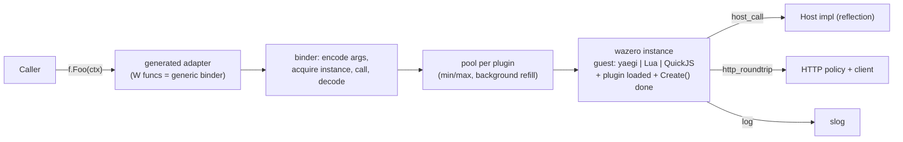

# plg — sandboxed plugin system for Go services

Module `github.com/heynemann/go-plg`, package `plg`, Go ≥ 1.27.

Plugins written in **Go, Lua and TypeScript** are loaded **as source** from pluggable storages and called through ordinary Go interfaces. Every plugin runs inside **WebAssembly** ([wazero](https://github.com/tetratelabs/wazero), pure Go, no cgo):

| Plugin language | Interpreter inside WASM |
|---|---|
| Go | [yaegi](https://github.com/traefik/yaegi) compiled to wasip1 |
| Lua | C Lua 5.4 built with wasi-sdk |
| TypeScript | QuickJS-ng built with wasi-sdk; [esbuild](https://github.com/evanw/esbuild) transpiles on the host |

Plugin authors never run a build step.

**Stability is the top priority.** A plugin must never be able to take down the host process. Out-of-memory, panics, stack overflow, runaway CPU and data races inside a plugin all become errors on that plugin's call; the faulty instance is discarded.

Engineering rules (strict linting, testing, benchmarks, concurrency, JSON) are in [RULES.md](RULES.md); every ticket must meet them.

## Public API

```go
import (
    "github.com/heynemann/go-plg"
    _ "github.com/heynemann/go-plg/guest/golang"     // only the guests you use
    _ "github.com/heynemann/go-plg/guest/lua"
    _ "github.com/heynemann/go-plg/guest/typescript"
)

c := plg.New(
    plg.WithLogger(logger),
    plg.WithMeterProvider(mp),
    plg.WithMemoryBudget(4 << 30),
    plg.WithCompilationCacheDir("/var/cache/plg"), // default: os.UserCacheDir()/plg/<wazero version>
)
defer c.Close(ctx)

err := plg.Register[contract.Fooer](ctx, c, "fooer",
    plg.WithStorage(plg.NewFSStorage("/srv/plugins/fooer")),
    plg.WithGolangPlugins(), plg.WithLuaPlugins(), plg.WithTypescriptPlugins(), // none = all
    plg.WithPool(1, 64),
    plg.WithMemoryLimit(64 << 20), // per instance
    plg.WithPollInterval(30*time.Second),
    plg.WithHost[contract.Host](hostImpl),
    plg.WithHTTP(plg.HTTPPolicy{AllowedHosts: []string{"api.example.com"}}),
)

f, err := plg.Get[contract.Fooer](ctx, c, "fooer/my-own-fooer")
bar, err := f.Foo(ctx)
for key, f := range plg.All[contract.Fooer](ctx, c) { /* key order */ }

err = c.Reload(ctx)                        // every registered interface
err = plg.ReloadInterface(ctx, c, "fooer") // one interface
```

| Function | Semantics |
|---|---|
| `New(opts...)` | Container-wide options: `WithLogger` (slog; discard by default), `WithMeterProvider` (OTel metric API; global by default), `WithMemoryBudget`, `WithCompilationCacheDir`, `WithOnPanic`, `WithPanicHistory(n)` (default 64). |
| `Register[T](ctx, c, name, opts...) error` | Loads synchronously and fails fast. Validates `T` (and `Host`), lists the storages, fetches, compiles, warms `min` instances, then publishes a new snapshot atomically. Registering the same `name` twice is an error. Fails with a message naming the import if a needed guest package isn't linked in. |
| `Get[T](ctx, c, key) (T, error)` | `key` = `<name>/<descriptor key>`. Errors: `ErrNotFound`, or `ErrTypeMismatch` if the key belongs to another interface. 0 allocations, ≤ 50 ns. |
| `All[T](ctx, c) iter.Seq2[string, T]` | Plugins implementing `T`, in key order, over a fixed snapshot. 0 allocations. |
| `c.Reload`, `ReloadInterface` | Mirrors the storage catalogue (see Lifecycle). |
| `c.Close(ctx)` | Stops pollers and refillers, drains in-flight calls, closes instances and runtimes. |

### Interface contract (checked by reflection at Register, for both `T` and `Host`)

- **Method shape:** every method is `M(ctx context.Context, args...) (results..., error)`. ctx first and error last are both required.
- **Allowed types:** data only: bool, integers, floats, string, `[]byte`, slices, string-keyed maps, structs, struct pointers, `time.Time`, error. Funcs, channels and interfaces are rejected.
- **Big integers:** values Lua/JS numbers can't represent exactly (|n| > 2^53) fail with an error rather than losing precision.
- **Name mapping in Lua/TS:** method names stay exact. Struct fields use the `json` tag name, otherwise the Go field name.

## Storage

```go
type Storage interface {
    Name() string // used only in logs and metrics
    List(ctx context.Context) ([]Descriptor, error)
    Open(ctx context.Context, d Descriptor) (fs.FS, error)
}

type Descriptor struct {
    Key         string   // unique within one Register call
    Language    Language // LanguageGo | LanguageLua | LanguageTypeScript
    Entrypoint  string   // path inside the fs.FS returned by Open
    Version     string   // change detection; empty → content hash
    MemoryLimit uint64   // per-instance bytes; 0 → the Register limit, which it may only lower
}
```

- **Scope:** storages belong to one Register call. Every plugin they list implements that interface.
- **Built-in storages:** memory (`NewMemoryStorage`), filesystem directory (`NewFSStorage(dir)`), and any `io/fs.FS` (`NewFSStorageFromFS(name, fsys)`). S3 (aws-sdk-v2) and Postgres (pgx) are provided only as `examples/`.
- **Built-in layout:** one directory per plugin containing `plugin.json` with `{"language", "entrypoint", "version"?, "memoryLimit"?}`. The key is the directory name. `memoryLimit` may only *lower* the Register limit.
- **Multi-file plugins:** the plugin's fs.FS is mounted read-only into the guest at `/plugin`.
  - yaegi compiles the package directory.
  - Lua `require` resolves only inside `/plugin`.
  - esbuild bundles TS imports from the fs.FS on the host.
- **Duplicate keys** across a Register's storages: an error at Register; on Reload, keep the previous version and log.
- **Languages not enabled:** a plugin in a language the Register didn't enable is skipped, logged and counted; not an error.

## Codegen (service developer only)

The host still needs one compiled adapter per interface, because Go can't create a type with methods at runtime. The service adds one line next to the interface:

```go
//go:generate go run github.com/heynemann/go-plg/cmd/plg gen Fooer
```

It generates:
- **The adapter for `Fooer`:** `struct{ W<Method> func(...) }` plus forwarding methods, with a compile-time check (`var _ Fooer = ...`) so a changed interface fails the build until you regenerate. Its `init()` registers the adapter with plg.
- **The contract package's source,** embedded with `go:embed` (non-test files, excluding the generated file). The generic Go guest interprets this source, so Go plugins can `import` the real contract package. The contract package may import only allowlisted packages; `plg gen` checks this.

Not generated:
- **Host dispatch:** the host calls `Host` methods by reflection.
- **Go guest stubs for `Host`:** plg synthesizes this Go source at Register and the guest interprets it.

Other commands:
- **`plg warm`:** compiles every linked guest into the compilation cache. Run it in the Docker build so containers start warm. Cold compile: yaegi guest ≈ 11–15 s, QuickJS/Lua ≈ 0.1–0.5 s; from cache ≈ 0.02–0.3 s.
- **`plg build-guest -pkg encoding/xml -o guest.wasm`:** builds a custom Go guest with extra packages, passed in via `WithGoGuest(embedded)`. The service takes on that build and its cold compile.

## Architecture



**One guest ABI for all three languages,** so the host side is the same for every language:
- **Guest exports:** `plg_alloc`, `plg_init` (load the entrypoint, run `Create`), `plg_call(method, ptr, len)`, `plg_close`.
- **Host imports:** `plg.host_call`, `plg.http_roundtrip`, `plg.log`.

**Codec:** our own length-prefixed little-endian binary format.
- Host and Go guest use encoder/decoder plans built once per type.
- The Lua and QuickJS glue (C) build tables and objects directly.

**Plugin entry points:**

| Language | Entry |
|---|---|
| Go | `func Create(host contract.Host) (contract.Fooer, error)`, or `func Create() (contract.Fooer, error)` when no Host is registered |
| Lua | `function Create() return { Foo = function(self, ...) end } end`, with `host` and `http` as globals |
| TS | `export function Create() { return { Foo(...) {} } }`; methods may be `async`; `host` and `fetch` are globals |

ctx is never visible to scripts. The host uses it to enforce deadlines and passes it to Host and HTTP calls.

**Guest capabilities:**
- **WASI:** read-only `/plugin` mount, monotonic and wall clocks, random. No filesystem beyond `/plugin`, no env, no sockets.
- **stdout/stderr** are captured per instance (bounded) and sent to slog with the plugin key.

**Go guest stdlib allowlist** (fixed in the prebuilt guest; the list lives in `internal/goallow/packages.txt`):
`bufio bytes context encoding/base64 encoding/hex encoding/json errors fmt io maps math math/* net/http (client only, via host transport) net/url regexp slices sort strconv strings sync sync/atomic time unicode/*`, plus the contract source and the synthesized `Host` stubs.

**Goroutines are banned in Go plugins.** Plugin source is parsed with `go/parser` before loading, and any `go` statement is rejected. Reasons, observed in probes:
- A WASM guest has no parallelism.
- Guest goroutines are paused between calls (a background counter advanced 0 while the host was idle).
- They freeze during host calls.

Parallelism comes from the instance pool.

**Lua/TS libraries:**
- Lua: `base` (minus file loading), `string`, `table`, `math`, `utf8`, `coroutine`, plus a bundled in-guest `json` module (`json.encode`/`json.decode`).
- QuickJS: ECMAScript built-ins only (no `std`/`os` modules), plus `console`, `host` and `fetch`.
- TS async: when a method returns a Promise, the host runs QuickJS's pending jobs until it settles or ctx ends.

## Resource limits

- **Memory:**
  - **Per instance:** `WithMemoryLimit` per Register. Defaults: Lua/TS 64 MiB, Go 128 MiB (yaegi's baseline is ≈ 29 MiB). The limit is enforced by wazero's `WithMemoryLimitPages`.
  - **One runtime per limit:** one wazero runtime per distinct (Register, language, limit), all sharing the compilation cache.
  - **Container budget:** `WithMemoryBudget(total)`. Register fails if the worst case (Σ plugins × pool max × limit) exceeds it, and pools stop growing once the budget is reached.
- **CPU:** `WithCloseOnContextDone` is always on. Every call is stopped preemptively when its ctx ends; that instance is then closed and replaced. Cost ≈ 2 µs per call plus a 1.5–4× slowdown of guest code. This is accepted.
- **Pool:** `WithPool(min, max)`.
  - **Background refill:** a goroutine per plugin keeps `min` instances warm. Callers take an idle instance; they create one only while under `max` and the budget; otherwise they wait on ctx.
  - **Failing `Create()`:** a `Create()` that fails during refill backs off exponentially and is reported.
  - **Fresh instances:** each pool member is a separate instance with its own `Create()` result, so state is per instance.
- **Instance discard:** an instance is discarded on a trap, deadline, panic, or codec/ABI failure. It's kept when the plugin returns an ordinary error.
  - Reason: wazero leaves a trapped instance callable, and it then answers with `err=nil` (observed), so trapped instances must never be reused.
- **Call depth:** Lua (`LUAI_MAXCCALLS`) and QuickJS (`JS_SetMaxStackSize`, linked with a larger wasm stack) turn deep recursion into ordinary errors. Go recursion hits the memory limit and traps.

## HTTP (built in, off by default)

`WithHTTP(plg.HTTPPolicy{...})` per Register. Default values once enabled:
- `AllowedHosts` (required)
- `BlockPrivateNetworks: true` (SSRF protection)
- `Timeout: 10s` (and never later than the call's ctx deadline)
- `MaxRequestBytes: 1 MiB`, `MaxResponseBytes: 4 MiB`
- `MaxRequestsPerCall: 16`

How each language reaches it:
- **Go plugins** use the standard `net/http` client: the guest sets `http.DefaultTransport` to a transport that calls the host. Proven: `http.Get` from yaegi inside wazero → `200 OK`; a host not on the allowlist → `403 Forbidden host not allowlisted`.
- **TS** uses `fetch()`; **Lua** uses `http.request{...}`.
- **Every request** is logged and counted in metrics (status, latency, bytes) by plugin key.

Requests block the instance for their duration (one call per instance), so size pools for I/O: Lua/TS instances are 0.2–0.5 MiB; Go instances are ≈ 29 MiB.

**gRPC:** for now, expose gRPC-backed operations as typed `Host` methods implemented with your own grpc-go clients. A generic gRPC capability will be designed when it's needed.

## Concurrency and performance

- **Snapshot:** the catalogue is an immutable snapshot behind `atomic.Pointer`. Register and Reload publish with compare-and-swap. **No mutexes anywhere**; shared mutable state uses `sync/atomic`, `xsync/v4` or channels.
- **Get/All:** `Get` is a map lookup plus a type assertion; `All` iterates a pre-sorted slice per type. Neither allocates.
- **Measured per call (spike, wazero v1.12.0, go1.27.3, CPU cap on / off):**

| Guest | Per call | Memory per instance | Instantiate |
|---|---|---|---|
| QuickJS-ng | 3.1 / 1.05 µs | 0.5 MiB | 1.7 ms |
| C Lua 5.4 | 7.5 / 3.7 µs | 0.2 MiB | < 1 ms |
| yaegi | 78 / 19 µs | ≈ 29 MiB | 38–59 ms |

- **Budgets:** Get/All 0 allocations and Get ≤ 50 ns, enforced in CI. Call costs are tracked with benchstat but don't fail the build.

## Lifecycle

- **Register:** any failure returns an error. Nothing is published.
- **Reload / polling** (`WithPollInterval` per Register; unchanged plugins are skipped by version or hash):
  - Removed from the catalogue: removed from the snapshot.
  - New but broken: skipped, logged, counted.
  - Updated but broken: the last good version stays, logged, counted.
  - Duplicate keys: the previous version stays, logged.
- **Draining:** each plugin generation keeps an atomic count of calls in flight. When it reaches 0 after replacement or removal, `plg_close` runs (calling the plugin's optional `Close`) and the instances are freed.

## Stability and panic containment

**Inside the guest:**
- **Traps:** out-of-memory, stack overflow, a Go runtime abort, or a deadline become errors on that call. The instance is discarded. Other instances and the host are unaffected (observed for every case in the spike).
- **Go plugin panics** are recovered by the guest at the call boundary and returned as `*plg.PanicError`. That instance is discarded anyway.

**On the host:** every host-side boundary runs behind `recover()`:
- Storage `List`/`Open`
- esbuild
- the codec
- Host method dispatch
- HTTP policy/transport
- pollers and refillers
- user callbacks

**Reporting:** every failure is a `*plg.PanicError` you can extract with `errors.As`:

```go
type PanicError struct {
    Key      string
    Language Language
    Phase    Phase  // Load | Create | Call | Host | HTTP | Storage | Close | Poll | Refill | Callback
    Method   string
    Value    any    // recovered value or trap message
    Stack    []byte // host Go stack (host-side failures)
    Guest    string // guest traceback: Go runtime/yaegi, Lua traceback or JS stack, from captured stderr
    Time     time.Time
}
```

It is:
- logged at Error level;
- counted in the `plg.plugin.panics{key,phase}` metric;
- passed to `WithOnPanic` (itself guarded by recover);
- kept in a bounded, lock-free history (a ring of `atomic.Pointer`) available through `c.RecentPanics()`.

**Residual risks:**
- Host memory is ordinary Go heap: after a large guest closes, RSS stays high until the Go scavenger returns memory (observed).
- Lua's error handling depends on wazero's *experimental* exception-handling feature. Pinned and covered by tests.
- Untested: whether yaegi can interpret typical contract packages, and whether the reflection codec works on interpreted types. This is the first task in M5; if it fails, the fallback is a per-contract guest built by `plg gen`, which the spike proved works.

## Observability

- **slog:** loads, reloads, skips, failures, panics and traps, pool exhaustion, budget refusals, HTTP requests, guest stdout/stderr.
- **OTel metrics** (`go.opentelemetry.io/otel/metric` API only), labelled by plugin key:
  - calls, latency, errors, panics/traps;
  - pool in-use, waits, refills;
  - instance memory;
  - loads and reload failures;
  - HTTP requests, latency, bytes.

## Package layout

- **Core:** `github.com/heynemann/go-plg` (package `plg`, flat).
- **Guests:** `github.com/heynemann/go-plg/guest/{golang,lua,typescript}`, each embedding its `.wasm` and registering itself with a blank import. The `.wasm` files are committed, built by `make guests` with pinned wasi-sdk/Go versions, and checked in CI for reproducible builds.
- **Guest sources:** `guestsrc/` (C glue for Lua/QuickJS, Go sources for the yaegi guest).
- **CLI:** `cmd/plg` (`gen`, `warm`, `build-guest`).
- **Examples:** `examples/` (S3 storage, Postgres storage, an end-to-end service).

## Milestones

Each milestone is implemented, tested with `go test -race`, smoke-run against real plugins, and committed separately.

1. **M1 Core:** Container, snapshot, `Register`/`Get`/`All`, interface and Host validation, `Storage`/`Descriptor`, memory/FS/fs.FS storages, `plugin.json`, errors, `PanicError` and the recover helpers on the host.
2. **M2 WASM host:**
   - Runtime management: memory limits, CPU cap, compilation cache.
   - The guest ABI, codec, binder, pool with background refill, memory budget.
   - Host interface dispatch and the HTTP capability on the host side.
   - Instance discard rules and trap → `PanicError` mapping.
3. **M3 TypeScript guest:** QuickJS-ng build plus glue, esbuild bundling from fs.FS, async methods (job loop), `fetch`, `console`, call depth limit.
4. **M4 Lua guest:** C Lua 5.4 build (wasm exception handling), sandboxed `require`, `http.request`, call depth limit.
5. **M5 Go guest:**
   - First, prove that yaegi can interpret contract source.
   - Generic yaegi guest with stdlib allowlist and host transport for net/http.
   - `go` statement rejection, guest-side panic recovery, synthesized Host stubs.
   - `plg gen` and `plg build-guest`.
6. **M6 Lifecycle:** Reload, polling, last-good handling, draining, `plg_close`, `c.Close`.
7. **M7 Observability:** slog/OTel wiring, panic history, `plg warm`, benchmarks with Get/All budgets enforced and call costs tracked.
8. **M8 Fast paths:** generated codec plans and direct binders, kept only where benchmarks show the gain.
9. **M9 Multiplexed async I/O:** TS and Lua instances serve other calls while a `fetch`/`http.request` is pending. Kept only if benchmarks of I/O-heavy plugins show the memory and density win.

## Known risks

- Go plugins are ≈ 80× slower per call and ≈ 60× heavier per instance than Lua/TS in this design. This was accepted for full isolation.
- wazero's exception-handling feature (needed by Lua) is experimental.
- The yaegi guest's cold compile (≈ 11–15 s) depends on the disk cache and `plg warm` for fast startups.
- The guest `.wasm` artifacts must be rebuilt and re-verified whenever wazero, wasi-sdk, Lua, QuickJS, yaegi or Go are upgraded.

## Decisions and measurements (implementation log)

### Ticket 01: Go guest artifact and compilation cache

- **Contract-source interpretation works; no fallback needed.** Inside the committed wasip1 artifact running in wazero v1.12.0, yaegi v0.16.1 interprets the contract package's source at its real import path (`github.com/heynemann/go-plg/internal/testcontract`, an `internal/` path: yaegi does not enforce Go's internal-import rule) and a plugin package importing it, and calls through a host-rendered dispatcher (`internal/engine` integration test `TestGoGuestInterpretsContractSource`). Plugins may be `package main` (the dispatcher imports them under an alias); yaegi then runs their `main()` at load, like an `init`.
- **Artifact:** `guest/golang/golang.wasm`, 14.5 MB raw (3.3 MB gzipped), so it is committed uncompressed (the gzip threshold was ~20 MB). Built by `make guests` with `-trimpath -buildvcs=false -buildmode=c-shared` and `GOTOOLCHAIN=go1.27.3`; `make verify-guests` (CI) rebuilds it and the symbol tables and fails on any diff.
- **Compile times (Go guest, wazero compiler, linux/amd64, measured by `TestCompileCacheAcrossProcesses` in two fresh non-race processes):** cold ≈ 2.9–3.7 s, warm from the disk cache ≈ 0.12–0.14 s. Under `-race` the same compile is ≈ 33 s cold / 0.7 s warm, which is why that test builds its helper without the race detector. (The 11–15 s quoted earlier was for a guest with the full stdlib.)
- **Stdlib allowlist** is extracted with `yaegi extract` for GOOS=wasip1 into `guestsrc/golang/symbols` (`make symbols`). `cmp` is available too, because yaegi compiles it from source for its generic `maps`/`slices`. `encoding/json.Options` is excluded: its method takes an internal type, so no wrapper can be generated.
- **yaegi v0.16.1 workarounds, both in the guest:** (1) methods with *unnamed* parameters (`func (f *T) M(context.Context) ...`) read their receiver from the wrong frame slot and panic, so `internal/goguest` rewrites every unnamed parameter to `_` as it reads sources (line numbers unchanged); (2) yaegi does not type-check that `Create`'s result implements the interface and its run-time assertions on interpreted interfaces are unreliable, so the dispatcher assigns `plugin.Create` to a `func() (contract.Fooer, error)` variable (a wrong signature fails at load) and reports a nil instance as a load error.
- **wazero v1.12.0 data race:** `internal/version` caches the module version unsynchronized on first use, so the first concurrent `NewCompilationCacheWithDir`/`NewRuntime` calls race. `engine.New` resolves it once per process first (`primeWazeroVersion`).
- **Guest ABI as built:** `plg_alloc(size) ptr`, `plg_init(len) packed`, `plg_call(method, len) packed`, `plg_close() packed`; results are `ptr<<32|len` of a status-prefixed buffer (statuses OK, Error, Panic, Load, ABI; zero is invalid). Messages are capped at 64 KiB. Panic and ABI statuses, traps, deadline stops and malformed buffers mark the instance broken.
- **Lint config:** `exhaustruct_v5` (golangci-lint 2.14's successor of the already-disabled `exhaustruct`) is disabled for the same reason.

### Ticket 02: tracer bullet (a Go plugin through a typed interface)

- **Contract registration:** `plg.Contract{Interface, Adapter, Source}` (the import path is `Interface.PkgPath()`), registered with `RegisterContract` (returns an error) or `MustRegisterContract` (panics; what `plg gen`'s `init()` will call). It validates the interface, requires one `W<Method>` field per method of exactly the method's type (parameter names are irrelevant to type identity, so generated fields may omit them) and a pointer that implements the interface, snapshots `Source` (at least one `.go` file at its root) and builds, once per contract, the rendered dispatcher, the Go init payload and the per-method codecs. `internal/testcontract/fooer_plg.go` is the hand-written stand-in for ticket 04's output. A contract whose types the codec cannot encode yet (slices, maps, structs) is rejected until ticket 03.
- **Interface validation** runs at Register before the contract lookup, so the precise message wins over "no contract". Data types are bool, integers, floats, string, `time.Time`, and slices, string-keyed maps, structs with only exported fields and struct pointers built from them (recursive types allowed). `error` and `context.Context` are accepted only as the last result and the first parameter; variadic methods are allowed (the variadic parameter is a slice). Arrays, complex numbers and `uintptr` are rejected along with funcs, channels and interfaces.
- **Errors:** exported sentinels (`ErrNotFound`, `ErrTypeMismatch`, `ErrClosed`, `ErrInvalidInterface`, `ErrInvalidContract`, `ErrNoContract`, `ErrInvalidName`, `ErrDuplicateName`, `ErrNoStorage`, `ErrInvalidDescriptor`, `ErrDuplicateKey`, `ErrUnsupportedLanguage`, `ErrGuestNotLinked`, `ErrLoad`, `ErrCall`) wrapped with details. A plugin's own error is a `*PluginError` whose `Error()` is exactly the plugin's message; failures outside the plugin's code (trap, deadline stop, guest panic, ABI violation) wrap `ErrCall` and discard the instance. `ErrCall` is what ticket 07 refines into `*PanicError`.
- **Get/All type identity:** `Get[T]` compares the plugin's registered interface type with `T` before asserting, so an interface with the same method set (which the adapter would satisfy) is still `ErrTypeMismatch`.
- **All's snapshot is taken when the iteration starts**, not when `All` is called: `All` must stay small enough to inline (with the race detector too), otherwise the compiler cannot see that the loop body does not escape and every `range` allocates. Coverage instrumentation defeats that inlining, so the allocation test skips under `-cover` and `make allocs` (part of `make check`) runs it uninstrumented, with `-race`.
- **Names** are non-empty, contain no `/`, and are unique per container across interfaces; they are reserved (xsync.Map) before loading, so concurrent duplicates fail fast, and released when a Register fails. Register lists every storage and checks every key, entrypoint and duplicate before resolving guests, then loads plugins one by one; nothing is published unless all load. A Register racing `Close` returns `ErrClosed` and closes what it loaded.
- **Languages:** only `LanguageGo` exists so far; any other language is `ErrUnsupportedLanguage` until its guest ticket adds it. A Go plugin whose guest is not linked fails with `ErrGuestNotLinked` naming `import _ "github.com/heynemann/go-plg/guest/golang"`. Guest linking is per program, so the not-linked and broken-guest cases are test-only packages (`internal/noguest`, `internal/brokenguest`).
- **Go entrypoint:** a package directory, or a `.go` file in it; every file below that directory is copied into the plugin's immutable source tree (`src/plg.local/plugin`, next to the contract source and the dispatcher), shared by all of the plugin's instances.
- **Runtime and module:** one wazero runtime per container with the Go limit of 128 MiB (ticket 06 makes it one per distinct limit); each guest module is compiled once per container by the first Register needing it (concurrent Registers wait; a failed compile is forgotten and retried).
- **Pool (size 1):** a buffered channel of slots; a caller takes a slot (waiting on its ctx, or failing with `ErrClosed`), spawns an instance into it if it is empty, and gives it back. A broken or discarded instance is closed and its slot left empty, so the next caller spawns a fresh one with a fresh `Create`. Each slot owns a reusable argument buffer. `Close` takes every slot back (waiting on its ctx for calls in flight) and closes the instances.
- **testcontract** gained `Spin(ctx, n)` (a deadline stops it preemptively in tests) and the corpus a `createpanics` plugin.
- **Measured (go1.27.3, linux/amd64, 32 threads, no race detector):** `Get` 10.7 ns/op, `All` over two plugins 17.7 ns/op, both 0 allocs (parallel: ~1 ns/op); one `Foo` call into a Go plugin ≈ 244 µs/op, 10 allocs, almost all of it inside the guest (yaegi interpreting the dispatcher, the plugin and the contract code), with every protection on.

### Ticket 04: `plg gen`

- **Command:** `cmd/plg` is one statement, `os.Exit(cli.Main(os.Args[1:], ".", os.Stderr))`; `internal/cli` dispatches commands (ticket 11 adds `warm` and `build-guest` there) and `internal/gen` generates. Exit codes: 0 ok, 1 failure, 2 usage. `plg gen A B ...` writes one file, `<first name in lower case>_plg.go`, for all named interfaces, starting with `// Code generated by plg gen. DO NOT EDIT.`. It never overwrites a file without that header and leaves an identical file untouched (no needless rebuilds).
- **Generated code:** per interface, `type plg<Iface> struct{ W<Method> func(<param types>) <results> ... }` (methods in go/types order, i.e. sorted like reflect's), forwarding methods with parameters named `p0, p1, ...` (interface parameter names could clash with the file's imports), `var _ Iface = (*plg<Iface>)(nil)` so a changed interface fails `go build` until regenerated; per file, `//go:embed *.go` into `plg<First>Source` and an `init()` calling `plg.MustRegisterContract` for each interface. Imports and package-level names avoid every identifier the package declares (deterministic numeric suffixes: `context2`, `plgFooer2`); an import is aliased when its name is not its path's last element (`plg "github.com/heynemann/go-plg"`, `rand2 "math/rand/v2"`).
- **Source handed to the guest:** ticket 02 filtered nothing (the hand-written `Source` embedded `contract.go` by name). `go:embed` has no exclusions, so the generated embed takes every `.go` file and `internal/contractsrc` drops `_test.go` files and plg-generated files (first line equal to the header, CRLF tolerated) when the contract is registered; other files are kept as before. `plg gen` checks the imports of exactly the files the guest receives, including files the host's build constraints exclude (they are embedded too), and type-checks the ones that build on the host. Loading uses `go/parser` + `go/types` with the standard library's `gc` importer (export data from the go command's build cache): no `golang.org/x/tools` dependency, and the allowlist check runs before type-checking, so only allowlisted stdlib packages are ever imported. The `source` importer was measured ≈ 90× slower under `-race` (1.36 s vs 15 ms per load) and made the `-count=10` run take a minute.
- **Refused, with the reason:** names that are not identifiers or are repeated; directories without a package; parse, build-constraint and type errors; names that are not interfaces, generic interfaces (and generic aliases), type constraints, and interfaces with methods `M` and `WM` (the field would clash with the method); imports outside the allowlist, each listed as `file:line:col: "path"`, followed by the allowlist. `plg gen` does not re-check plg's interface contract (ctx first, error last, data types): `MustRegisterContract` does at init.
- **One allowlist:** `internal/goallow/packages.txt` (package `goallow`) is the Go guest allowlist; the Makefile derives `GUEST_STDLIB` from it (minus `cmp`, compiled by yaegi from source, and `encoding/json`, extracted separately), `plg gen` checks against it, goguest's allowlist test imports every package of it, and a goallow test fails if the committed symbol tables do not match it. Same extracted list as before, so the artifact is unchanged.
- **testcontract** is generated (`//go:generate` in `contract.go`); `source.go` and the hand-written adapter are gone and the tracer tests run unchanged on the generated code. A gen test fails if the committed `fooer_plg.go` is not what `plg gen` produces; the engine and goguest tests read the contract through `contractsrc.Snapshot`. The `cmd/plg` integration test runs `go generate` in a scratch module that requires this checkout: twice with no diff, `go vet`, a program whose `Register` succeeds only if the generated `init` registered the contract, a changed interface failing `go build` (`missing method`) until regenerated, and a disallowed import failing `go generate`.
- **Coverage:** `cmd/plg/main.go` is excluded from the gate (`os.Exit` cannot run in a test process; the integration test runs it as a subprocess, whose coverage `go test` does not collect). `internal/gen` leaves 2 statements uncovered, the unreachable `go/format` failure of its own output.
- **CI fix:** CI's `go test -race -shuffle=on -count=10 ./...` panicked: the `internal/guestreg` tests registered fixed language names in the process-global registry, so the second run registered them twice. They now use fresh random names. `make check` runs the same `-count=10` unit run (`make repeat`) and CI's separate step is gone since `make check` covers it.

### Ticket 05: filesystem and fs.FS storages with plugin.json

- **API:** `NewFSStorage(dir)` (an `os.DirFS`, named `dir`) and `NewFSStorageFromFS(name, fsys)` (any `io/fs.FS`, e.g. an `embed.FS` narrowed with `fs.Sub`) both return `*FSStorage`. Register options `WithGolangPlugins`, `WithLuaPlugins`, `WithTypescriptPlugins`; constants `LanguageLua` (`"lua"`) and `LanguageTypeScript` (`"typescript"`); `Descriptor.MemoryLimit uint64` (bytes, 0 = the Register limit); sentinel `ErrInvalidManifest`.
- **Layout:** every top-level directory is a plugin whose key is its name; top-level files and dot-prefixed entries are ignored (so `.git` or a README next to the plugins are harmless). `List` returns the plugins sorted by key; `Open` returns `fs.Sub(fsys, key)` after rejecting keys that are not a single directory name. Symlinked files are skipped, as `memfs.AddTree` skips them at load.
- **plugin.json** is parsed with sonic configured `CaseSensitive`, `DisallowUnknownFields`, `ValidateString`, `UseUnicodeErrors`: a misspelt or wrongly cased key (`memory_limit`, `Language`) is an error instead of a silently ignored limit. `language` must be exactly `go`, `lua` or `typescript`; `entrypoint` a non-empty `fs.ValidPath`; `memoryLimit`, when present, an integer from 1 to 4 GiB (the wasm32 maximum, 65536 pages; rounding to pages is ticket 06's). Any failure, a missing plugin.json included, is `ErrInvalidManifest` naming the directory, and Register wraps it in `ErrLoad` naming the storage. Fuzzed by `FuzzFSStorageManifest` (a rejected manifest names its directory; an accepted one meets every constraint and survives re-encoding unchanged); 60 s / 7.8 M execs found nothing.
- **Content-hash versions:** a missing `version` becomes `sha256:<hex>` over each regular file's path (relative to the plugin directory, varint-length-prefixed) and the SHA-256 of its contents, in lexical order, so it changes exactly when a file is added, removed, renamed or edited, and does not depend on the key or on the backing FS (a directory and an embed.FS of it hash the same). Register applies the same hash to an empty `Version` from any storage (memory, custom), so every loaded plugin has a version for ticket 10's change detection.
- **Allowlist semantics:** no language option enables every language. With options, a plugin in another language (unknown ones like `cobol` included) is skipped and logged at Info with `key`, `storage` and `language` (counting it is ticket 14's metrics). Keys and duplicates are checked over every listed plugin before skipping, so enabling a language later can never turn a valid configuration into a duplicate-key error. An enabled Lua/TypeScript plugin fails Register with `ErrUnsupportedLanguage` until its guest ticket lands.
- **Multi-file Go plugins** needed no new loading code: ticket 02 already copies the entrypoint's whole package directory into the read-only source tree; `testdata/storages/disk/multifile` (three files, entrypoint `.`) proves it end to end through a real directory.
- **Not enforced yet:** `MemoryLimit` is parsed, validated and carried on the Descriptor only; ticket 06 applies it (it may only lower the Register limit).
- **Measured (`BenchmarkFSStorageList`, the per-storage cost Register pays before loading, testdata tree of three plugins with one hashed):** directory 53 µs/op, 11.6 KB, 100 allocs; embed.FS 6.2 µs/op, 7.6 KB, 63 allocs. Hashing reads through one 4 KiB buffer per plugin and hides `*os.File`'s `WriteTo`, which otherwise allocates 32 KiB per file (168 KB/op before).
